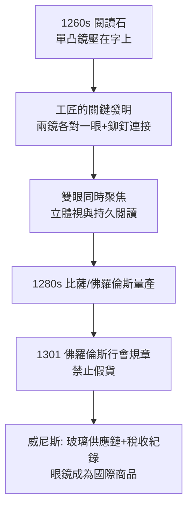

## 1285 - 眼鏡的發明（兩片凸透鏡解放了老花的閱讀者）

## 案件摘要

**本案偵破的是一場沒有留下發明者姓名的革命：老花的人，為什麼戴上兩片玻璃就能重新讀書？**

1280 年代，義大利比薩與佛羅倫斯一帶出現第一批有記載的老花眼鏡（rivet spectacles，鉚接式：兩枚凸透鏡以鉚釘相連、夾持於鼻樑）。最早的文獻證據是 1289 年前後 Pisa 修士 Giordano da Rivalto 的佈道——他說眼鏡「發明不過二十年，是世上最有用的器物之一」；1301 年佛羅倫斯眼鏡匠行會（Arti dei Medici e Speziali 轄下 cristallai）已有產銷規章；1313 年威尼斯開始徵收眼鏡稅。發明者已不可考，但理論根據清楚可考：Ibn al-Haytham（見 `1021-伊本海賽姆視覺光學.md`）的屈光幾何。本案成果：視覺缺陷第一次被「可量產的光學元件」矯正——人類史上最大的個人視力解放。

## 前因 -- 為什麼會有這個案子

- **老視是普遍的職業災害**。45 歲以上讀經、抄經、核帳者皆失去一臂距離內的聚焦能力；中世紀僧侶的解法是「找年輕眼睛代讀」——口述代抄制。
- **水晶體調節能力的年齡衰退**（其機理要到 1801 年 Young 才講清，見 `1801-楊格調節理論與三色覺.md`）：調節幅度 $A(z)$ 隨年齡近線性下降：

$$ A_{10} \approx 14D \;\rightarrow\; A_{45} \approx 3.5D \;\rightarrow\; A_{60} \approx 1D $$

- **玻璃工業的成熟**。威尼斯穆拉諾島的水晶玻璃（cristallo）透光率與均勻度在 13 世紀突飛猛進；凸透鏡原本作為「閱讀石」（reading stone，1260s）被壓在字上放大使用。
- **理論先行**。培根在 1267 年《大著作》中引述伊斯蘭光學，明言「凸鏡可使小字看來放大，對老人極有用」——理論與材料在比薩—佛羅倫斯—威尼斯的工匠網絡裡會合。

## 線索與推理 -- 幾何光學的破案

**線索一：成像方程。** 老視的問題是近點（near point）退遠。凸透鏡把近物重建成像在退遠的近點之後：

$$ \frac{1}{f} = \frac{1}{s} + \frac{1}{s'} $$

戴鏡後：實物 $s = -0.25\,\mathrm{m}$（正常閱讀距離），透鏡令其虛像落在患者屈光系的遠點/舒適距離 $s'$ 上：

$$ P_{\text{鏡}} = \frac{1}{s'} - \frac{1}{s} \quad (\text{以屈光度 D 計}) $$

例：某老視者舒適近點已退到 $0.5\,\mathrm{m}$，欲在 $0.25\,\mathrm{m}$ 閱讀，則

$$ P_{\text{鏡}} = \frac{1}{0.5} - \frac{1}{-0.25} = 2 + 4 = +6D $$

一枚 +6D 凸鏡即解決——工匠不需要知道公式，只需要實測「多凸才看得清」，但公式說明這一切**可複製、可規格化**。

**線索二：從閱讀石到鉚接鏡的工程跳躍。**

**線索三：為何「發明者是無名氏」可信。** 眼鏡同時出現在多個義大利城市、且無任何個人專利或傳說附會——這是**漸進工匠改良**的典型指紋（對比：望遠鏡 1608 有明確專利糾紛）。史學家 Alessandro della Riviera 等以行會檔案與墓誌拼出地域網絡，而非單一天才。

**線索四：需求側的推力。** 13 世紀的大學擴張、哥特式修道院抄經室、商業簿記——「讀小字的人數」在歐洲史無前例地增長；眼鏡是知識生產率革命的硬體。

## 結案 -- 後果與影響

- **工匠年限的延長**。學者與工匠的「高產年限」平均延長 15 年以上；有史家稱眼鏡之於知識界，如同蒸汽機之於工業界。
- **光學產業鏈誕生**。磨鏡、驗配、行會標準——這條供應鏈後來直接孕育了望遠鏡（1608）、顯微鏡（1620s）與檢眼鏡（1851，見 `1851-亥姆霍茲檢眼鏡.md`）。
- **驗光學的伏筆**。Donders 1862 年的屈光分類（正視/近視/遠視/散光/老視）把眼鏡從工匠經驗升級為醫學處方——本案的「病人體驗」終於有了理論語言。
- **陰影面**。眼鏡一度是財富與學問的階級標記（見於十五世紀肖像畫）；近視在印刷與閱讀普及後成為現代流行病——本案的勝利自帶下一案。
- **一句話結案**：沒有發明者的名字，因為發明它的是一整個工匠網絡；而「理論（伊斯蘭光學）＋材料（威尼斯玻璃）＋需求（歐洲閱讀爆炸）」三方會師，才是真正的兇手。

## 關鍵人物與文獻

- **Giordano da Rivalto（約 1260–1311）**——比薩多明我會修士，1289 年佈道文是眼鏡最早的可斷代記載：「不過二十年歷史」。
- **Roger Bacon（約 1214–1294）**——牛津方濟各會士，理論預告者；常被誤傳為發明人。
- **Alessandro della Spina（逝於 1313）**——比薩修士，文獻稱他「照別人的樣子」複製眼鏡——證明發明權在他之前已屬於無名群體。
- 原始文獻——Giordano 佈道稿；佛羅倫斯行會檔案（1301）；威尼斯稅冊（1313 起）；Vincent Ilardi, *Renaissance Vision from Spectacles to Telescopes*（2007）。
