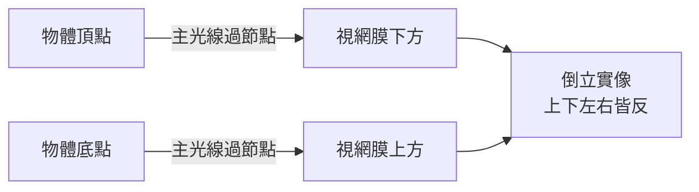

## 1604 - 克卜勒視網膜成像（眼睛是一台照相機：倒立實像的定音一錘）

## 案件摘要

**本案偵破的是視覺科學最大的謎題：外界景物，究竟成像在眼內何處？**

1604 年，天文學家克卜勒（Johannes Kepler）在布拉格出版《天文學光學之附錄》（Ad Vitellionem Paralipomena，即《威特羅光學之補遺》）。他以幾何光學證明：光線經角膜與水晶體兩度折射後，在**視網膜**上聚焦成一個**倒立的實像**——水晶體不是感知器官，只是透鏡；視網膜才是「底片」。他坦承兩個未解點（晶體的精確折射率、大腦如何「正立」倒像），並留下名言：「我把視覺的理論留給光學家，把『倒像為何被看成正立』留給哲學家。」1619 年 Christoph Scheiner 以刮去鞏膜後壁的解剖牛眼**親眼看見**這個倒像——本案的物證到位。現代視覺科學從這一年開始。

## 前因 -- 為什麼會有這個案子

- **Ibn al-Haytham 留下的半成品**（見 `1021-伊本海賽姆視覺光學.md`）：方向正確（光入眼），但具體折射結構錯誤——他以為晶體才是「感知的終點」。
- **Scheiner 的先期工作**：1603 年 Scheiner 已在《天文學序說》中指出晶體形狀改變即聚焦改變——調節概念的萌芽。
- **望遠鏡的倒逼**（1608 專利糾紛、Galileo 1609 觀天）：望遠鏡用兩枚透鏡成像，其幾何與眼球極為相似——既然望遠鏡在鏡片後某距離形成實像，眼球呢？
- **Della Porta 的混淆**：他的《自然魔法》（1589）把眼比作暗箱，卻說成像「在晶體前」——理論與解剖各說各話，需要一次總清算。

## 線索與推理 -- 幾何光學的總攻

**線索一：兩次折射的成像式。** Kepler 把眼球簡化為兩個折射面：

$$ \text{光線: 空氣} \xrightarrow{\text{角膜 } n_1} \text{房水/晶體 } n_2 \xrightarrow{\text{玻璃體}} \text{視網膜} $$

以薄透鏡近似（$n_{\text{房水}} \approx n_{\text{玻璃體}} \approx 1.336$，晶體 $\approx 1.42$）：

$$ \frac{1}{f_{\text{全眼}}} = \frac{1}{f_{\text{角膜}}} + \frac{1}{f_{\text{晶體}}} \approx \frac{1}{43D^{-1}} + \frac{1}{19D^{-1}} \Rightarrow f_{\text{全眼}} \approx 17\,\mathrm{mm} = \text{角膜頂至視網膜距離} $$

眼前 24mm 的眼軸與 17mm 焦距——**自然恰好把平行光聚焦在視網膜上**。這個數值巧合本身就是證據。

**線索二：倒像的幾何必然。** 一次會聚折射系統必成倒像，無可逃遁：



**線索三：Scheiner 的實物驗證（1619）。** 刮去後極部鞏膜與脈絡膜，以玻璃窗為物，透過半透明視網膜**直接目擊**縮小的倒立像：

```python
# Scheiner 牛眼實驗（1619）重演
ox_eye = dissect(retina_window=True)          # 視網膜半透明化
image = optics.image_of(scene="窗外騎手", scale=1/20)
assert image.orientation == "inverted"        # 倒像直接可見
assert image.location == "retina"             # 像落在視網膜上
print("Kepler 的數學, 變成了看得見的像")
```

**線索四：三重機制的殘案移交。** Kepler 明列未解問題：(1) 像為何「被看成」正立——他裁定是大腦的詮釋（後來 Descartes 以牛眼視網膜倒像＋心理正立說推廣）；(2) 晶體折射率的精確值——19 世紀 Helmholtz 與 Gullstrand（見 `1911-古爾斯特蘭德裂隙燈.md`）接手；(3) 調節機理——Young 1801 接手（見 `1801-楊格調節理論與三色覺.md`）。

## 結案 -- 後果與影響

- **白內障的物理學定義**。既然晶體只是透鏡，其混濁即「鏡片起霧」：光路被遮、像的對比度崩壞。白內障從「假膜」正式降格為可置換的光學元件故障——Daviel 摘除（`1745-達維爾白內障摘除術.md`）與 Ridley 人工水晶體（`1949-里德利人工水晶體.md`）的理論前提在此完成。
- **屈光不正的統一解釋**。近視＝眼軸過長使像落在視網膜前；遠視＝過短在後；散光＝角膜曲面不對稱。驗光學獲得了公理系統（Donders 1862 落地，見 `1285-眼鏡的發明.md`）。
- **視覺科學的分工**。「光學（眼）＋神經（腦）」兩段式架構確立；視錯覺、色覺（Young–Helmholtz）皆在其延長線上。
- **望遠鏡與照相機的合法化**。眼球＝光學儀器的認識，使「造一台比眼更好的眼」成為工程問題。
- **一句話結案**：Kepler 沒有解剖過幾隻眼球，卻以一頁幾何計算裁定瞭解剖學家吵了 1,400 年的案子——在光學的法庭上，計算就是證詞。

## 關鍵人物與文獻

- **Johannes Kepler（1571–1630）**——帝國數學家、行星定律作者；《補遺》同年兼寫新星觀測——宇宙尺度的光學與眼球尺度的光學出自同一支筆。
- **Christoph Scheiner（1575–1650）**——耶穌會天文學家；1619 年《眼、目與視覺》（Oculus）以牛眼實驗定案倒像，並首倡晶體調節說。
- **René Descartes（1596–1650）**——1637 年《屈光學》以作圖法普及化成像理論，並設計「視網膜倒像牛眼演示」於荷蘭宮廷表演。
- 原始文獻——Kepler, *Ad Vitellionem Paralipomena*（1604）；Scheiner, *Oculus*（1619）；A. C. Crombie 與 D. C. Lindberg 的史學整理。
