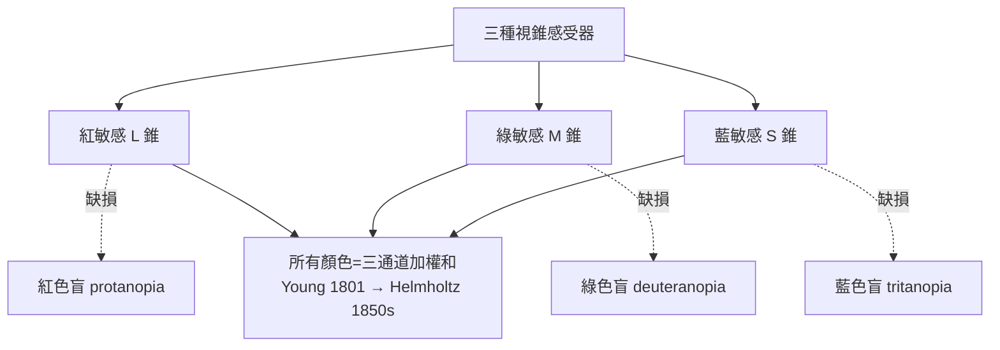

## 1801 - 楊格調節理論與三色覺（一場演講解開眼睛的兩大機密）

## 案件摘要

**本案偵破的是兩個互補的謎題：眼睛如何把焦點從遠拉到近？眼睛如何用有限的物質看出無限的色彩？**

1801 年 1 月 27 日，27 歲的倫敦醫師 Thomas Young 在皇家學會宣讀《眼的機制》（On the Mechanism of the Eye）：他證明調節不是靠角膜變形、也不是靠眼軸伸長，而是**水晶體形狀改變**——睫狀肌收縮使懸韌帶放鬆，晶體因自身彈性變凸。同一批講稿中他提出色覺的三色假說：視網膜只有**三種感受器**，分別對紅、綠、藍敏感，所有顏色皆為三者加權之和。1850 年代 Helmholtz 以實驗完善兩者（Helmholtz 調節張力實驗與 Young–Helmholtz 三色論），本案兩案併結。一個人以一場演講，定調了此後 150 年的視覺生理學。

## 前因 -- 為什麼會有這個案子

- **調節之謎的候選兇手**。1759 年 Porterfield 首度系統提出「眼球有主動聚焦能力」；候選機制包括：角膜曲率變化（Le Cat）、晶體前後移動（Home）、眼軸延長、瞳孔變化——各有一點證據，全都不對。
- **物理學家的跨界**。Young 是聲光波動說的衛士（雙縫實驗）、埃及學家（羅塞塔石碑）、工程師——他有最強的幾何光學工具箱，卻選擇了醫學院生涯，正好把物理帶進眼科。
- **色覺的既有事實**。牛頓《光學》已證明白光是混合光；1802 年前後，色盲（道爾頓症）被報告；油彩配色的三原色經驗（繪畫、織染）暗示「少量基色可拼出全彩」。
- **Scheiner 的遺產**（見 `1604-克卜勒視網膜成像.md`）：1619 年已提出晶體形狀改變＝調節，但無實驗驗證——懸案等了 180 年。

## 線索與推理 -- 實驗物理學的偵查

**線索一：排除法的三連擊。** Young 設計實驗逐項排除：

$$
\begin{aligned}
&\text{(a) 瞳孔改變？} \quad \text{針孔照樣調節} \Rightarrow \text{否}\\
&\text{(b) 角膜變形？} \quad \text{他測量角膜形狀在調節時不變} \Rightarrow \text{否}\\
&\text{(c) 眼軸延長？} \quad \text{需要肌肉做功過大且解剖無據} \Rightarrow \text{否}
\end{aligned}
$$

剩下的唯一嫌犯：**晶體形狀**。

**線索二：調節的力學模型。** Young 提出的平衡式（現代表述）：

$$ \text{睫狀肌收縮} \Rightarrow \text{懸韌帶張力 } T \downarrow \Rightarrow \text{晶體彈性回彈} \Rightarrow P_{\text{晶體}}: +19D \rightarrow +31D $$

看遠時相反。1855 年 Helmholtz 以「張力計」（把針壓在角膜上測晶體弧度變化）證實此模型；1900s Gullstrand 以裂隙燈攝影（見 `1911-古爾斯特蘭德裂隙燈.md`）拍下晶體變凸的實況——他因此獨得 1911 年諾獎。

**線索三：三色假說的邏輯。** 任何單一波長的顏色體驗可以由三個數字編碼：

$$ C(\lambda) = (\,r(\lambda),\, g(\lambda),\, b(\lambda)\,) \in \mathbb{R}^3 $$

解釋力：為什麼彩色電視只需三種磷光體、為什麼任何顏色都可在色三角內配出、為什麼色盲是「一種感受器缺損」——三案一破全解。1850s Helmholtz 與 Maxwell 以配色實驗定量三原色曲線；1960s Wald 在視錐細胞直接測得三種光色素，本案物證到位（1967 諾獎）。

**線索四：紅綠色盲的預言式解釋。**

## 結案 -- 後果與影響

- **驗光學的生理學基礎**。老視＝調節幅度衰竭（見 `1285-眼鏡的發明.md` 的 $A(z)$ 曲線），近視矯正、睫狀肌麻痺劑驗光、人工水晶體度數計算——全部站在調節模型上。
- **色覺科學開科**。Young–Helmholtz 三色論成為色度學（CIE 1931 色空間）、彩色攝影/電視/顯示器的公理；「缺陷基因檢測」能定位 L/M 錐蛋白基因於 X 染色體——兩百年前的假說成為分子醫學判決。
- **「醫師—物理學家」的原型**。Young 之後，Helmholtz（檢眼鏡，`1851-亥姆霍茲檢眼鏡.md`）、Gullstrand（裂隙燈）接力——眼科成為物理學家最常造訪的臨床學科，因為眼球是最精密的光學儀器。
- **陰影面**。Young 的演講被同代冷遇（皇家學會同仁嫌其過於數學化）；三色論一度被 Hering 的對抗色學說（紅綠/藍黃/黑白通道）壓制，直到 20 世紀才確認兩者在**不同層級**（感受器 vs 視神經節後）皆真——兩個「對手」其實是接力者。
- **一句話結案**：Young 一次破兩案，靠的是同一種偵探手法——把眼睛當儀器拆解：變焦靠晶體，色彩靠三通道。今天的每一台相機自動對焦與每一塊彩色螢幕，都是本案的判決書。

## 關鍵人物與文獻

- **Thomas Young（1773–1829）**——皇家學會院士、最後一位「通曉一切的人」；《眼的機制》講稿 1801，1807 年收入《自然哲學與機械工藝講義》。
- **Hermann von Helmholtz（1821–1894）**——生理學與物理學雙料大師；1855 年調節實驗定案、1850s 三色論定量版。
- **James Clerk Maxwell（1831–1879）**——以轉盤配色實驗為三色論提供首張定量色三角。
- 原始文獻——Young, *On the Mechanism of the Eye*（Phil. Trans. R. Soc., 1801）；Helmholtz, *Handbuch der physiologischen Optik*（1856–1867）。
- **現代註腳**——人工水晶體度數計算公式（SRK、Haigis）內建「術後預期調節損失」項；老花雷射與多焦點 IOL 的全部工程，都在修補 Young 指出的那一枚失去彈性的透鏡。
