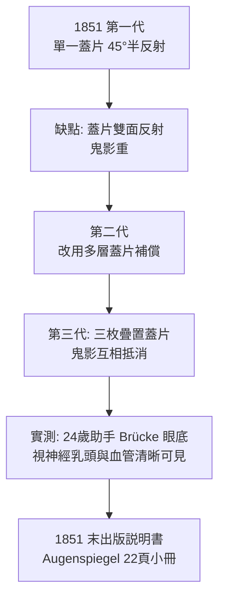

## 1851 - 亥姆霍茲檢眼鏡（第一支照進活人眼底的燈）

## 案件摘要

**本案偵破的是一個看似不可能的物理難題：如何看進別人的眼睛內部——明明它自己也在朝你看？**

1851 年 12 月，柯尼斯堡的生理學教授 Hermann von Helmholtz 發明檢眼鏡（Augenspiegel）：一枚玻璃蓋片成 45° 半反射，光源自側方射入、經蓋片折射沿視軸照進病人眼底；醫師的視線則**穿過同一枚蓋片中央**直視被照亮的視網膜。設計的巧思是補償玻璃片造成的雙重影像（半反射面反光與折射位移）——他連續設計並親測三代原型，第三代以三枚相疊的蓋片消除鬼影。幾天內，他與同事就能在活人眼底看清視神經乳頭、視網膜血管。醫學史家普遍認定：這是醫學史上單一儀器在單一時刻開啟全新臨床領域的極端案例——「眼睛從此不再是黑箱」。

## 前因 -- 為什麼會有這個案子

- **檢查手段的黑洞**。1850 年的眼科可以矯屈光、摘白內障、治外眼病，但**視網膜、視神經與玻璃體是永遠的黑箱**；眼底病的診斷全靠病人主訴＋死後解剖。
- **前人的三次擦身而過**。1823 年 Brücke、1846 年 Cumming、1847 年 Babbage 各自接觸過「以鏡照亮眼底」的構想：Babbage 請一位反射鏡匠試做，因「影像不佳」放棄——案卷證明他們離答案只差一層光學設計。
- **Helmholtz 的教學壓力**。他要在課堂上演示「人眼光學」；1850 年代他剛發表色彩與調節理論（見 `1801-楊格調節理論與三色覺.md`），需要能**直接檢視活體眼底**以驗證屈光與調節模型。
- **光源與光學件已就位**。油燈—聚光鏡組、薄玻璃蓋片、凹面鏡皆為現成商品；缺的只是「光進＋視出」共路的光路設計。

## 線索與推理 -- 光路的偵探學

**線索一：問題的物理表述。** 醫師的視線與照明都必須經過同一枚小瞳孔：

$$ \text{條件: 光路}_{\text{入}} \;\|\; \text{光路}_{\text{出}} \quad\text{且}\quad \text{兩者皆過 } \phi \le 4\,\mathrm{mm} \text{ 瞳孔} $$

正入射會產生角膜反光（紅光反射的倒影）遮蔽眼底——必須**旁光入射、軸上觀察**。

**線索二：三代原型的迭代。**



**線索三：競爭方案的並行破案。** 同一時期 Ruete（1852）改用側照凹面鏡＋半鍍銀反射，形成更亮的「間接檢眼鏡」路線；Giraud-Teulon（1861）加上雙目鏡成立體視。光學目標一致，工程取捨不同：

$$ \text{直接檢眼鏡: 高倍率 } (\sim 15\times), \text{ 單眼, 視野小} \quad\text{vs}\quad \text{間接檢眼鏡: 立體, 視野大, 需鞏膜加壓配合} $$

兩條路線至今並存：門診查視神經用直接式，視網膜手術用間接式。

**線索四：眼底即刻的偵破成果。** 檢眼鏡一問世，數十年懸案接連告破：

```python
# 1851-1860 檢眼鏡下的新證據清單
findings = {
  "視神經乳頭": "正常色澤與凹陷——青光眼視盤改變的基線確立",   # → Graefe 1856-1869
  "視乳頭水腫": "顱內壓升高的眼底指紋（Wilbrand/Saenger 後續）",
  "視網膜血管": "動脈硬化與高血壓的可視化窗口",
  "糖網病微血管瘤": "1860s-1870s 逐步描述 → 1946 光凝的靶點",  # → 1946-視網膜光凝固術
  "視網膜剝離": "可以活體診斷（Coccius 1853 首述）→ 1970 玻切手術化",  # → 1970-馬赫默玻璃體切除術
}
```

## 結案 -- 後果與影響

- **「眼底是全身病的窗口」**。糖病、高血壓、顱內病灶、血液病——內科醫師從此都要借眼科的燈；檢眼鏡成為醫學通用檢查。
- **現代眼科學院成立**。Von Graefe、Donders、Arlt 在柏林/海德堡建立以檢眼鏡為核心的臨床眼科（見 `1856-格雷夫青光眼手術.md`）；Graefe 用它診斷青光眼視盤凹陷，開啟眼壓—視野—視盤的三聯診斷傳統。
- **儀器時代開幕**。裂隙燈（1911，見 `1911-古爾斯特蘭德裂隙燈.md`）、視野計（1889，見 `1889-比耶魯姆視野計與青光眼.md`）、眼底相機（1926 Nordenson）皆是本案的直接後裔；OCT（`1991-OCT光學同調斷層掃描.md`）則把「看眼底」升級為「量眼底」。
- **科學發明的風格**。Helmholtz 拒絕申請專利：「發現屬於全人類」——檢眼鏡在一兩年內被全球複製改良，證明開源本身就是推廣策略。
- **一句話結案**：Babbage 的失敗與 Helmholtz 的成功之間，只隔著「雙重反射會產生鬼影、鬼影可以疊加抵消」這一層光路設計——偵探與路人，常常差的就是最後一次計算。

## 關鍵人物與文獻

- **Hermann von Helmholtz（1821–1894）**——生理—物理雙棲大師；檢眼鏡、能量守恆、神經傳導測速、聽覺共鳴理論皆其戰功；1860s 起任海德堡、柏林教授。
- **Christian Georg Theodor Ruete（1810–1867）**——萊比錫眼科醫師，1852 年間接檢眼鏡路線的建立者。
- **Charles Babbage（1791–1871）**——分析機之父；1847 年放棄的檢眼鏡嘗試，成為本案最著名的「輸了半步」檔案。
- 原始文獻——Helmholtz, *Beschreibung eines Augenspiegels zur Untersuchung der Netzhaut im lebenden Auge*（Berlin, 1851）。
- **現代註腳**——1991 年的 OCT 論文開篇即致敬檢眼鏡：1851 年人類第一次「看見」視網膜，1991 年第一次「切層」視網膜——同一隻眼，相隔 140 年的兩次開幕。
