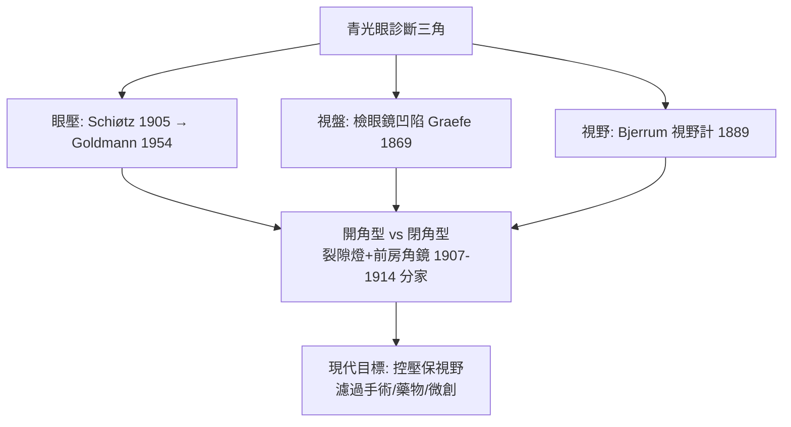

## 1856 - 格雷夫青光眼手術（「眼內壓力」概念的臨床誕生）

## 案件摘要

**本案偵破的是：一種「不痛不癢卻偷走視力」的病，究竟做錯了什麼？**

1856–1857 年，25 歲的柏林眼科教授 Albrecht von Graefe 報告：以**虹膜切除術**（iridectomy）治療急性青光眼（當時稱 amaurosis with cupping／「絕對期青光眼」），多數劇痛、眼硬如石的病人，術後眼壓下降、疼痛消失、視力部分保留。這是青光眼第一次被「治好」（哪怕只是部分）。隨後他在 1869 年以檢眼鏡（見 `1851-亥姆霍茲檢眼鏡.md`）描述視神經凹陷的進展規律，把「青光眼＝視神經被壞」的病理鏈首次完整寫出。本案的成果：青光眼從一團症狀（紅痛、瞳孔散大、硬眼、失明）變成**有機制（房水循環障礙）、有指標（眼壓）、有手術（造瘻/解除瞳孔阻滯）**的疾病。

## 前因 -- 為什麼會有這個案子

- **古代的病名已備、機理全無**。Hippocrates 與 Celsus 描述過「眼球堅硬如石」；Arabic 眼科（見 `1000-阿里伊本伊薩眼科專書.md`）與 17 世紀 Banister 區分了白內障與「眼球硬化」——但兩者機理混淆至 19 世紀。
- **檢眼鏡點燃的診斷革命**。1851 年後，Graefe 在柏林門診大量直視眼底，發現青光眼病人視盤凹陷（glaucomatous cupping）與視野缺損相關。
- **房水循環的解剖學基礎**。1835 年 Bowman 描述角膜內皮與前房角結構；1855 年 Lee 與 von Recklinghausen 揭示 Schlemm 管（1682 年 Schlemm 首述）——「房水生成—循環—流出」的水管圖譜已近完整。
- **柏林眼科學院的體制**。Graefe 師承 Pagenstecher，1855 年創刊《眼科檔案》（Archiv für Ophthalmologie）——世界最老的專科期刊，本案的證據發佈平台。

## 線索與推理 -- 流體力學進入眼球

**線索一：急性青光眼發作的機理模型。** 現代表述（Graefe 時代已有其直覺）：

$$
\begin{aligned}
&\text{瞳孔散大/前房角關閉} \Rightarrow \text{後房水被晶體-虹膜阻擋} \\
&\Rightarrow \text{後房壓 } P_{\text{post}} \gg P_{\text{ant}} \;\text{（瞳孔阻滯）}\\
&\Rightarrow \text{虹膜根部被推向角膜} \Rightarrow \text{房角完全關閉} \Rightarrow IOP \uparrow\uparrow\uparrow
\end{aligned}
$$

虹膜切除術的機理：在虹膜上開一個**旁路孔**，使 $P_{\text{post}} = P_{\text{ant}}$，解除晶體前推——Graefe 當時並不確知細節，但他的手術**結果與這個模型完全吻合**（詮釋由後來的 Curran 1920 補齊）。

**線索二：以手術結果反推病理，與撥障同構。**

```python
# Graefe 的臨床推理（1856）重演
def iridectomy_effect(glaucoma_case):
    # 術後: 眼球硬度下降, 疼痛消失, 視力改善
    assert glaucoma_case.IOP_after < glaucoma_case.IOP_before
    # 術式作用點: 虹膜 → 前後房壓力差 → 房角開放
    return "兇手不是視神經本身, 而是眼內壓力"
```

與 `-0600-妙聞金針撥障.md` 的「術中證據法」如出一轍：手術是當時最銳利的生理學實驗。

**線索三：眼的流體力學框架成形。** 1860s–1900s 逐步建立房水動力學：

$$ \text{F} = \frac{P_{\text{眼}} - P_{\text{靜脈}}}{R_{\text{流出}}} \quad(\text{Goldmann, 1950s 定式}) $$

其中 $F$ 為房水生成率（約 2–3 μL/min）、$R$ 為小梁網流出阻力——青光眼＝$R$ 增大（開角型）或房角機械性關閉（閉角型）。這條方程的臨床落地要等 1905 年眼壓計（見 `1905-秀茲眼壓計.md`）與 1954 年 Goldmann 壓平式眼壓計。

**線索四：診斷三角的形成。**



## 結案 -- 後果與影響

- **青光眼成為可管理的慢性病**。虹膜切除術之後，濾過手術（De Wecker 1868 鞏膜切除、1938 Elliot 鞏膜環鑽、1968 Cairns 小樑切除術）接力至今；閉角型青光眼在虹膜切除/雷射周邊虹膜切除術下成為「可預防致盲」的病。
- **「眼壓—視野—視盤」三聯診斷成為全球標準**。今天的青光眼門診流程（眼壓計＋檢眼鏡/OCT 視盤分析＋視野計）正是 Graefe 三角，加上 OCT 的第四件量具（見 `1991-OCT光學同調斷層掃描.md`）。
- **眼科期刊與學院體制**。《眼科檔案》使病例與失敗可公開審查——本案與 Daviel 的 52% 報告（見 `1745-達維爾白內障摘除術.md`）共同確立「外科結果必須分母化」的傳統。
- **陰影面**。Graefe 的虹膜切除術對**開角型**青光眼無效，造成數十年的過度使用；「低眼壓性/正常眼壓青光眼」的存在也證明眼壓不是唯一兇手——視神經供血與易感性的從犯至今仍在審。
- **一句話結案**：Graefe 砍掉一小片虹膜，卻打開了眼科最大的水閘——青光眼的真兇是眼內的水壓，而管理水壓，從此成為眼科醫師的終身任務。

## 關鍵人物與文獻

- **Albrecht von Graefe（1828–1870）**——「現代眼科學之父」；1866 年任柏林大學眼科教授，37 歲死於肺結核；其《眼科檔案》沿用至今（改名 Graefe's Archive）。
- **William Bowman（1816–1892）**——組織學家，前房角顯微解剖的奠基者；Bowman 膜以其名。
- **Heinrich Curran（1884–1952）**——1920 年以「虹膜膨隆與瞳孔阻滯」完整解釋 Graefe 手術為何有效，補上遲到 64 年的理論判決。
- 原始文獻——Graefe, *Archiv für Ophthalmologie*, Bd. 2–3（1856–1857）；Bowman, *Lectures on the parts concerned in the operations on the eye*（1849）。
