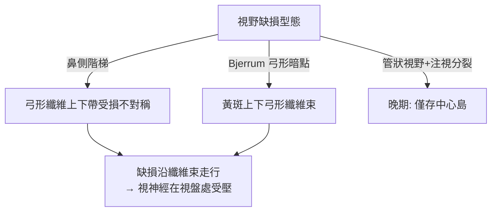

## 1889 - 比耶魯姆視野計與青光眼（視野：視神經的測謊儀）

## 案件摘要

**本案偵破的是：青光眼在病人「感覺不到」的時候，如何被偵測、被追蹤、被定量？**

1889 年，丹麥哥本哈根眼科醫師 Jannik Bjerrum（1851–1920）在實習醫院以自製的**弧形視野計**（perimeter）進行大規模視野檢查，首次系統描述青光眼的典型視野缺損：**鼻側階梯（nasal step）**與 **Bjerrum 暗點（seidel arcuate scotoma，繞過注視點的弓形暗區）**，並證明缺損按神經纖維束的解剖走向進展。視野檢查從此成為青光眼的功能性標準檢查——眼壓會波動、視盤判讀有主觀性，但**視野是視神經功能的筆錄**。本案成果：青光眼診斷從「眼硬、眼紅、眼盲」升級為可重複測量的心理物理學。

## 前因 -- 為什麼會有這個案子

- **Graefe 留下的半案**（見 `1856-格雷夫青光眼手術.md`）：視盤凹陷已被看見，但「視功能損失」的型態與進展缺乏定量工具。
- **前人的粗糙視野測量**。1856 年 Forster 首製弧形視野計；1889 年前後 Groenouw 亦做過系統檢查——Bjerrum 的貢獻是**大量、重複、圖譜化**：他與門診累積數百例的缺損型態。
- **開角型青光眼的大問題**。它無痛、眼壓僅輕中度升高、視力到晚期才崩——病人往往在「管狀視野」才就診。需要一個能在早期抓到「周邊視覺漸失」的探測器。
- **視網膜神經纖維解剖**。1880s 視網膜神經纖維層的走向被闡明：弓形纖維繞黃斑匯入視盤上下極——這是解讀視野缺損的「地圖密碼」。

## 線索與推理 -- 心理物理學的偵查

**線索一：測量什麼。** 視野計測的是「看得見的最弱光」隨視網膜位置的函數：

$$ S(\theta) = \text{光敏感度}(\text{偏心角 } \theta) \quad\text{正常值: 中心最高, 周邊遞減} $$

青光眼的指紋：特定弓形區域 $S(\theta)$ 局部塌陷，而其餘區域正常——**缺損的形狀即病灶的位置**。

**線索二：神經纖維束密碼。** 把視野缺損翻譯回解剖：



Bjerrum 證明：缺損可以**跨經線、貼合纖維束**——這排除了「視網膜局部病變」的解釋，把指紋指向視盤與視神經。

**線索三：與眼壓的相關性辯論。** Bjerrum 證明青光眼可以在「眼壓不高於正常」時仍有典型缺損（他與其學派對此猶豫，其弟子 Ronne 最終確立）——這是「正常眼壓性青光眼」概念的先聲：**視野才是病人真正的損害賬本**。

**線索四：儀器的迭代。**

```python
# 視野計的演化（1889 → 1970s → 1990s）
perimeters = {
  "1889 Bjerrum 弧形視野計": "手工移動白色視標, 半定量, 圖譜手繪",
  "1945 Goldmann 球形視野計": "標準化視標/背景亮度, 全球統一判讀",   # → Goldmann 1954 眼壓計同門
  "1970s-80s 靜態自動視野計": "逐點測閾值, 統計指數 MD/PSD, 可追蹤進展",
  "1990s+ OCT 聯合": "結構(神經纖維層厚度) + 功能(視野) 對帳",      # → 1991-OCT
}
```

## 結案 -- 後果與影響

- **青光眼的「功能標準」確立**。至今診斷與治療目標仍是「保住視野」——眼壓只是中間指標；任何新藥新手術的終點判定（endpoint）都寫著視野。
- **心理物理學方法論輸出**。「以病人主觀反應做可重複定量」的範式，後來成為暗點計、對比敏感度、微視野計的方法學母體。
- **青光眼篩檢的公共衛生學**。視野計＋眼壓計＋檢眼鏡構成 20 世紀青光眼篩檢三件組；2020 年代 OCT 神經纖維層分析（見 `1991-OCT光學同調斷層掃描.md`）把本案的「缺損圖譜」升級為「厚度曲線」。
- **陰影面**。視野檢查依賴病人配合，變異性大；「早期診斷遲到」仍是全球青光眼半數未確診的主因——本案的測謊儀，仍等著更靈敏的傳感器。
- **一句話結案**：眼壓是嫌疑犯，視野是被害者的傷情鑑定——Bjerrum 證明：要給青光眼定罪，不能只量壓力，要追蹤神經纖維束一寸寸被抹去的筆跡。

## 關鍵人物與文獻

- **Jannik Bjerrum（1851–1920）**——哥本哈根眼科教授；1889 年起發表青光眼視野系列論文，其子 Ejler Bjerrum 續成其業。
- **Hans Goldmann（1899–1991）**——伯爾尼眼科教授；1945 球形視野計、1954 壓平眼壓計（見 `1905-秀茲眼壓計.md`）——一個人統一了青光眼的兩把尺。
- 原始文獻——Bjerrum, "Om en tilføjelse til den saedvanlige synsfeltundersøgelse"（1889）及哥本哈根系列；Armaly、Anderson 與 Drance 的現代視野判讀整理。
- **現代註腳**——今日標準自動視野計（Humphrey 24-2/30-2）的測試點陣，仍以 Bjerrum 暗點與鼻側階梯的地圖為設計藍圖——136 年前的指紋卡，仍在出庭作證。
