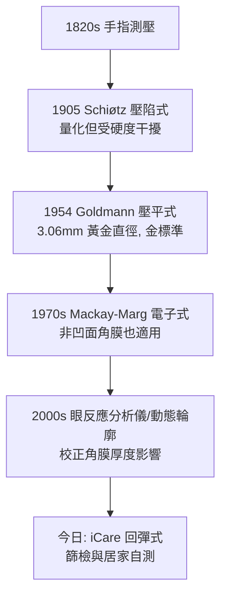

## 1905 - 秀茲眼壓計（把「摸眼球的手感」變成一個數字）

## 案件摘要

**本案偵破的是：青光眼管理的核心變量——眼內壓，究竟如何被測量？**

1905 年，挪威奧斯陸眼科醫師 Hjalmar Schiøtz（1850–1927）發表**壓陷式眼壓計**（indentation tonometer）：一支已知重量的柱塞經中空腳板壓在麻醉後的角膜上，柱塞壓陷角膜與鞏膜的**深度**由標尺讀出，經對照表換算為眼壓（mmHg）。這是眼壓第一次成為可重複、可記錄、可比較的數字。此後近半世紀它是全球標準；1954 年 Hans Goldmann 依 **Imbert–Fick 定律**設計壓平式眼壓計（applanation tonometer），修正了壓陷式的眼球壁硬度誤差，成為至今的金標準。本案成果：Graefe 的流體力學假設（見 `1856-格雷夫青光眼手術.md`）獲得了臨床測量儀——青光眼從此有血壓計。

## 前因 -- 為什麼會有這個案子

- **「手指測壓」的世紀**。1820s 起醫師以指尖按壓閉瞼的眼球估計硬度（T+、T+2 記法）；急性青光眼可摸出「石樣硬」，但開角型與療效追蹤完全超出手指解析度。
- **Graefe 三角缺一角**。視盤有了檢眼鏡（1851）、視野有了 Bjerrum（1889，見 `1889-比耶魯姆視野計與青光眼.md`），唯獨「壓力」沒有量具——青光眼的病因學核心懸空。
- **前代機械的失敗**。1860s Von Graefe、Donders、Maclean 等嘗試各種壓平/壓陷設計，皆因沒有固定重量系統與角膜彈性補償而不可重複。
- **麻醉的到位**。1884 年可卡因局部麻醉（Koller，維也納）使角膜接觸式測量可行——本案的必要前件。

## 線索與推理 -- 流體力學與彈性校正

**線索一：Imbert–Fick 定律——本案的理論基石。** 對一個薄壁、完全柔性、球形的壓力容器，外部以力 $W$ 壓平面積 $A$ 時：

$$ P = \frac{W}{A} $$

眼球近似此容器，但角膜太厚太硬、鞏膜剛性大——**Fick 定律需要校正**。這正是本案與後續 Goldmann 案的技術核心。

**線索二：Schiøtz 的壓陷式策略。** 不壓平、改**壓陷**：柱塞在腳板上施加重力 $W$，壓陷深度 $d$ 與眼壓反相關：

$$ P = f(W, d) \quad\text{(經 Friedenwald 校準曲線, 1948/1954 定式)} $$

他設計三檔重量（5.5g、7.5g、10g）以應對不同眼球壁硬度；1948–1954 年 Friedenwald 以屍眼與實驗重建換算表，修正了早期標定系統性偏低。

```python
# Schiøtz 眼壓計讀數換算（Friedenwald 校準, 簡化示意）
def schiotz_iop(scale_reading, plunger_weight=5.5):
    # scale_reading: 柱塞壓陷深度(格) 越大 → 眼壓越低
    E = 0.0215          # Friedenwald 眼球壁硬度係數 (估計)
    d = scale_to_indentation(scale_reading, plunger_weight)
    P = friednwald_table(W=plunger_weight, indent=d, rigidity=E)
    return P  # mmHg
```

**線索三：殘留誤差 → Goldmann 的壓平革命。** 壓陷式的固有誤差：眼球壁硬度 $E$ 個體差異大，且壓陷使**眼內容積改變**，本身會推高眼壓。Goldmann 的解法（1954）：只壓平 **3.06mm 直徑**的角膜圓面積——這個直徑經過精心計算，使角膜彈性阻力與鞏膜表面張力**恰好互相抵消**：

$$ W_{\text{3.06mm}} \;\Rightarrow\; \underbrace{F_{\text{角膜彎曲阻力}} \approx F_{\text{表面張力}}}_{\text{兩誤差抵消}} \;\Rightarrow\; P = \frac{W}{A} \text{ 幾乎無需校正} $$

雙稜鏡（applanation prism）把重合圓環調到對齊即為壓平面積——讀數直接乘 10 得 mmHg。

**線索四：測壓技術的後續家譜。**



## 結案 -- 後果與影響

- **青光眼進入「以數字管理」時代**。降眼壓藥的療效判定、手術適應症、隨訪標準——全部以 mmHg 記帳；「眼壓 21mmHg」的統計學界線（正常人群均值＋2SD）成為百年常識（儘管後來證明此界線對個體不可靠）。
- **中央角膜厚度的連環案**。1990s–2000s 發現角膜厚度影響所有眼壓計讀數（薄角膜高估風險）——本案的誤差項成為青光眼風險評估的獨立變量，OCT/超聲測厚進入常規。
- **Goldmann 跨世紀的金標準地位**。1954 至今所有抗青光眼藥物臨床試驗（包括 OHTS、EMGT）皆以其測壓——儀器壽命超過 70 年。
- **陰影面**。「高眼壓＝青光眼」的過度簡化造成大量假陽性；正常眼壓性青光眼（見 `1889-比耶魯姆視野計與青光眼.md`）證明壓力不是唯一兇手——本案量到的是「主要嫌疑犯」，不是全部案情。
- **一句話結案**：Schiøtz 把手指換成柱塞，Goldmann 把柱塞換成一枚算準直徑的稜鏡——眼科醫師終於能對眼球內的水壓說出精確數字，青光眼的審判庭從此有了物證科。

## 關鍵人物與文獻

- **Hjalmar Schiøtz（1850–1927）**——奧斯陸眼科教授；1905 年發表眼壓計與讀數表，該器械生產沿用至 1980s。
- **Hans Goldmann（1899–1991）**——伯爾尼眼科教授、視野計與壓平眼壓計雙料發明人；其「標準化」思想塑造了 20 世紀眼科計量學。
- **Paul Friedenwald（1881–1961）**——巴爾的摩眼科學者，1948/1954 年以屍眼實驗重建 Schiøtz 校準與眼球壁硬度理論。
- 原始文獻——Schiøtz, "Tonometrie"（Arch. Augenheilkd., 1905）；Goldmann & Schmidt, "Über Applanationstonometrie"（Ophthalmologica, 1957）。
