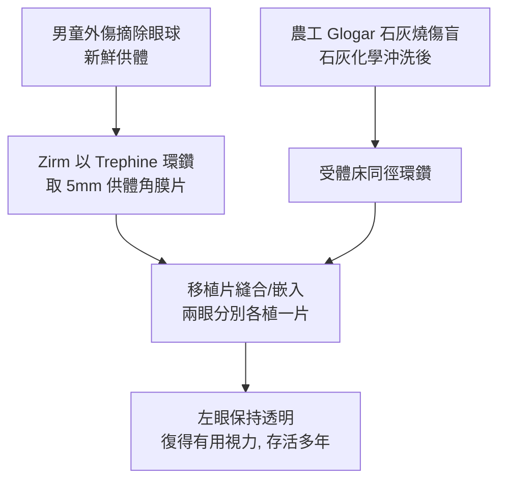

## 1905 - 齊姆角膜移植（第一例成功的人類角膜復明手術）

## 案件摘要

**本案偵破的是：一塊透明的「窗戶玻璃」能否從一個人身上移植到另一個人身上並長期存活？**

1905 年 12 月 7 日，奧地利眼科醫師 Eduard Zirm（1863–1944）在摩拉維亞的 Olmütz（今捷克 Olomouc）Sankt Georgen 醫院，為一名在石灰燒傷中雙目失明的 45 歲農工 Alois Glogar，移植了剛被摘除眼球的 11 歲男童之角膜。術後一隻眼角膜保持透明，病人復得有用視力，存活多年。這是**人類史上第一例成功的人類同種角膜移植**——也是人類第一例成功的人體組織/器官移植之一（早於腎移植近半世紀）。本案的成功不靠手術刀的奇蹟，而靠一套「選對病人、選對材料、當日移植、無菌操作」的工程思維。

## 前因 -- 為什麼會有這個案子

- **角膜是免疫特權之地的線索未明**。1837 年 Bigger 在瞪羚眼上完成首例動物角膜移植成功；1880s 後歐洲多國嘗試人體移植，全軍覆沒——失敗在感染、玻璃體溢出、移植片渾濁。
- **前代偵探的屍檢報告**。von Hippel（1888–1891）以兔角膜為人移植首次「部分透明」，並首創**環鑽（trephine）**取片——器械已備，策略未明。
- **Zirm 的職業優勢**。他在維也納受訓於當時最強的眼科學派，又在 Olmütz 小醫院掌管手術室與消毒流程，可自主設定操作標準。
- **意外的材料條件**。同日醫院裡一名男童因外傷接受眼球摘除——新鮮、健康、年輕的供體角膜就在手上；石灰燒傷病人的單眼有完好的後段與淚液環境。

## 線索與推理 -- 成功條件的工程學重演

**線索一：移植片存活的必要條件清單。** Zirm 的操作可以逆推為五條規則：

$$
\begin{aligned}
&\text{(1) 供體組織越新鮮越好（當日摘除當日移植）}\\
&\text{(2) 供體年輕（內皮細胞密度高、代償力強）}\\
&\text{(3) 病人後段健康、眼表條件尚可（單眼移植、非終末眼）}\\
&\text{(4) 嚴格無菌（石炭酸沖洗、全程消毒）}\\
&\text{(5) 全麻下以環鑽取片、精確縫合對位}
\end{aligned}
$$

**線索二：為何是角膜——免疫特權的無聲饋贈。** 角膜**無血管**（avascular）：

```python
# 角膜移植比其他器官移植容易 50 年的免疫學解釋
if cornea.avascular:               # 沒有血管 = 供體抗原難以入血
    immune_surveillance = weak     # 淋巴管也幾乎缺如
    result = "同種移植片可長期存活"  # '免疫特權' 概念 1948 年後才命名
```

移植片的長期透明還依賴**角膜內皮泵**（20 世紀中葉才闡明）：內皮細胞以主動運輸把基質的水分泵出，維持 $ \text{厚度} \approx 0.52\,\mathrm{mm} $ 的精確脫水狀態——透明即脫水。

**線索三：手術流程的復原。**



**線索四：為何兩眼中只有一隻成功。** 石灰燒傷的右眼眼表（結膜瘢痕、淚膜破壞）使移植片缺氧缺營養而渾濁；左眼條件相對好——本案早在 1905 年就演示了現代角膜移植的第一原則：**移植的成功一半在手術，一半在受體眼表**（1990s 才有 eye banking 與 limbal 幹細胞理論正式化）。

## 結案 -- 後果與影響

- **角膜盲從此可治**。角膜病變是當時全球主要致盲原因之一；20 世紀 eye bank 制度（1945 Townley Paton 創立紐約眼庫）、保存液（1960s McCarey-Kaufman 培養液）、穿透/板層/DSEK/DMEK 術式接力，使角膜移植成為最常見的移植手術。
- **人體移植醫學的先驅**。比腎移植（1954）早 49 年；「免疫特權、無血管移植床、不縫或精細縫合」的角膜經驗，為整個移植外科提供原型。
- **環鑽與縫線的器械譜系**。von Hippel 的環鑽經 Castroviejo（1930s，雙極精細鑽＋8-0 絲線）、Török 改良至今；角膜手術成為微創精細外科的訓練場。
- **陰影面**。移植排斥（尤其是血管化的角膜）在 20 世紀中葉後由局部皮質類固醇（1950s 起滴眼劑）控制；供體長期短缺至今未解——本案的成功同時開出了排隊名單。
- **一句話結案**：Zirm 赢在「條件清單」而不是刀法——當日的新鮮角膜、年輕的內皮、尚好的眼表、嚴格的無菌：四個條件同時到位，復明才成為現實。

## 關鍵人物與文獻

- **Eduard Konrad Zirm（1863–1944）**——維也納受訓、任 Olmütz Sankt Georgen 醫院院長；1906 年發表病例報告。
- **Arthur von Hippel（1841–1916）**——哥廷根眼科教授；1888 年動物角膜移植與環鑽的先驅，本案的器械與動物實驗前案。
- **Alois Glogar（1860–1932）**——石灰燒傷致盲的農工，人類組織移植史的第一位受益人；術後復得左眼視力，生活自理多年。
- 原始文獻——Zirm, "Eine erfolgreiche totale Keratoplastik"（Graefe's Arch. Ophthalmol., 1906）。
- **現代註腳**——今日 DMEK（後彈力層內皮移植）僅移植 10–15μm 的內皮-後彈力層捲片，術後視力可達 1.0——從 Zirm 的 5mm 全層圓片到一枚薄如光波長的內皮捲，是 120 年的器械史。
