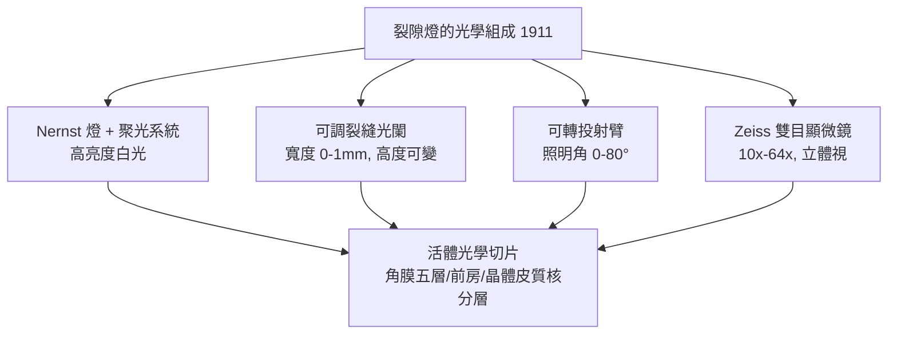

## 1911 - 古爾斯特蘭德裂隙燈（「光刀」切開活體眼前的每層結構）

## 案件摘要

**本案偵破的是：如何在不接觸、不麻醉、不傷害的前提下，看到活體眼前段的**分層三維結構**？**

1911 年，瑞典烏普薩拉的眼科教授 Allvar Gullstrand（1862–1930）發明**裂隙燈顯微鏡**（slit lamp biomicroscope）：把一條極窄的亮縫光斜向投入眼球，角膜、前房、晶體各層被「光刀」逐一切亮，醫師經雙目顯微鏡放大 10–64 倍觀察——眼前段第一次獲得**光學切片（optical section）**。同年，他**獨得**諾貝爾生理學或醫學獎（表彰其屈光研究），成為眼科學史上第一位、也是極少數「單人獲獎」者。裂隙燈與檢眼鏡（見 `1851-亥姆霍茲檢眼鏡.md`）構成眼科檢查的兩大支柱至今。本案成果：眼的檢查從「看見內部」升級為「分層測量內部」。

## 前因 -- 為什麼會有這個案子

- **檢眼鏡的盲區**。1851 年的檢眼鏡照亮眼底，但**角膜、前房、晶體的層次細節**在彌散照明下糊成一片——虹膜炎的 KP（角膜後沉著物）、前房閃輝、晶體分層混濁皆不可辨。
- **Gullstrand 的雙重身份**。他既是眼科醫師又是幾何光學家：此前已完成眼的模型眼計算（1980s 起為此建立 Gullstrand 模型眼，I 號精確眼與 II 號簡化眼），深知「角膜反光會吞掉內部細節」的物理瓶頸。
- **前人半步**。1905 年以前，Purkinje、Czermak 等已用斜照光觀察眼前段；1905 年東歐的 Dimmer 已製作帶裂隙的照明裝置但無雙目顯微鏡——**裂隙照明＋雙目顯微**的合體尚缺。
- **光源革命**。1910 年前後 Nernst 燈／碳弧燈提供足夠亮度的白光，可壓縮成 0.1mm 級裂縫而不失照度。

## 線索與推理 -- 光學切片的物理原理

**線索一：為何「裂隙」能分層。** 眼組織近乎透明，彌散光下對比度趨零。裂隙光的訣竅：

$$ \text{散射光強} \propto \text{被照體積} \times \text{濃度差} \quad\text{而裂隙把體積壓成薄層} $$

只有裂縫所照的那一薄層散射光進入醫師視線，前後組織都暗著——**亮與暗的邊界就是組織分層**。斜向照明令光路與視線成 30–60°夾角，切片圖盡收眼底。

**線索二：Gullstrand 的系統設計。**



**線索三：切片立刻能診斷什麼。**

```python
# 裂隙燈 1911-1930 年代新增的臨床證據
findings = {
  "角膜後沉著物 KP": "葡萄膜炎的細胞指紋（粒徑、色素）",
  "前房閃輝 Tyndall": "血-房水屏障破壞的蛋白滲出 — 半定量分級",
  "前房角: 窄/閉": "配合前房角鏡 → 閉角青光眼分型",       # → 1856-格雷夫
  "晶體皮質 vs 核": "白內障分型分期, 術式選擇依據",         # → 1745/1967
  "角膜潰瘍深度": "細菌/真菌/棘阿米巴性角膜炎的鑑別與穿孔預警",
  "調節時晶體形變": "直接觀察晶體變凸 — Helmholtz 調節理論的活體實證",  # → 1801
}
```

**線索四：Gullstrand 模型眼——本案的理論底座。** 他的模型眼為現代屈光手術與 IOL 計算奠基：

$$ P_{\text{Gullstrand 精確眼}} \approx +58.6D, \quad f \approx 17.05\,\mathrm{mm}, \quad \text{角膜 } +43D, \text{ 晶體 } +19D $$

這組數字是 LASIK（見 `1990-LASIK屈光手術.md`）與人工水晶體度數公式（見 `1949-里德利人工水晶體.md`）的公理系。

## 結案 -- 後果與影響

- **眼科檢查的「標準三件組」成形**。檢眼鏡（後段）＋裂隙燈（前段）＋眼壓計（見 `1905-秀茲眼壓計.md`）——今日眼科門診的基本配置，1911 年代已大致定格。
- **青光眼分型的儀器基礎**。裂隙燈＋前房角鏡（Trantas 1907、Salzmann 1914）使閉角/開角分家，手術策略（虹膜切除 vs 濾過術）從此分流（見 `1856-格雷夫青光眼手術.md`）。
- **Zeiss 的產業聯盟**。1912 起 Gullstrand 與蔡司合作量產，設計（照明—顯微同軸可調）成為百年不變的商品形制；蔡司裂隙燈今天仍佔全球教學醫院主力。
- **獨享諾獎的重量**。1911 年該獎未與任何人分享，且直接因「眼的屈光研究」——眼科光學在科學史上的一次巔峰加冕。
- **一句話結案**：Gullstrand 把太陽光壓成一條 0.1mm 的亮縫，就讓透明得「什麼都看不見」的角膜與晶體，吐出了自己的剖面圖——好的照明，勝過一百個假設。

## 關鍵人物與文獻

- **Allvar Gullstrand（1862–1930）**——烏普薩拉眼科與光學教授、諾貝爾物理委員會成員；晚年反對愛因斯坦相對論獲獎的是同一人——光學家的執拗與成就同源。
- **Leopold Dimmer（1856–1939）**——布拉格眼科教授，1905 年製作早期裂隙照明裝置（「Nernst 裂隙燈」），本案的先行者。
- 原始文獻——Gullstrand, "Methode der Spaltlampenmikroskopie des lebenden Auges"（1912）；其模型眼收於 *Einführung in die Methoden der Dioptrik des Auges*。
- **現代註腳**——1991 年的 OCT 論文自稱「光學切片的革命接力者」：裂隙燈以散射光切前段、OCT 以干涉光切全眼（見 `1991-OCT光學同調斷層掃描.md`）——從 0.1mm 的光縫到 10μm 的光層，是同一案情的續章。
