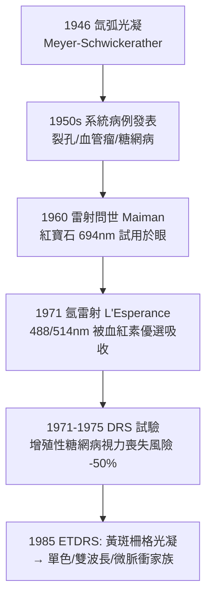

## 1946 - 視網膜光凝固術（第一束照進眼底治病的「光刀」）

## 案件摘要

**本案偵破的是：光能否像手術刀一樣，在眼底「焊接」裂孔、封閉異常血管？**

1946 年，德國埃森眼科醫師 Gerd Meyer-Schwickerather（1920–1992）以**氙弧光**（xenon arc）經改良 Gullstrand 型檢眼鏡聚焦投射，對視網膜裂孔與血管異常施行第一例**光凝固術**（photocoagulation）——光能轉化為熱能，使目標組織蛋白凝固、產生瘢痕粘連。1949 年他發表首批系統病例；1950s 氙光光凝治療視網膜裂孔與糖網病逐步推廣；1971 年起氬雷射（L'Esperance）以其**可調波長、精確光斑、可定量能量**全面取代氙光。1971–1975 年的 DRS 多中心試驗證明光凝使增殖性糖網病嚴重視力喪失風險下降逾 50%——眼科循證醫學的第一座大山。本案成果：眼底病從「觀察與絶望」變成「光照即治療」。

## 前因 -- 為什麼會有這個案子

- **視網膜裂孔的致命鏈條**。裂孔 → 液化玻璃體灌入 → 視網膜剝離 → 失明；1950 年代前唯一對策是鞏膜外加壓手術，創傷大、復位率有限。
- **「曬傷」的意外線索**。1940s 有報告指出日蝕觀測者視網膜灼傷、焊接工黃斑灼傷——光能足以在眼底造成凝固性損傷，但無人把它變成**可控的治療**。
- **氙弧燈的亮度**。德國戰後工業仍能提供氙弧光源——亮度遠超白熾燈，可在短曝光內沉積足夠熱能。
- **檢眼鏡光路成熟**（見 `1851-亥姆霍茲檢眼鏡.md`）：投射—觀察共路系統已有 90 年積累，只需加裝聚焦與濾光。

## 線索與推理 -- 熱能劑量的物理學

**線索一：凝固所需的能量計算。** 目標是把組織升溫至蛋白變性（約 60–70°C）而不碳化：

$$ Q = P \times t \quad (\text{光功率} \times \text{曝光時間}), \qquad \Delta T \approx \frac{Q \cdot \alpha}{\rho c V} $$

氙光光斑大（0.5–2mm）、時間長（0.1–1s）、能量粗放；雷射則可精確到斑徑 50–500μm、時長 0.01–0.2s、功率毫瓦級可控——**從「放火」進化到「點焊」**。

**線索二：氙光 → 氬雷射的技術接力。**



**線索三：DRS 的循證判決。** 1976 年發表的多中心試驗（>1,700 眼）：

$$ \text{嚴重視力喪失風險: 對照 } \sim 28\% \;\rightarrow\; \text{氬光凝組 } \sim 7\% $$

治療組風險下降逾 50%——「泛視網膜光凝（PRP）」成為增殖性糖網病標準治療；1985 年 ETDRS 再為黃斑水腫定柵格光凝適應症。**光凝由此成為第一個以 RCT 立法的眼科治療**。

**線索四：作用機理的分工。**

```python
# 光凝的三種臨床用途（同一物理原理, 不同戰術）
uses = {
  "封孔":  "裂孔周圍激光焊點 → 神經視網膜-色素上皮粘連, 阻斷剝離",
  "消融":  "PRP 全視網膜光凝 → 破壞缺氧視網膜, 下調 VEGF 分泌",   # → 1989-VEGF 血管新生學說
  "封閉":  "黃斑局灶光凝 → 燒閉滲漏的微血管瘤與 CNV 膜",
}
# 共同原理: 靶組織吸收光能 → 局部凝固 → 瘢痕重塑
```

## 結案 -- 後果與影響

- **視網膜專科的治療主權確立**。裂孔、剝離、糖網病、視網膜血管瘤、老年黃斑變性 CNV——半世紀間光凝覆蓋整個後節；1970 年 Machemer 玻切（見 `1970-馬赫默玻璃體切除術.md`）把光凝併入手術室（眼內光凝）。
- **循證眼科學的開端**。DRS/ETDRS 的登記、分級（EDTRS 視力表）、終點定義成為全球眼科試驗模板；抗 VEGF 時代（見 `2004-抗VEGF治療濕性黃斑變性.md`）的試驗設計直接承襲。
- **雷射家族的爆發**。氬→氪→半導體→810nm 經瞳溫熱→577nm 黃光→微脈衝（subthreshold，不產生可見瘢痕）——「能量更少、瘢痕更小、療效不減」是此後 50 年的迭代主題。
- **陰影面**。PRP 的代價是周邊視野、夜視與調節的永久損失；「以視野換中心視力」的取捨由病人知情同意承擔——本案的治療，本質是外科級的截肢。
- **一句話結案**：Meyer-Schwickerather 證明光可以被馴服成刀；DRS 證明這把刀真的能保住視力——從此，光既是眼科的偵探工具，也是它的手術兵器。

## 關鍵人物與文獻

- **Gerd Meyer-Schwickerather（1920–1992）**——埃森眼科教授；1946 年首例、1949 年首批論文、1959 年專著《光凝固術》。
- **François Fankhauser 與 Alan L'Esperance**——1960s–70s 雷射光凝系統化與氬雷射臨床化的關鍵工程—臨床搭檔。
- 原始文獻——Meyer-Schwickerather, *Lichtkoagulation*（1959）；DRS Group, *Photocoagulation treatment of proliferative diabetic retinopathy*（Arch Ophthalmol / Am J Ophthalmol, 1976–1981）；ETDRS Report No. 1–26（1985–1991）。
- **現代註腳**——2020s 的抗 VEGF 時代，PRP 退居二線（僅用於無法規律隨訪者），微脈衝與導航雷射把能量校準到單個感光細胞層——1946 年那束粗糙的氙光，如今已精細到「不留痕跡」。
