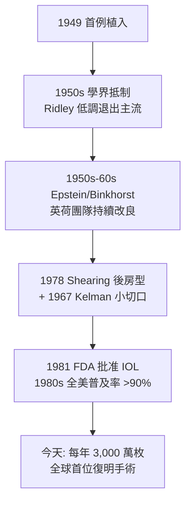

## 1949 - 里德利人工水晶體（戰機座艙碎片啟發的「眼內眼鏡」）

## 案件摘要

**本案偵破的是白內障手術最古老的悖論：混濁的透鏡摘除了，病人卻換上一枚厚如酒瓶底的眼鏡——能不能直接在眼內裝一枚新透鏡？**

1949 年 11 月 29 日，倫敦聖托馬斯醫院的眼科醫師 Harold Ridley（1906–2001）為一名 45 歲女病人植入史上第一枚**人工水晶體**（intraocular lens, IOL）：以 PMMA（聚甲基丙烯酸甲酯，壓克力）車削的雙凸透鏡，置於摘除白內障後的虹膜之前。靈感來自他觀察到二戰中**飛行員眼球內殘留的壓克力座艙碎片數年不被排斥**。此舉在當時被英國眼科學界視為異端，Ridley 因此沉寂十餘年；1960s–70s 起大量病例與新固定設計平反此案。今天，IOL 植入與白內障摘除同台完成，全球每年約 3,000 萬枚——史上最成功的人體植入物之一。本案成果：白內障手術從「復明的代價是深度遠視」進化為「復明且不戴鏡」。

## 前因 -- 為什麼會有這個案子

- **Daviel 以降 200 年的無晶體困境**。摘除術（見 `1745-達維爾白內障摘除術.md`）後眼球屈光力從 $+60D$ 掉到 $+43D$：

$$ \text{需 } +10 \sim +12D \text{ 眼鏡（且視野縮小、像差放大 } \sim 25\% \text{）} $$

- **二戰戰傷的觀察**。1940 年不列顛空戰中，噴火/颶風戰機座艙蓋為 PMMA；飛行員擋風玻璃碎片入眼的病例（Ridley 由眼科同事報告）顯示：PMMA 在眼內**惰性、不被排斥**。
- **當時正統的反對理由**。「眼內不能放異物」是移植與感染時代的鐵律——Wegner 等權威的口頭判詞："frivolous and eccentric"（輕率而古怪）。
- **Ridley 的解剖學洞察**。他知道 Rayner 公司的實驗室可加工光學級 PMMA（Ici/Rayner 合作），且自己主刀大量戰傷眼摘除——材料、病例與手術技術三項在手。

## 線索與推理 -- 材料與力學的偵查

**線索一：材料的選擇邏輯。** 供選材料的年表式篩選：

$$
\begin{aligned}
&\text{玻璃: 太重（} \rho \approx 2.5 \text{）, 脆} \Rightarrow \text{否}\\
&\text{金屬: 虹膜摩擦、金屬中毒} \Rightarrow \text{否}\\
&\text{PMMA: } \rho = 1.19, \; n = 1.49, \; \text{眼內 } 0 \text{ 排斥（戰傷證據）} \Rightarrow \text{選定}
\end{aligned}
$$

**線索二：第一例的操作與首戰挫敗。** 1949 年首例：8.35mm 直徑、10.5D 雙凸片，置於虹膜前。術後早期發生 **玻璃體溢出與脫位**（該病人最終植入未成功保留）——Ridley 學到：**固定**是本案真正的難題，不是材料。

```python
# IOL 固定方式的迭代（1949-1980s）
designs = {
  "1949 Ridley":       "虹膜前平放, 靠玻璃體托住 → 脫位率高",
  "1952 Epstein/Baron": "前房角固定 → 角膜內皮失代償, 大泡性角膜病",
  "1958+ iris clip":   "Binkhorst/Feodorov 虹膜夾持 → 虹膜萎縮, 旋轉",
  "1978 Shearing":     "後房型 J-_loop: 支撐袢入睫狀溝 → 成為現代標準",
  "1980s+ 折疊IOL":    "矽膠/親水丙烯酸酯, 注入式 2-3mm 切口",   # → 1967-超音波乳化
}
```

**線索三：度數計算——光學數學的最後一環。** 植入度數需精確補償角膜與眼軸（Gullstrand 模型眼，見 `1911-古爾斯特蘭德裂隙燈.md`）：

$$ P_{\text{IOL}} = \frac{n}{l - d} - \frac{n}{\frac{1}{K} + d} \quad\text{(簡化 SRK: } P = A - 0.9K - 2.5L \text{, 1980)} $$

$K$＝角膜屈光力（角膜曲率計）、$L$＝眼軸長（1970s 起超聲測量）——IOL 計算使「術後正視」成為可承諾的工程指標。

**線索四：平反的時間線。**



## 結案 -- 後果與影響

- **白內障手術變成「屈光手術」**。摘除＋植入＝一次完成的眼內光學置換；目標從「恢復光感」升級為「術後正視、甚至摘鏡」——本案把 `1745-達維爾白內障摘除術.md` 的最後一塊拼圖補上。
- **生物材料的帝國**。PMMA → 矽膠 → 親水/疏水丙烯酸酯；非球面、多焦點、EDOF（景深延長）、Toric（散光矯正）IOL——一枚透鏡的眼內化，直接孕育了屈光手術市場（見 `1990-LASIK屈光手術.md`）。
- **醫學異端的方法論教訓**。Ridley 的依據是**臨床觀察＋材料證據**，卻輸給了時代成見；他的平反靠的也是同樣的東西——長期病例數據。本案證明：醫學史的陪審團反應很慢，但證據終會到庭。
- **陰影面**。早期 IOL 併發症（內皮失代償、脫位、黃斑囊樣水腫）真實存在；今天的後囊混濁（PCO，成人 10–20%）仍是「彩虹後的雨」——Nd:YAG 後囊切開雷射（1980s）成為常規善後。
- **一句話結案**：Ridley 從戰機殘骸裡讀出了材料學的證詞，把 200 年的「摘鏡換鏡」悖論終結在一枚 4mm 的壓克力透鏡裡——異端的證據鏈足夠長，正統就會翻案。

## 關鍵人物與文獻

- **Harold Ridley（1906–2001）**——聖托馬斯醫院眼科醫師；1976 年獲騎士勳銜、1992 年當選皇家學會院士——異端最終以科學最高榮銜結案。
- **Peter Choyce（1916–2001）**——英國 IOL 先驅，Ridley 的公開辯護者與前房型設計改良者。
- **Cornelius Binkhorst（1912–1995）**——荷蘭眼科醫師，虹膜夾持 IOL 的系統化者；IOL 計算公式以他命名。
- **Steven Shearing**——1978 年設計後房型 J-loop IOL，現代囊袋/睫狀溝固定的起點。
- 原始文獻——Ridley, "Intra-ocular acrylic lenses"（Trans. Ophthalmol. Soc. UK, 1951–52 系列）；Apple & Trivedi, *Harold Ridley and the Invention of the IOL*（2002）。
