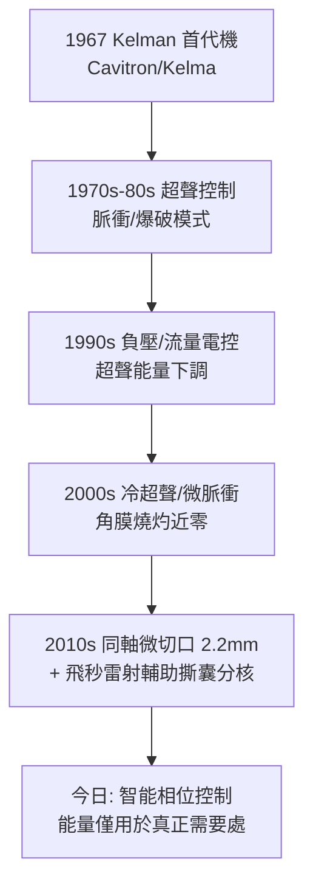

## 1967 - 凱爾曼超音波乳化手術（12mm 切口變 3mm：白內障手術的微創革命）

## 案件摘要

**本案偵破的是：能不能不用「取出」這個動作，讓混濁的晶體自己從小孔裡流出來？**

1967 年，紐約耳鼻喉醫院的 Charles Kelman（1930–2004）發表**超音波乳化術**（phacoemulsification, "phaco"）：一支 2–3mm 的中空鈦針以 40kHz 超音波縱向振動，把白內障核**粉碎乳化**成漿，邊振盪邊被灌注—抽吸系統吸出眼外。切口從 Daviel 式 ECCE 的 12mm 縮到 3mm——不必縫線、不必住院、散光極小。配合 1949 年 IOL（見 `1949-里德利人工水晶體.md`）與 1980s 折疊式 IOL，白內障手術成為全球量最大的復明手術：門診 15–20 分鐘、切口 2.2mm、術後當日回家。本案成果：外科史上罕見的「同一手術連續三次革命」（摘除→乳化→折疊植入）的第三棒。

## 前因 -- 為什麼會有這個案子

- **ECCE 的切口瓶頸**。晶體核直徑約 8mm——要整核娩出，切口就得 12mm；大切口意味著縫線、散光、長恢復、臥床數日。
- **牙科的技術外溢**。Kelman 最初為青光眼與白內障設計機械攪碎器失敗；他在牙科診療看到**超音波潔牙器**粉碎牙結石而不傷齦——「高頻振盪＋灌注冷卻」的組合豁然成形。
- **Kelman 的表演者性格**。他既是外科醫師又是薩克斯手與喜劇演員；為湊研發費曾在夜總會表演——本案的研發史帶著爵士樂的即興色彩。
- **先行的失敗經驗**。1963–1966 年他嘗試機械刀頭、震盪刀頭（低頻）皆致角膜損傷與切口過大；1967 年 2 月首例超音波乳化成功。

## 線索與推理 -- 聲學與流體力學的偵查

**線索一：乳化的物理過程。** 鈦針尖端以 $f = 40\,\mathrm{kHz}$ 振幅 50–100μm 縱振：

$$ \text{核組織} \xrightarrow{\text{空穴效應+機械剪切}} \text{乳化漿} \xrightarrow{\text{抽吸}} \text{眼外} $$

高頻振動在液體中產生微氣泡（cavitation），崩潰時局部剪切粉碎組織；灌注套管同時持續注水維持前房深度並冷卻刀頭：

$$ Q_{\text{灌注}} \approx Q_{\text{抽吸}} + \text{滲漏} \quad\Rightarrow\quad P_{\text{前房}} \text{ 穩定} \Rightarrow \text{眼壁不塌陷} $$

**線索二：從「整核」到「碎核」的手術邏輯翻轉。**

```python
# ECCE vs Phaco 的演算法對照
def ecce(lens_nucleus):          # Daviel 1745 / 現代 ECCE
    incision = 12.0              # mm
    deliver_whole_nucleus()
    suture()                     # 需縫合
    recovery = "臥床數日"

def phaco(lens_nucleus, energy, vacuum, flow):
    incision = 2.8               # mm
    divide_into_quadrants("分核溝 + 轉核")
    for quadrant in lens_nucleus.quadrants:
        emulsify_and_aspirate(quadrant,
                              limits={"超声能量": energy, "負壓": vacuum})
    inject_foldable_IOL()
    return "無縫線, 當日回家"
```

**線索三：可控性參數的建立。** Kelman 之後 50 年的工程迭代就是「三參數＋能量釋放模式」的精細化：



**線索四：與 IOL 的耦合成功。** 3mm 切口的價值只有搭配**可折疊 IOL**（1980s 矽膠與丙烯酸酯，見 `1949-里德利人工水晶體.md`）才兌現：晶體捲成「捲餅」經 2.2mm 推注器注入囊袋——摘除與植入在同一微創切口內完成。

## 結案 -- 後果與影響

- **白內障手術的流行病學翻身**。手術時間從 1 小時降到 15 分鐘、住院日從 5–10 天到 0 天；發展中國家的「白內障積壓」從此有了可規模化的解法（Aravind 模式的單日批量手術即建基於 phaco/MSICS）。
- **屈光目標內建**。小切口＝幾乎無醫源性散光，IOL 度數計算（見 `1949`）的預測精度得以兌現；Toric IOL、多焦點 IOL 使「順便摘鏡」成為標準話題。
- **眼科儀器工業的旗艦賽道**。Alcon、Abbott/Johnson、Bausch+Lomb、Zeiss 的超聲乳化平台成為眼科最大單一設備市場；飛秒雷射（2008 FDA 批准）把撕囊與分核也交給雷射——本案開啟的賽道至今仍在跑。
- **陰影面**。學習曲線陡峭（後囊破裂風險集中於新手）、設備昂貴（每台百萬級）；發展地區至今並用成本更低的 MSICS（小切口手動摘除）——「微創」與「可及性」仍是張力。
- **一句話結案**：Kelman 從牙醫的洗牙機上偷來 40kHz，把「把石頭搬出房間」的問題改寫成「把石頭化成水吸走」——最省力氣的偵探，是改寫題目的人。

## 關鍵人物與文獻

- **Charles D. Kelman（1930–2004）**——紐約眼科醫師；1967 年首例 phaco；另發明睫狀體冷凍、雷射虹膜切除等多項技術；1994 年獲 Lasker 獎。其自傳的書名就是本案的註腳：*Through My Eyes*。
- **Anton Banko**——工程搭檔，Cavitron/Kelma 機型的共同設計者。
- 原始文獻——Kelman, "Phaco-emulsification and aspiration: a new technique of cataract extraction"（Am J Ophthalmol, 1967）。
- **現代註腳**——2020s 飛秒雷射輔助 phaco 把切口、撕囊、分核全數交給雷射規劃，超聲能量使用率再降 40%；Kelman 的鈦針仍在高速振動，只是聽它指揮的軟體變聰明了。
