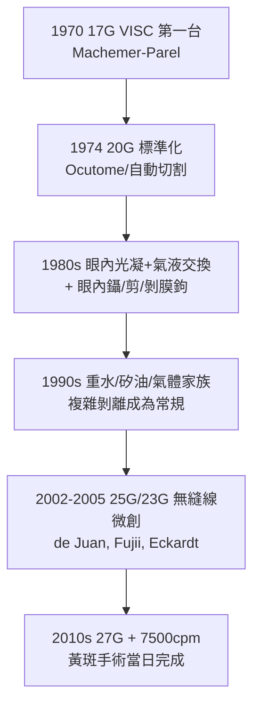

## 1970 - 馬赫默玻璃體切除術（打開眼球最後的禁地）

## 案件摘要

**本案偵破的是眼科外科的最後一塊禁地：充滿眼球的透明「果凍」——玻璃體——能不能被安全地切除、置換？**

1970 年，美國邁阿密 Bascom Palmer 眼科研究所的 Robert Machemer（1933–2009）與工程師机械师 Parel 合作，製成第一台**玻璃體切除儀**（vitrectomy unit）：一支 17G（約 1.5mm）的旋切刀頭，經睫狀體平坦部（pars plana）進入眼內，邊**切割**邊**抽吸**邊**灌注**，將病變玻璃體（積血、增殖膜）清除並以生理液體置換。1971 年發表首批病例（糖尿病玻璃體積血、玻璃體混濁），此術式定名 **PPV**（pars plana vitrectomy）。眼後節從此從「內科觀望區」變成手術室；視網膜剝離、糖尿病眼、眼外傷、黃斑手術全面開刀化。本案成果：眼球內部從「不可觸」變成「可進入、可切除、可重建」。

## 前因 -- 為什麼會有這個案子

- **玻璃體的傳統禁忌**。1850s 起教科書一致警告：切開玻璃體＝玻璃體流失＝視網膜剝離與眼球癆——「眼內不可留空隙」是百年鐵律。
- **糖尿病視網膜病變的洪峰**。1940s 起胰島素延長了糖尿病病人壽命，增殖性糖網病（玻璃體積血、纖維血管膜牽拉）成為工作年齡人口首位致盲病——內科與氬光凝（見 `1946-視網膜光凝固術.md`）都救不了已積血的眼。
- **意外的模型**。Machemer 的靈感來自一次**意外**：一位病人自述「鐵絲刺入眼內後視力反而改善」——他推測細針切斷了牽拉視網膜的增殖膜。這條軼事成為本案的起點假設：**牽拉，才是剝離的兇手**。
- **工程條件**。他在德國杜賓根跟 Jean-Marie Parel（年輕工程師）合作，把電動剃鬚刀式的旋切概念與灌注抽吸系統合體。

## 線索與推理 -- 「三聯管」的流體力學與力學

**線索一：同軸三功能刀頭的設計。** 17G 刀頭集三功能於一管：

$$
\begin{aligned}
&\text{切割: 内刀 60-80 rpm 旋切（後演化為 1500-7500 cpm 切斷）}\\
&\text{抽吸: 負壓把切下的組織吸出}\\
&\text{灌注: 由另側套管持續補液維持 } P_{\text{眼}} \approx 30-40\,\mathrm{mmHg}
\end{aligned}
$$

核心守恆式：

$$ Q_{\text{灌注}} \ge Q_{\text{抽吸}} + Q_{\text{漏}} \;\Rightarrow\; V_{\text{眼內}} \text{ 恆定} \Rightarrow \text{眼壁不塌、視網膜不被吸住} $$

**百年禁忌的破解**就在此式：玻璃體被切除的同時，空間被液體即時填補——「眼內不許留空」的教條以**流量守恆**回答。

**線索二：牽拉假說的臨床驗證。**

```python
# Machemer 的病理鏈與手術靶點
chain = [
  "缺血視網膜 → 新生血管膜(纖維血管增殖)",
  "膜收縮 → 對視網膜施加徑向/切線牽拉",
  "牽拉 → 視網膜裂孔/剝離 → 失明",
]
targets = {
  "切除積血":  "恢復光路, 同時取得手術視野",
  "剝除增殖膜": "解除牽拉 — 真正的病灶",   # 'membrane peeling' 由此誕生
  "眼內光凝":  "封閉缺血區, 阻止膜再生",   # → 1946-光凝
  "氣/油填充": "頂壓視網膜貼合",
}
```

**線索三：器械的進化時間線。**



**線索四：玻璃體替代物的力學分工。** 切除後需要「占位物」頂住視網膜：

| 替代物 | 比重/特點 | 用途 |
|---|---|---|
| 空氣/C₃F₈/SF₆ | 上浮 | 上方裂孔頂壓，數日–數週吸收 |
| 矽油（1000/5000 cSt） | 比水輕/可調 | 長期填充，複雜病例 |
| 重水（PFCL） | 比水重 | 術中「液壓熨斗」展平視網膜 |

## 結案 -- 後果與影響

- **視網膜外科誕生**。PPV 與鞏膜扣帶術並列為視網膜剝離兩大支柱；糖尿病牽拉性剝離、巨大裂孔、增生性玻璃體視網膜病變（PVR）的復位率從近乎 0 提升到 80–90%+。
- **黃斑手術的開啟**。1990s 以 PPV 平台完成黃斑裂孔封閉、黃斑前膜剝除——「黃斑不可碰」成為歷史；今日 27G 黃斑手術當日視力即可用眼。
- **與光凝、抗 VEGF 的三足鼎立**。玻切（機械）、光凝（熱能）、抗 VEGF（生物藥，見 `2004-抗VEGF治療濕性黃斑變性.md`）構成現代眼底治療三角；玻切中聯合注射抗 VEGF 已成為增生性糖尿病眼的標準組合拳。
- **陰影面**。PPV 加速白內障形成（氣體與器械接觸晶體）、醫源性裂孔、眼內炎風險雖極低但存在——「打開眼」的代價清單仍需逐項管理。
- **一句話結案**：Machemer 用一支旋切刀與一條流量守恆式，拆掉了百年禁忌——眼睛最後一塊禁地變成了手術台，而「牽拉」這個真正的兇手，終於可以被當場逮捕。

## 關鍵人物與文獻

- **Robert Machemer（1933–2009）**——德國出生、杜賓根受訓，後任杜克大學眼科教授；VITAS/VISC 系統研發者，PPV 之父，視網膜學會（The Retina Society）主席。
- **Jean-Marie Parel**——法裔工程師，與 Machemer 合造 VISC；後為 Bascom Palmer 終身工程教授——「醫師＋工程師」搭檔模式的典範。
- 原始文獻——Machemer, Buettner, Norton, Parel, "Vitrectomy: a pars plana approach"（Trans. Am. Acad. Ophthalmol. Otolaryngol., 1971）；Machemer, *Vitrectomy* 專著（1975）。
- **現代註腳**——今日 27G 刀頭直徑 0.4mm、切速 7500 次/分、無縫線自閉切口；從 1.5mm 的第一支 VISC 到 0.4mm 的微創刀頭，本案縮小了 3.5 倍——外科史上最優雅的「瘦身」之一。
