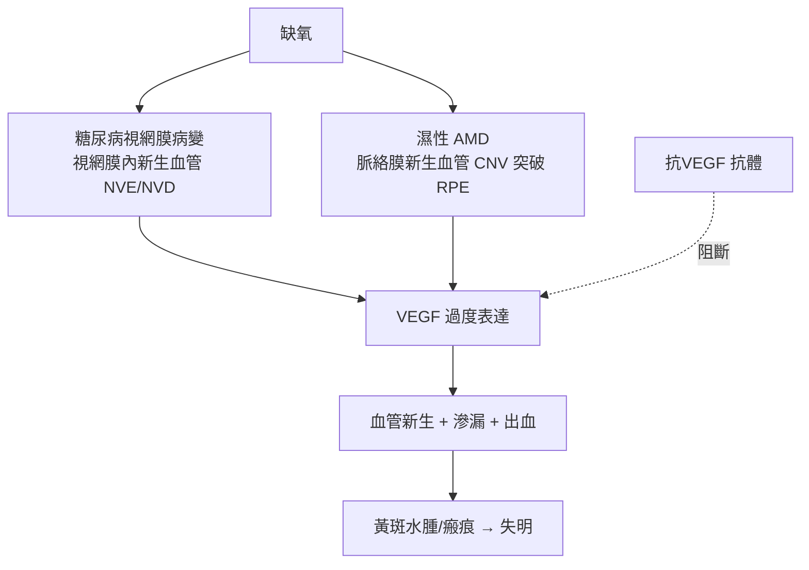

## 1989 - VEGF 血管新生學說（找出「讓眼裡長出壞血管」的兇手蛋白）

## 案件摘要

**本案偵破的是濕性老年黃斑變性（AMD）與糖尿病眼背後的分子兇手：誰在命令脈絡膜與視網膜長出那些出血滲漏的異常血管？**

1989 年，Napalkov 與 Tischer 等分別克隆出血管內皮生長因子（vascular endothelial growth factor, VEGF；最初的別名 VPF「血管通透因子」），Harold Dvorak 與 Napoleone Ferrara（Genentech）系統闡明其功能：**缺氧誘導組織分泌 VEGF → VEGF 與血管內皮受體結合 → 血管新生（angiogenesis）＋血管滲漏**。此學說接上 Judah Folkman 1971 年「腫瘤生長依賴血管新生」的假說，把眼底出血性疾病的因果鏈完整寫出。2004 年 pegaptanib、2006 年 ranibizumab 相繼獲批（見 `2004-抗VEGF治療濕性黃斑變性.md`），本案的「通緝令」變成「拘捕令」。成果：一種曾被視為不可治的失明病，被還原為一個**單一分子通路過度活化**的問題。

## 前因 -- 為什麼會有這個案子

- **Folkman 的異端假說（1971）**。「腫瘤若無新生血管供血，生長不超過 1–2mm³；抑制血管新生＝治癌」——最初被主流嘲笑，卻催生了整個血管新生醫學。
- **臨床病理的既有線索**。濕性 AMD 的脈絡膜新生血管（CNV）與糖尿病視網膜病變的視網膜新生血管都：來自缺氧區、極易滲漏出血、生長迅速——1980s 視網膜缺氧已被證明上調「血管生成素樣活性」。
- **Senger 與 Dvorak 的滲漏因子**。1983 年 Dvorak 團隊從腫瘤細胞培養液中分離出能使血管「漏水」的因子（VPF）——後證實就是 VEGF：新生血管與滲漏**同一兇手**。
- **Ferrara 的克隆**。Genentech 的 Ferrara 於 1989 年克隆牛 VEGF 並證其為特異性內皮有絲分裂原——分子身份證到手。

## 線索與推理 -- 血管新生的分子邏輯

**線索一：缺氧—VEGF 軸。** 兒兇手的指揮系統：

$$ \text{缺氧} \Rightarrow \text{HIF-1}\alpha \text{ 穩定} \Rightarrow \text{VEGF 基因轉錄} \uparrow \Rightarrow \text{VEGF}_{165} \text{ 分泌} \Rightarrow \text{內皮 KDR/Flt-1 受體活化} $$

在視網膜：缺血區（糖尿病毛細血管閉塞、AMD 脈絡膜灌注不足）正是「報案現場」——這解釋了為什麼 PRP 光凝（破壞缺血視網膜，見 `1946-視網膜光凝固術.md`）能間接「降 VEGF」：**光凝早就誤打誤撞地打擊了兇手的兵工廠**。

**線索二：兩種眼病，同一兇手。**



**線索三：驗證實驗的邏輯鏈。** 1990s 的關鍵證據：

```python
# 判定 VEGF 為兇手的證據鏈（1990s）
evidence = [
  "眼底 CNV/糖尿病膜標本: VEGF mRNA 與蛋白過量表達",
  "動物模型: 玻璃體腔注入 VEGF → 復現新生血管+滲漏",
  "阻斷實驗: 抗 VEGF 抗體或可溶性受體 → 新生血管受抑",
  "人類印證: 玻璃體 VEGF 濃度與病變活動度正相關",
]
# Koch 法則的分子版: 兇手在場、分離培養、復現、再逮捕
```

**線索四：從腫瘤藥物到眼科藥物的同源分流。** Genentech 的抗 VEGF 抗體同時發展出兩支：全長抗體 **bevacizumab（Avastin，2004 年獲批治結直腸癌）** 與切割自抗體的抗原結合片段 **ranibizumab（Lucentis，38kDa，能穿透視網膜各層）**——同一條偵查線上的雙胞胎武器（見 `2004-抗VEGF治療濕性黃斑變性.md`）。

## 結案 -- 後果與影響

- **眼科藥物革命**。VEGF 被裁定為濕性 AMD、糖尿病黃斑水腫、視網膜靜脈阻塞、早產兒視網膜病變的共同驅動因子；玻璃體腔注射成為眼科給藥的新常態——「眼球是免疫特權房間，可以直接關門打狗」。
- **Folkman 的遲到加冕**。2004 年 Avastin 獲批治癌，Folkman 的 1971 假說成為主流；2007 年他生前未及見諾獎，但「血管新生醫學」以他為公理系創始人。
- **診斷—治療閉環**。OCT（見 `1991-OCT光學同調斷層掃描.md`）與 OCTA 以形態學追蹤「兇手造成的現場」（視網膜厚度、液體量），抗 VEGF 負責抓捕——診斷與治療首次在同一物理量（黃斑中心厚度）上對帳。
- **陰影面**。VEGF 也是正常視網膜與脈絡膜維持所需的生理因子——長期全阻斷有 RPE 萎縮與地理性萎縮加速的疑慮；「精準劑量與間隔」至今是臨床藝術。
- **一句話結案**：從「眼底出血、原因不明」到「HIF-1α→VEGF→內皮增殖」的完整因果鏈，本案把最常見的致盲病還原成一個分子通路的失控——兇手落網之日，正是數百萬病人復明之時。

## 關鍵人物與文獻

- **Napoleone Ferrara（1956–）**——Genentech 科學家，VEGF 克隆（1989）與 ranibizumab 研發的核心；2010 年 Lasker 獎、2019 年突破了 Lasker–DeBakey 臨床醫學研究獎的前身表彰。
- **Judah Folkman（1933–2008）**——哈佛兒童醫院外科醫師；1971 年血管新生假說的提出者，本案的公理奠基人。
- **Harold Dvorak**——哈佛病理學家，1983 年分離 VPF（後即 VEGF）；「腫瘤像一個不癒合的傷口」是他的名句。
- 原始文獻——Leung/Tischer/Napalkov et al., *Science* 246:1306（1989）；Ferrara & Henzel, *Biochem Biophys Res Commun* 161:851（1989）；Folkman, *NEJM* 285:1182（1971）。
