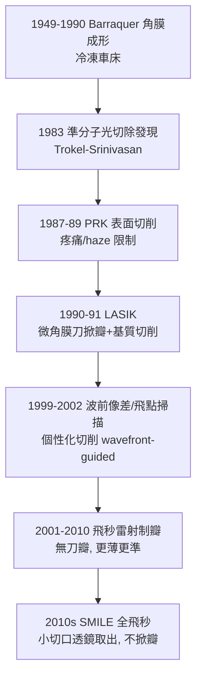

## 1990 - LASIK 屈光手術（在角膜上「磨眼鏡」：摘鏡時代開幕）

## 案件摘要

**本案偵破的是：既然近視是「眼軸過長、像落在視網膜前」的幾何問題（見 `1604-克卜勒視網膜成像.md`），能否直接改變角膜這枚最強透鏡（+43D）的曲率，把像重新拉回視網膜？**

1990–1991 年，希臘的 Ioannis Pallikaris（克里特大學）與義大利的 Lucio Buratto 各自發展並命名 **LASIK**（Laser-Assisted In Situ Keratomileusis）：先以微角膜刀（microkeratome）掀起一層 160μm 的**角膜瓣**，再以 193nm 準分子雷射對基質床作**光切除**（photoablation）修正屈光度，最後把瓣蓋回——基質層保留，疼痛小、次日即視力清晰。前身技術鏈：1949–1970s Barraquer 的角膜成形（刀削）、1983 年 Trokel–Srinivasan 發現準分子雷射可精確削切角膜、1987–1989 年 PRK（表面切削）臨床化。本案成果：屈光矯正從「外掛光學（眼鏡/隱形眼鏡）」變成「重塑原生光學」，數千萬人摘鏡。

## 前因 -- 為什麼會有這個案子

- **角膜是全眼屈光力的主要承重牆**。$P_{\text{角膜}} \approx +43D$ vs 晶體 $+19D$——只占眼重量的薄層組織承載三分之二屈光力，是「改光學」的最高槓桿點。
- **Barraquer 的先驅與教訓**。1949 年起哥倫比亞外科醫師 José Barraquer 發明 keratomileusis：冷凍切下角膜片、車床磨薄、再縫回——手術可行但併發症多、不可控。角膜刀的技術已備，只差「更精確的刀」。
- **準分子雷射的意外登場**。1975 年 ArF 準分子雷射（193nm）被發現；1981–83 年 Srinivasan 與 Trokel 證明紫外光子（$E \approx 6.4\,\mathrm{eV}$）能**直接切斷分子鍵**，使角膜組織氣化清除，熱損傷區 <0.2μm——「冷光刀」的物理性質完美匹配角膜微雕。

$$ E_{\text{photon}} = \frac{hc}{\lambda} = \frac{1240\,\mathrm{eV\cdot nm}}{193\,\mathrm{nm}} \approx 6.4\,\mathrm{eV} > \text{肽鍵鍵能} \approx 3.5\,\mathrm{eV} $$

- **PRK 的限制**。1987 年起 PRK（直接切削角膜表面）有效但疼痛劇烈、恢復慢、 haze 風險——需要「保護上皮與前彈力層」的方案：把切削藏進基質＝掀瓣。

## 線索與推理 -- 光切削與瓣的幾何

**線索一：屈光修正的數學。** 欲矯正近視 $-6D$，需在角膜中央區削出一個「負鏡片」形狀——切削深度由 Munnerlyn 公式給出：

$$ t_{\max} = \frac{D \cdot d^2}{8 \cdot (n-1)} \approx \frac{D \cdot d^2}{3.33} $$

例：矯正 $-6D$、光學區 $d = 6\,\mathrm{mm}$：

$$ t_{\max} = \frac{6 \times 36}{3.33} \approx 65\,\mathrm{\mu m} $$

典型切削深度 30–120μm，而基質總厚 ~500μm——留足 250μm 床層以防角膜擴張（ectasia）即為安全紅線。

**線索二：每一發雷射「削」多少。** 準分子每脈衝削除約 0.25μm：

```python
# LASIK 切削的工程計算（簡化）
def ablation_pulse_count(diopters, optical_zone_mm=6.0):
    depth_um = diopters * optical_zone_mm**2 / 3.33   # Munnerlyn
    pulses_per_um = 4                                 # 0.25 μm/pulse
    total_pulses = int(depth_um * pulses_per_um)
    assert residual_stromal_bed(depth_um) > 250       # 安全紅線 μm
    return total_pulses                               # ~260 發, 數十秒
```

**線索三：三代的技術接力。**



**線索四：為何「瓣」是關鍵發明。** 上皮與前彈力層是疼痛與 haze 的來源；LASIK 把切削移入基質、以活瓣自然覆蓋——術中保留生物敷料。代價是**瓣相關併發症**（皺褶、移位、瀰漫性層間角膜炎 DLK、乾眼加劇）與終身的角膜生物力學弱化——SMILE（2011）不掀瓣、取出基質透鏡，正是對本案代價清單的回應。

## 結案 -- 後果與影響

- **屈光手術產業誕生**。全球累計 LASIK/SMILE 超過 6,000 萬例；滿意率 ~95%（Meta 分析 Solomon 2009）；準分子與飛秒平台成為眼科設備最大市場之一。
- **與 IOL 手術的融合**。老視者選擇「屈光晶體置換（RLE）＋多焦 IOL」（見 `1949-里德利人工水晶體.md`）；LASIK 亦可矯正 IOL 術後殘餘屈光——「摘鏡」有了光學家族的完整菜單。
- **波前像差學的臨床化**。Hartmann-Shack 波前感測（源自天文自適應光學）使「個性化切削」成為可能——望遠鏡技術回饋眼科，構成與 `1285-眼鏡的發明.md` 的對稱：光學史上眼與望遠鏡互為工具。
- **陰影面**。角膜擴張（術後圓錐角膜）是本案最重的代價，2020s 波士頓 Ectasia Risk Score 與角膜生物力學測量（OCT-A、Corvis）用於術前把關；夜間眩光、乾眼在早期技術普遍——「永久改變一個健康器官」的倫理辯論至今未歇。
- **一句話結案**：Trokel 找到了那把 6.4eV 的冷刀，Pallikaris 為它設計了掀瓣的工法——近視這個幾何問題，最終被另一組幾何（瓣厚、光學區、切削深度）精確地修改了答案。

## 關鍵人物與文獻

- **Ioannis Pallikaris（1947–）**——希臘克里特大學眼科教授；1991 年 LASIK 命名與系統化（與 Violanti 合作的兔子實驗 1990）；後創 SMILE 技術路線的學術基礎。
- **Lucio Buratto（1948–）**——米蘭眼科醫師；1992 年發表準分子輔助 keratomileusis 的改良，與 Pallikaris 共享 LASIK 之父名銜。
- **Stephen Trokel**——哥倫比亞大學眼科；1983 年與 Srinivasan 發表準分子角膜切削論文，本案物理學的奠基文。
- 原始文獻——Pallikaris et al., "Laser in situ keratomileusis"（Lasers Surg Med, 1990; Arch Ophthalmol, 1991）；Trokel, Srinivasan, Braren, "Excimer laser surgery of the cornea"（Am J Ophthalmol, 1983）。
- **現代註腳**——SMILE（2011 FDA）以一枚飛秒雷射切出的角膜透鏡經 2mm 切口取出，不掀瓣、保留更多生物力學；「磨眼鏡」的刀法，仍在往更小、更冷、更個性化進化。
