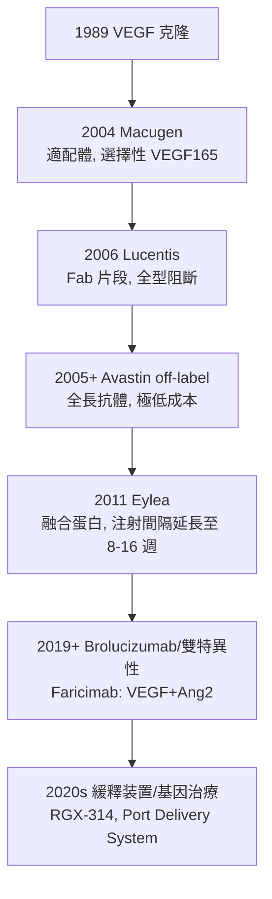

## 2004 - 抗 VEGF 治療濕性黃斑變性（把「必盲之病」變成慢性病）

## 案件摘要

**本案偵破的是：兇手（VEGF，見 `1989-VEGF血管新生學說.md`）既已通緝在案，如何把它在眼內繳械？**

2004 年 12 月，第一個眼科抗 VEGF 藥 **pegaptanib（Macugen）** 獲 FDA 批准——一種選擇性結合 VEGF₁₆₅ 的核酸適配體（aptamer），玻璃體腔注射。真正的浪潮在 2005–2006 年：Genentech 的 **ranibizumab（Lucentis）**（VEGF 全型阻斷的抗原結合片段）與 off-label 的 **bevacizumab（Avastin）**（同一抗體的全長版本，價格僅 1/50）在臨床試驗中改寫病程——濕性 AMD 病人首次**不是延緩失明，而是平均視力進步**。AMD 從眼科絕症變成「每月一針」的慢性病，糖尿病黃斑水腫與視網膜靜脈阻塞同步受益。本案成果：藥物治療首次在眼底病的中心舞台擊敗手術與雷射。

## 前因 -- 為什麼會有這個案子

- **舊療法的天花板**。氬光凝封閉 CNV（見 `1946-視網膜光凝固術.md`）在燒閉血管的同時燒毀其下的感光細胞——「以中心視力為代價」；光動力療法（PDT, Visudyne, 2000）延緩但不逆轉——醫界對 AMD 的期待被壓在「少惡化一點」。
- **流行病壓力**。濕性 AMD 是西方 65 歲以上首位致盲原因；糖尿病患病率攀升，糖尿病黃斑水腫（DME）成為工作年齡層致盲主力——市場與人道壓力同時到頂。
- **腫瘤藥物的跨界**。Genentech 的抗 VEGF 抗體管線同時生出 Avastin（全長 IgG1，149kDa）與 Lucentis（Fab 片段，48kDa）——後者體積小，可穿透視網膜全層、玻璃體半衰期更長（~9 天 vs ~4 天）。
- **玻璃體腔注射的復興**。1990s 之前眼內注射被視為高風險（眼內炎）；更昔洛韋玻璃體注射（CMV 視網膜炎時代）與 Foscarnet 經驗重建了操作規範——「直接把藥送到病灶」成為可行常規。

## 線索與推理 -- 劑型、試驗與倫理的三線推理

**線索一：為什麼要在眼內打針。** 血—視網膜屏障使全身給藥到眼內濃度極低：

$$ \text{玻璃體腔注射} \Rightarrow C_{\text{玻璃體}} \approx 10^3 \times C_{\text{全身給藥}} \quad\text{且藥量 } \sim 0.05\,\mathrm{mg} \ll \text{腫瘤劑量 } 5\,\mathrm{mg/kg} $$

解剖學饋贈：眼球是**封閉腔室**——0.05ml 藥液直接進入 4.5ml 的玻璃體腔，靶點近在咫尺。

**線索二：改寫病程的試驗證據。** 2005–2006 年 MARINA 與 ANCHOR 試驗（ranibizumab）：

$$ \text{12 個月視力: 安慰組 } -16 \text{ 字母} \;\rightarrow\; \text{Lucentis 組 } +7 \text{ 字母（} \sim 95\% \text{ 失明風險消除）} $$

「**平均視力進步**」——眼科史上第一次，治療新血管性 AMD 的目標從「減少喪失」改為「獲得改善」。2008 年 ABC/PONTO/CATT 系列再證明 Avastin 療效相當，價差 50 倍，引發全球藥價與藥規大辯論。

**線索三：三代藥物的演化譜。**



**線索四：治療範式的意外收穫。** PRP 光凝（見 `1946`）的「犧牲缺血視網膜以降 VEGF」邏輯被藥物替代——抗 VEGF 成為糖網病首選；新生血管性青光眼、早產兒視網膜病變（ROP，Bevacizumab 注射已入部分指南）——一個靶點，全眼底血管病受益。

**線索五：Avastin 分裝的醫學經濟學偵查。** 100mg/4ml 的腫瘤包裝由藥劑師分裝成 0.05ml 眼科劑量：

```python
# 同一分子, 兩種定價（本案的社會經濟插曲）
prices = {"Lucentis": 2000, "Avastin": 50}   # USD/劑（2006-2010 典型）
efficacy_delta = "~0"                        # 主要試驗對帳結果
# CATT 試驗 (2011, NEJM): 療效無顯著差異 → 全球處方行為分裂
```

## 結案 -- 後果與影響

- **AMD 治療史的斷代**。「濕性 AMD＝數月內失明」成為歷史；英國皇家眼科學院與 Cochrane 評價：抗 VEGF 是「20 年來視力預後最大的單一改善」。
- **眼科的給藥革命**。玻璃體腔注射成為全球量最大的眼內操作；抗 VEGF 已超過白內障手術成為美國 Medicare 眼科第一大支出項——治療量與治療成本同時登頂。
- **靶點醫學的方法論勝利**。與 606 號（見性病卷 `1910`）同構：「先定靶點（VEGF）→再設武器（抗體/片段/適配體）→以 RCT 驗收」——跨世紀的魔法子彈在眼科完成了一次完美復刻。
- **陰影面**。每 4–8 週一針的負擔、注射相關眼內炎（~0.05%）、長期抑制生理性 VEGF 的 RPE 萎縮疑慮、以及 Avastin/Lucentis 的定價與法規灰色地帶——勝利清單上每項都留著未結的尾註。
- **一句話結案**：從「無藥可醫、雷射以火止戰」到「一針進玻璃體、血管退潮、視力回升」——本案證明：找到分子兇手，是所有復明故事中最便宜的一步。

## 關鍵人物與文獻

- **Napoleone Ferrara**——Genentech；VEGF 克隆與 ranibizumab 研發核心（見 `1989`）。
- **Philip Rosenfeld**——邁阿密 Bascom Palmer 視網膜專家；2005 年率先發表 Avastin 玻璃體腔注射治療 AMD 的病例系列，點燃 off-label 革命。
- **Gabriel Sperduto、David Boyer 與 MARINA/ANCHOR/HARBOR 試驗團隊**——RCT 的執行者，把改寫病程的證據送上監管法庭。
- 原始文獻——Rosenfeld et al., *Ophthalmology* 112:1031（2005）；Gragoudas et al.（V.I.S.I.O.N., *NEJM* 351:2805, 2004）；Rosenfeld et al.（MARINA, *NEJM* 355:1419, 2006）；CATT Research Group, *NEJM* 364:1906（2011）。
