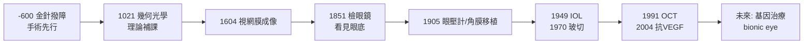

# 眼科的歷史：從金針撥障、幾何光學、檢眼鏡、眼壓流體力學到雷射、人工水晶體與抗 VEGF

> 本書以「推理探案」的體例，為眼科史上每個關鍵事件寫一篇 wiki：
> 謎題是什麼（眼睛如何看？白內障的病灶在哪裡？）？偵探是誰？線索與推理是什麼？背後的理論（幾何光學、調節理論、Goldmann 眼壓流體力學、血管新生學說、光的干涉）如何破案？
> 每篇檔名以年份開頭（4 位數，西元前以 `-` 開頭，如 -0600）。

## 雙線主軸

| 線 | 演變 |
|---|---|
| **視覺理論線** | 投射說/眼火說 → 幾何光學（Ibn al-Haytham）→ 視網膜成像（Kepler）→ 調節與色覺（Young）→ 檢眼鏡直視眼底 → OCT 顯微斷層 |
| **治療技術線** | 金針撥障 → 白內障囊外摘除 → 麻醉與感染控制 → 人工水晶體 → 超音波乳化 → 雷射光凝/準分子 → 玻璃體切除 → 抗 VEGF 藥物 |

---

## 年表（非常詳細版）

### 第一篇：古代的瞎猜——「光從眼睛射出」的千年誤區與最早的撥障手術

| 年份 | 事件 | 意義 | wiki |
|---|---|---|---|
| 約前 1550 | 埃及《埃伯斯紙草》已有眼病處方；荷魯斯之眼成為護符 | 眼病醫學的最早記錄 | （背景） |
| 約前 800–前 500 | 印度《阿闥吠陀》提及白內障；眼科（śālakya tantra）列為八醫科之一 | 「śālākī＝針」：以針治眼 | （背景） |
| 約前 600 | 妙聞（Sushruta）《妙聞本集》詳載「金針撥障」（couching）：以針將混濁水晶體壓入玻璃體 | 白內障手術的最早完整記錄，比西方早千年 | [-0600-妙聞金針撥障](-0600-妙聞金針撥障.md) |
| 約前 400 | 希波克拉底學派描述白內障，仍以體液學說解釋 | 西方眼病觀察的起點 | （背景） |
| 約前 300 | 歐幾里得《光學》以直線傳播幾何解釋視覺 | 幾何光學的第一塊基石 | [1021-伊本海賽姆視覺光學](1021-伊本海賽姆視覺光學.md) |
| 約 150 | 蓋倫解剖牛眼與猴眼，提出「視覺氣（pneuma）」從腦經視神經到水晶體 | 一個「水晶體是感知器官」的錯誤統治 1400 年 | [0150-蓋倫眼球解剖與視覺氣](0150-蓋倫眼球解剖與視覺氣.md) |
| 約 800–1000 | 阿拉伯眼科黃金時代：Hunayn ibn Ishaq《眼之十論》、Thabit 描述水晶體混濁 | 眼科成為獨立專科 | [1000-阿里伊本伊薩眼科專書](1000-阿里伊本伊薩眼科專書.md) |

### 第二篇：光學革命——從反射定律到視網膜成像

| 年份 | 事件 | 意義 | wiki |
|---|---|---|---|
| 約 1000 | Ibn al-Haytham《光學書》：光由物體進入眼睛；實驗驗證反射、折射、小孔成像 | 現代光學與實驗方法的誕生 | [1021-伊本海賽姆視覺光學](1021-伊本海賽姆視覺光學.md) |
| 約 1000 | 阿里伊本伊薩（Ali ibn Isa）《眼科醫師備忘錄》：130 種眼病、白內障「病灶在水晶體」、滴眼劑與撥障術 | 中世紀權威眼科教科書，歐洲沿用至 17 世紀 | [1000-阿里伊本伊薩眼科專書](1000-阿里伊本伊薩眼科專書.md) |
| 1266–1280s | 羅吉爾·培根、維特羅研讀伊斯蘭光學；義大利比薩/佛羅倫斯玻璃工匠磨出凸透鏡對讀鏡 | 眼鏡的技術前提 | [1285-眼鏡的發明](1285-眼鏡的發明.md) |
| 1285 前後 | 義大利出現第一副老花眼鏡（rivet spectacles，鉚接式兩枚凸鏡）；1301 年威尼斯眼鏡工匠行會規章 | 老視者的閱讀解放，知識生產革命 | 同上 |
| 1604 | 克卜勒《天文學光學之附錄》：光線經角膜與水晶體在**視網膜**聚焦成倒立實像 | 視覺理論的定音一錘；水晶體只是透鏡 | [1604-克卜勒視網膜成像](1604-克卜勒視網膜成像.md) |
| 1619 | Scheiner 以解剖牛眼（刮去鞏膜後壁）直接看到視網膜倒像 | 克卜勒理論的實物驗證 | 同上 |
| 1623 | Scheiner《眼》描述水晶體混濁令影像模糊＝白內障機理 | 白內障定位的物理學證據 | 同上 |
| 1625–1637 | Descartes《屈光學》以幾何作圖推廣成像理論；Snell/Snellius 折射定律發表 | 幾何光學的公理化 | [1021-伊本海賽姆視覺光學](1021-伊本海賽姆視覺光學.md) |
| 1801 | Thomas Young 皇家學會演講：眼的調節靠水晶體形狀改變；提出三色覺假說 | 調節理論＋色覺理論雙開幕 | [1801-楊格調節理論與三色覺](1801-楊格調節理論與三色覺.md) |
| 1850s | Helmholtz 測量調節的張力實驗；1855 年調節機制定論（睫狀肌—懸韌帶—水晶體） | 調節之謎閉案 | 同上 |

### 第三篇：看進眼球內部——儀器時代

| 年份 | 事件 | 意義 | wiki |
|---|---|---|---|
| 1745 | 法國外科醫師 Jacques Daviel 首創經角膜切口白內障囊外摘除術（ECCE） | 白內障從「撥入眼內」變成「取出眼外」 | [1745-達維爾白內障摘除術](1745-達維爾白內障摘除術.md) |
| 1851 | Helmholtz 發明檢眼鏡（Augenspiegel）：以玻璃片半反射光路照亮眼底，令醫師**直視活人視網膜** | 醫學史里程碑：一個器官的內部從此可查 | [1851-亥姆霍茲檢眼鏡](1851-亥姆霍茲檢眼鏡.md) |
| 1851–1854 | 檢眼鏡下視神經乳頭水腫、視網膜病變、糖網病首度被描述 | 眼底成為全身病的窗口 | 同上 |
| 1856–1857 | Albrecht von Graefe 以虹膜切除術治療急性青光眼，創辦《眼科檔案》 | 現代眼科學之父開科 | [1856-格雷夫青光眼手術](1856-格雷夫青光眼手術.md) |
| 1862 | Donders《屈光與調節之異常》建立正視、近視、遠視、散光、老視的系統分類與鏡片矯正 | 驗光學誕生 | [1285-眼鏡的發明](1285-眼鏡的發明.md) |
| 1869 | Graefe 描述視神經凹陷＝青光眼視盤改變 | 「眼壓壞視神經」的病理鏈 | [1856-格雷夫青光眼手術](1856-格雷夫青光眼手術.md) |
| 1889 | Bjerrum 弧形視野計＋系統視野檢查，定義青光眼典型視野缺損（鼻側階梯、Bjerrum 暗點） | 「視野是青光眼的筆錄」：功能學診斷開山 | [1889-比耶魯姆視野計與青光眼](1889-比耶魯姆視野計與青光眼.md) |
| 1905 | Hjalmar Schiøtz 發明壓陷式眼壓計；同時挪威人壓平式構想萌芽 | 眼壓第一次被量化 | [1905-秀茲眼壓計](1905-秀茲眼壓計.md) |
| 1905 | Eduard Zirm 完成第一例成功人類角膜移植（異種→同種，捷克 Olmütz） | 角膜盲的復明之路 | [1905-齊姆角膜移植](1905-齊姆角膜移植.md) |
| 1906–1911 | 貯存、縫線與排斥研究；Filetio、Elschnig 建立大量移植經驗 | 角膜移植的工程化 | 同上 |
| 1911 | Allvar Gullstrand 發明裂隙燈顯微鏡（配合 Nernst 燈狹縫光源），同年獨得諾貝爾生理學或醫學獎 | 活體眼前段光學切片＝「光刀」 | [1911-古爾斯特蘭德裂隙燈](1911-古爾斯特蘭德裂隙燈.md) |
| 1911–1920s | 裂隙燈＋檢眼鏡＋前房角鏡（Trantas/Salzmann）＝青光眼分類革命（開角/閉角） | 青光眼從一種病拆成機制不同的多種病 | [1856-格雷夫青光眼手術](1856-格雷夫青光眼手術.md) |
| 1954 | Hans Goldmann 壓平式眼壓計：以 Imbert-Fick 定律將眼壓測量變成流體力學標準 | 至今仍為眼壓測量金標準 | [1905-秀茲眼壓計](1905-秀茲眼壓計.md) |

### 第四篇：雷射、人工水晶體與玻璃體手術

| 年份 | 事件 | 意義 | wiki |
|---|---|---|---|
| 1946–1950 | Gerd Meyer-Schwickerather 以光凝固治療視網膜裂孔與血管病變（氙弧光） | 視網膜雷射治療元年 | [1946-視網膜光凝固術](1946-視網膜光凝固術.md) |
| 1949 | Harold Ridley 植入第一枚人工水晶體（IOL，以二戰飛行員壓克力座艙碎片啟發） | 「取出水晶體卻留下高眼鏡」的悖論終於破解 | [1949-里德利人工水晶體](1949-里德利人工水晶體.md) |
| 1961–1970s | IOL 材料與固定技術迭代；1978 Shearing 後房型折疊設計 | IOL 成為最成功的人體植入物之一 | 同上 |
| 1967 | Charles Kelman 超音波乳化術（phacoemulsification）：3mm 小切口乳化吸出白內障 | 白內障手術從住院大手術變門診 20 分鐘 | [1967-凱爾曼超音波乳化手術](1967-凱爾曼超音波乳化手術.md) |
| 1970 | Robert Machemer 發明經睫狀體平坦部玻璃體切除術（PPV），以 17G 旋切頭清除玻璃體積血 | 「眼內有刀」：玻璃體從不可觸禁地變成手術室 | [1970-馬赫默玻璃體切除術](1970-馬赫默玻璃體切除術.md) |
| 1971–1981 | 眼內光凝、氣液交換、視網膜剝離修補併入 PPV；25G/23G 微創演化 | 玻璃體視網膜專科成型 | 同上 |
| 1968–1972 | 氬雷射（L'Esperance, 1971）取代氙光；1971–1975 DRS 多中心試驗證實光凝減少糖網病失明 50% 以上 | 循證眼科的第一座大山 | [1946-視網膜光凝固術](1946-視網膜光凝固術.md) |
| 1980s | 准分子雷射（1975 發現 ArF 193nm；1981–83 Trokel/Srinivasan 用於角膜切削） | 「冷雷射」能削角膜不傷深層 | [1990-LASIK屈光手術](1990-LASIK屈光手術.md) |
| 1989 | Napalkov/Ferrara 等分離克隆血管內皮生長因子 VEGF；Folkman 血管新生學說成熟 | 濕性黃斑變性的「兇手蛋白」現形 | [1989-VEGF血管新生學說](1989-VEGF血管新生學說.md) |
| 1990–1991 | Pallikaris（希臘）與 Buratto（義大利）發展 LASIK：掀瓣＋準分子基質切削 | 屈光手術普及化：摘鏡時代 | [1990-LASIK屈光手術](1990-LASIK屈光手術.md) |
| 1991 | 黄存信（David Huang）等以低同調干涉（Michelson 干涉儀原理）發明 OCT，測得視網膜 10 μm 級斷層 | 「光學的超音波」：眼科診斷再度革命 | [1991-OCT光學同調斷層掃描](1991-OCT光學同調斷層掃描.md) |
| 2002–2004 | 血管新生抑制劑進入臨床；2004 pegaptanib（Macugen）獲批 | 抗 VEGF 元年 | [2004-抗VEGF治療濕性黃斑變性](2004-抗VEGF治療濕性黃斑變性.md) |
| 2005–2006 | ranibizumab（Lucentis）與 off-label bevacizumab（Avastin）試驗：濕性黃斑變性首度「可治」 | 全球最大規模眼科藥物革命 | 同上 |
| 2006–2010s | OCT 血管造影、單抗vs 抗體片段、遠距注射方案；糖網病、RVO 皆入抗 VEGF 版圖 | 眼科進入生物製劑紀元 | 同上 |

---

## 本書方法論：什麼是「推理探案」？

每篇 wiki 都依四段結構：

1. **案件摘要**——那個時代最急迫的謎題（眼睛如何看？白內障病灶在哪？眼壓如何毀視神經？濕性黃斑變性為何出血？）。
2. **前因**——線索累積：解剖、光學、工業技術、戰爭意外。
3. **線索與推理**——背後理論的數學與邏輯：幾何光學成像式、Helmholtz 調節方程、Goldmann 流體力學平衡、VEGF 血管新生假說、低同調干涉的光程公式；並以程式碼與 mermaid 圖重演偵探過程。
4. **結案**——後果與影響，以及本案留下的未解之謎。

---

## 延伸閱讀（本叢書）

- [性病的歷史](../性病的歷史/README.md)——同體例的姊妹卷。

## 版權與體例

- 檔名：`年份4碼-標題`，年份補滿 4 碼，西元前用負數（如 `-0600`）。
- 數學式用 `$ ... $`（行內）與 `$$ ... $$`（獨立），`$` 前後留空格。
- 流程與關係圖用 mermaid；演算法重演用 python 程式碼區塊。
