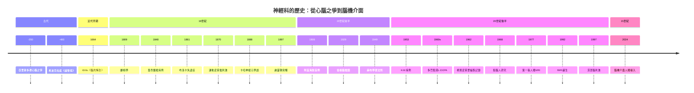

# 神經科的歷史

> 從「心 vs 腦」的兩千年之爭，到腦機介面把意念變成輸出——一本用「推理探案」體寫成的神經科學史。
> 姊妹書：[生理醫學史](../生理醫學史/)、[手術的歷史](../手術的歷史/)、[性病的歷史](../性病的歷史/)、[公共衛生的歷史](../公共衛生的歷史/)、[傳染病的歷史](../傳染病的歷史/)、[心理諮商的歷史](../心理諮商的歷史/)、[巫醫的歷史](../巫醫的歷史/)。

## 雙線主軸

本書的每一章都是一樁「案件」。兩條主軸交織推進：

| 主軸 | 演化鏈 | 核心問題 |
|---|---|---|
| **認知線** | 心 vs 腦 → 定位論 → 神經元 → 網路 | 意識、思想、記憶「住在」腦的哪裡？由什麼單位構成？ |
| **技術線** | 解剖刀 → 染色 → 電生理 → 影像 → 基因 | 我們用什麼工具「看到」腦？每次工具革命都翻一次案卷 |

規律：**每一次工具的升級，都會推翻一批用舊工具做出的「定論」**——顱相學被腦切除實驗推翻，網狀論被染色法推翻，屍檢定位論被活體影像改寫，而基因與連體學（connectomics）正在改寫我們剛剛寫下的答案。

## 歷史年表

### 第一篇：古代——心腦之爭的起點

| 年份 | 事件 | 意義 | wiki |
|---|---|---|---|
| 約 -7000 | 新石器時代開顱鑽孔術 | 人類最古老的神經外科，動機成謎 | [手術的歷史：新石器開顱](../手術的歷史/-7000-新石器開顱鑽孔術.md) |
| 約 -1600 | 艾德溫·史密斯紙草記載腦外傷 | 首次以臨床觀察連結腦與身體功能 | [手術的歷史：史密斯紙草](../手術的歷史/-1600-艾德溫史密斯紙草.md) |
| 約 -500 | Alcmaeon 主張腦是感覺與思維的中心 | 腦中心論首次提出 | [本書：心腦之爭](-0350-亞里斯多德心腦之爭.md) |
| 約 -400 | 希波克拉底學派《論聖病》 | 癲癇是腦病，不是神附身 | 同上 |
| 約 -350 | 亞里斯多德主張心是智慧座席、腦是散熱器 | 錯誤但影響千年的權威 | 同上 |
| 約 170 | 蓋倫以角鬥士解剖確立腦神經與腦室學說 | 醫學權威的腦功能理論 | [手術的歷史：蓋倫](../手術的歷史/0175-蓋倫角鬥士醫生.md) |

### 第二篇：近代早期——神經病學的誕生

| 年份 | 事件 | 意義 | wiki |
|---|---|---|---|
| 1664 | Willis《Cerebri anatome》出版 | 神經科學之父確立臨床—解剖方法 | [本書](1664-威利斯腦解剖.md) |
| 1791 | Galvani 蛙腿放電 | 電與神經的連結，電生理的起點 | [生理醫學史：Galvani](../生理醫學史/1791-Galvani蛙腿放電.md) |

### 第三篇：19 世紀——定位論的攻防

| 年份 | 事件 | 意義 | wiki |
|---|---|---|---|
| 1809 | Gall 與 Spurzheim 提出顱相學 | 功能分區的先驅＋偽科學包裝 | [本書](1809-加爾顱相學.md) |
| 1820s | Flourens 腦切除實驗 | 部分推翻顱相學，卻也阻礙定位論 | 同上 |
| 1848 | Phineas Gage 鐵棍貫穿前額葉 | 人格與額葉的第一個病例 | [本書](1848-蓋奇鐵棍病例.md) |
| 1861 | Broca 由「Tan」屍檢發現語言運動區 | 定位論的屍檢鐵證 | [本書](1861-布洛卡失語症.md) |
| 1870 | Fritsch 與 Hitzig 電刺激狗腦發現運動皮質 | 定位論從猜測變實驗 | [本書](1870-運動皮質電刺激.md) |
| 1873 | Golgi「黑色反應」染色法 | 讓個別神經元現形 | [本書：卡哈](1888-卡哈神經元學說.md) |
| 1874 | Wernicke 描述感覺性失語 | 語言網路的第二根柱子 | [本書：布洛卡](1861-布洛卡失語症.md) |
| 1888 | Cajal 確立神經元學說 | 腦由獨立細胞構成 | [本書](1888-卡哈神經元學說.md) |
| 1897 | Sherrington 命名 synapse | 從反射推斷微觀結構 | [本書](1897-謝靈頓突觸.md) |
| 1906 | Golgi 與 Cajal 共得諾貝爾獎、立場對立 | 網狀論 vs 神經元學說的世紀對決 | [生理醫學史：GolgiCajal](../生理醫學史/1906-GolgiCajal神經元學說.md) |
| 1906 | Alzheimer 報告 Auguste Deter 病例 | 失智症的病理首次現形 | [本書](1906-阿茲海默首例.md) |

### 第四篇：20 世紀前半——電與訊號

| 年份 | 事件 | 意義 | wiki |
|---|---|---|---|
| 1906 | Sherrington《神經系統整合作用》 | 反射弧與交互神經支配 | [本書：突觸](1897-謝靈頓突觸.md) |
| 1924–29 | Berger 首度記錄並發表人類腦電圖 | 從頭皮讀出腦的電流 | [本書](1929-伯格腦電圖.md) |
| 1932 | Sherrington 諾貝爾獎 | 抑制是主動過程 | [本書：突觸](1897-謝靈頓突觸.md) |
| 1949 | Hebb《行為的組織》 | 「一起放電的神經元連在一起」 | [本書](1949-赫布學習法則.md) |
| 1952 | Hodgkin 與 Huxley 動作電位模型 | 電訊號的離子機制被完整解出 | [生理醫學史：HodgkinHuxley](../生理醫學史/1952-HodgkinHuxley動作電位.md) |

### 第五篇：20 世紀中葉——記憶、化學與視覺

| 年份 | 事件 | 意義 | wiki |
|---|---|---|---|
| 1953 | H.M. 接受雙側海馬體切除，順行性失憶 | 多重記憶系統理論的起點 | [本書](1953-HM病例與記憶.md) |
| 1953 | Watson 與 Crick DNA 雙螺旋 | 分子時代的開端 | [生理醫學史：WatsonCrick](../生理醫學史/1953-WatsonCrick-DNA雙螺旋.md) |
| 1957 | Carlsson 證明多巴胺是神經遞質 | 化學神經解剖學的基石 | [本書：多巴胺](1960-多巴胺與帕金森.md) |
| 1958–62 | Hubel 與 Wiesel 記錄貓視覺皮質 | 方位選擇性與層級加工 | [本書](1962-休伯爾與維澤爾視覺皮質.md) |
| 1960s | Hornykiewicz 發現帕金森黑質多巴胺枯竭；L-DOPA 問世 | 神經科學的治療革命 | [本書](1960-多巴胺與帕金森.md) |
| 1960s | Sperry 與 Gazzaniga 研究裂腦人 | 左右半球分工與意識難題 | [本書](1968-斯佩里裂腦人.md) |
| 1973 | Bliss 與 Lømo 發現 LTP | Hebb 法則的實驗驗證 | [本書：赫布](1949-赫布學習法則.md) |

### 第六篇：20 世紀後半——活體看腦

| 年份 | 事件 | 意義 | wiki |
|---|---|---|---|
| 1971 | Hounsfield CT 問世 | 活體斷層影像的先聲 | [本書：MRI](1977-人類第一張MRI.md) |
| 1977 | Damadian 完成首張人體 MRI | 活體看腦取代屍檢推理 | [本書](1977-人類第一張MRI.md) |
| 1981 | Hubel、Wiesel 與 Sperry 共得諾貝爾獎 | 視覺與半球研究的加冕 | [本書：裂腦](1968-斯佩里裂腦人.md) |
| 1982 | MPTP 事件 | 毒品副產品造出人類帕金森模型 | [本書：多巴胺](1960-多巴胺與帕金森.md) |
| 1984–91 | Aβ 與 tau 的分子確認、類澱粉級聯假說 | 阿茲海默的分子偵查 | [本書：阿茲海默](1906-阿茲海默首例.md) |
| 1987 | Benabid 高頻刺激抑制震顫 | 深部腦刺激的起點 | [本書](1997-深部腦刺激.md) |
| 1990–92 | Ogawa、Kwong、Bandettini 等建立 BOLD fMRI | 「看腦思考」成為可能 | [本書](1992-fMRI誕生.md) |
| 1997 | FDA 核准 DBS 治療特發性震顫 | 外科的「藥物化」 | [本書](1997-深部腦刺激.md) |

### 第七篇：21 世紀——網路、基因與介面

| 年份 | 事件 | 意義 | wiki |
|---|---|---|---|
| 2003 | Lauterbur 與 Mansfield 獲諾貝爾獎 | MRI 的正式加冕 | [本書：MRI](1977-人類第一張MRI.md) |
| 2012–16 | BrainGate 讓癱瘓者以意念操作機械臂 | 侵入式 BCI 的里程碑 | [本書：BCI](2024-腦機介面人體植入.md) |
| 2013 | 美國 BRAIN Initiative、歐盟 Human Brain Project | 國家級腦科學計畫競賽 | 同上 |
| 2021 | aducanumab 爭議核可；智利 neurorights 立法 | 藥物與神經權利的雙面課題 | [本書：阿茲海默](1906-阿茲海默首例.md) |
| 2024 | Neuralink 首名人類受試者植入 | 腦機介面進入商業人體試驗時代 | [本書](2024-腦機介面人體植入.md) |

## Mermaid 時間軸

## 章節目錄

1. [-0350 - 亞里斯多德心腦之爭](-0350-亞里斯多德心腦之爭.md) —— 散熱器還是靈魂座席？
2. [1664 - 威利斯腦解剖](1664-威利斯腦解剖.md) —— 神經病學在牛津誕生
3. [1809 - 加爾顱相學](1809-加爾顱相學.md) —— 錯誤包裝裡的正確核心
4. [1848 - 蓋奇鐵棍病例](1848-蓋奇鐵棍病例.md) —— 鐵棍改寫的人格
5. [1861 - 布洛卡失語症](1861-布洛卡失語症.md) —— 「Tan」的腦說了實話
6. [1870 - 運動皮質電刺激](1870-運動皮質電刺激.md) —— 用電流審訊大腦
7. [1888 - 卡哈神經元學說](1888-卡哈神經元學說.md) —— 染色揭穿連續網狀的迷思
8. [1897 - 謝靈頓突觸](1897-謝靈頓突觸.md) —— 看不見的間隙被功能證明
9. [1906 - 阿茲海默首例](1906-阿茲海默首例.md) —— 染色找到的兇手，至今難以定罪
10. [1929 - 伯格腦電圖](1929-伯格腦電圖.md) —— 從頭皮讀出腦的私語
11. [1949 - 赫布學習法則](1949-赫布學習法則.md) —— 一起放電，連在一起
12. [1953 - H.M.病例與記憶](1953-HM病例與記憶.md) —— 失去記憶的人教會我們記憶的結構
13. [1960 - 多巴胺與帕金森](1960-多巴胺與帕金森.md) —— 一種化學物質的枯竭與補充
14. [1962 - 休伯爾與維澤爾視覺皮質](1962-休伯爾與維澤爾視覺皮質.md) —— 微電極聽見大腦自述
15. [1968 - 斯佩里裂腦人](1968-斯佩里裂腦人.md) —— 一顆頭顱，兩個意識？
16. [1977 - 人類第一張 MRI](1977-人類第一張MRI.md) —— 活體看腦的時代來臨
17. [1992 - fMRI 誕生](1992-fMRI誕生.md) —— 看見思考的血氧足跡
18. [1997 - 深部腦刺激](1997-深部腦刺激.md) —— 用電極代替手術刀
19. [2024 - 腦機介面人體植入](2024-腦機介面人體植入.md) —— 意念直接出廠
