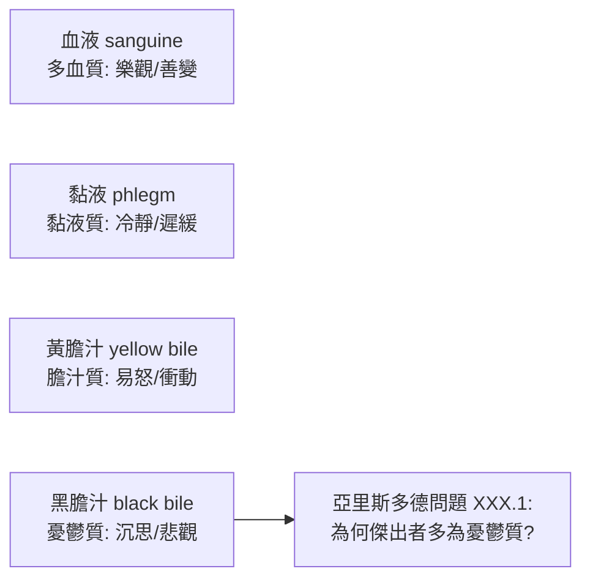

## -0400 - 希波克拉底與體液論的憂鬱症（黑膽汁：第一份「瘋狂」的自然化偵查報告）

## 案件摘要

**本案把「瘋狂」從神殿押送到醫學診間——兇手不是神，是身體裡的四種液體之一。**

約公元前 400 年，希波克拉底學派在科斯島提出：憂鬱（melancholia）源自**黑膽汁（melaina chole）**過多。這是一份革命性的偵查報告——在此之前，瘋癲屬於神聖領域（參見 `0760-庇加塔戈拉斯` 的降神傳統）；在此之後，精神疾病首次成為可以觀察、解釋、治療的**自然現象**。體液論統治精神醫學兩千餘年，直到 19 世紀才被推翻——但「憂鬱是一種病，不是一種罪」這一判決，是本案留下的永久判例。

## 前因 -- 為什麼會有這個案子

- **古希臘的瘋癲神學**。在希波克拉底之前，癲癇被稱為「神聖病」（sacred disease）；《荷馬史詩》中瘋狂是神罰（宙斯讓赫拉克勒斯發狂）。治療靠神殿睡眠療法（incubation）與淨化儀式。
- **《論神聖病》（On the Sacred Disease，約前 400）的挑戰**。這部匿名著作宣稱：「神聖病並不比其他病更神聖，它有自然的原因」——病因在大腦：大腦是意識與情感的王座，腦中黏液過多即致病。
- **恩培多克勒的四元素說**。土、水、氣、火四元素理論被醫學嫁接為四體液：血液（血性）、黏液（冷靜）、黃膽汁（易怒）、黑膽汁（憂鬱）。
- **臨床觀察的積累**。希波克拉底文集已記載產後精神錯亂、發燒譫妄、恐怖症（一名病人不敢靠近水溝）、酒精與躁症的關聯——素材已備，只缺一套解釋框架。

## 線索與推理 -- 數學式、程式、理論

**線索一：體液平衡模型。** 健康即四體液的比例混合（krasis）恰當；疾病即失衡（dyskrasia）。以現代符號寫成：

$$ \text{健康狀態} \iff \frac{\text{血}}{\text{黏液}} : \frac{\text{黃膽汁}}{\text{黑膽汁}} \approx \text{和諧比例} $$

憂鬱症的「偵查結論」：黑膽汁過量、停滯於脾臟或腦中，使病人「持續恐懼或沮喪」——《體液論》名言：「若恐懼或沮喪持續甚久，即是憂鬱之狀。」

**線索二：性格分類的誕生。** 體液論衍生出最早的氣質類型學：



亞里斯多德學派《問題集》第三十卷追問：為何哲學家、詩人、政治家多是憂鬱質？——「天才與瘋狂相鄰」的命題由此誕生，兩千年後的浪漫主義仍引用它。

**線索三：治療的邏輯。** 若黑膽汁過量，則治療即「排走多餘液體」：

```python
# 體液論治療邏輯的現代復原
def treat_melancholia(patient):
    plan = []
    if patient.black_bile > NORMAL:
        plan += ["放血或瀉劑(移除多餘黑膽汁)",
                 "飲食調節(避免黑膽汁性食物)",
                 "沐浴與按摩(促進液體循環)",
                 "談話與安慰(早期心理治療雛形)"]
    return plan
```

放血、瀉藥、催吐成為精神科治療的「基本功」，一路沿用至 19 世紀——這是一套自洽但無法證偽的體系：治好了是體液回歸平衡，治不好是失衡太深。

**線索四：蓋倫的系統化（2 世紀）。** 蓋倫把希波克拉底體液論與柏拉圖靈魂三分說（理性、意氣、欲望）縫合，提出腦室學說：精神由腦室中的「精神元氣（pneuma）」運作。這套理論成為中世紀伊斯蘭與歐洲醫學的標準教科書，統治 1500 年。

## 結案 -- 後果與影響

- **精神疾病自然化的第一槍**。瘋狂從神學問題變成醫學問題——「大腦是精神疾病的器官」這一判斷，直到現代神經科學仍站立。
- **兩千年的治療慣性**。放血、瀉藥、催吐、飲食療法以體液論之名延續到 19 世紀；阿維森納（11 世紀）仍在用它解釋相思病。
- **憂鬱的文學化**。從亞里斯多德的「憂鬱天才」到文藝復興 Ficino《論生命三書》（1489，學者憂鬱症）、Robert Burton《憂鬱的解剖》（1621），黑膽汁成為西方文化最深的一個隱喻。
- **未被推翻前的堅持**。體液論作為理論框架在 19 世紀細菌學與細胞病理學興起後崩解，但希波克拉底的**倫理姿態**——先觀察病人、再解釋病因——成為臨床醫學的原型。
- **一句話結案**：希波克拉底未必答對了「兇手是誰」（黑膽汁），但他答對了更根本的問題——**兇手住在身體裡，而不住在天上**；這是精神醫學史上最重要的一次偵查轉向。

## 關鍵人物與文獻

- **希波克拉底（Hippocrates, 約前 460–前 370）**——科斯島醫者；《希波克拉底文集》為學派集體著作，含《論神聖病》《體液論》《格言》。
- **恩培多克勒（Empedocles, 約前 494–前 434）**——四元素說提出者，體液論的哲學地基。
- **蓋倫（Galen, 129–約 216）**——帕加馬醫者；體液論的集大成者，其權威持續到文藝復興。
- 亞里斯多德學派，《問題集》XXX——「憂鬱質與天才」命題的最早文本。
- 原始文獻——*Hippocratic Corpus: On the Sacred Disease*（約前 400）；Galen, *On the Affected Parts*。
- 現代註腳——「melancholia」一詞沿用至今；DSM-5 仍保留 melancholic features（憂鬱特質）作為重度憂鬱症的標註——一個 2400 年前的臨床詞彙尚未退役。
