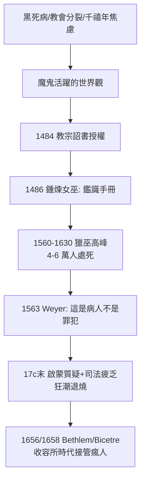

## 1484 - 《錘煉女巫》與精神疾病的魔鬼化（中世紀的最後一樁冤案：把病症當成罪證）

## 案件摘要

**本案是人類史上最大規模的「誤診」：數以萬計的精神症狀，被判讀為魔鬼附身的證據，並以火刑結案。**

1484 年 12 月，教宗英諾森八世頒布詔書 *Summis desiderantes affectibus*，授權多明我會修士 Institoris 與 Sprenger 獵捕女巫；1486 年二人出版《錘煉女巫》（*Malleus Maleficarum*），提供了一套「鑑識手冊」——如何訊問、如何用刑、如何定罪。在此後兩百年的獵巫狂潮中，幻聽、抽搐、木僵、多重人格樣行為、產後譫妄——今日我們會診斷為精神分裂症、癲癇、圖雷特症、譫妄的症狀——被系統性地解釋為與魔鬼締約。這是精神醫學史上的黑暗前置案件：**在「病人」概念恢復之前，先要有「瘋人不是罪犯」的平反**。

## 前因 -- 為什麼會有這個案子

- **中世紀的瘋癲光譜**。並非整個中世紀都魔鬼化瘋癲：修道院醫學延續蓋倫體液論，瘋人常由家庭或修道院收容；「愚人船」（Sebastian Brant, 1494）的諷刺文學顯示瘋癲被視為道德寓言而非罪惡。
- **宗教恐慌的燃料**。黑死病（1347–1351，歐洲人口三分之一死亡）、教會大分裂（1378–1417）、千禧年焦慮，使「魔鬼在世間活動」成為主流世界觀。
- **女巫刻板印象的形成**。15 世紀起，「女巫」從民間傳說中的智者/治療者，被教會法學重構為與魔鬼性交、吃嬰兒的墮落者——罪與性別的縫合。
- **司法技術的成熟**。宗教裁判所（1230s 起）發展出「訊問—刑求—共犯名單—再訊問」的擴散式辦案，獵巫只需套用模板。

## 線索與推理 -- 數學式、程式、理論

**線索一：鑑識手冊的「症狀學」。** 《錘煉女巫》列舉的女巫證據，今日讀來幾乎是一部反向精神症狀學教科書：

| 《錘煉女巫》的「罪證」 | 今日診斷視角 |
|---|---|
| 夜間飛行、與魔鬼交合的夢境敘述 | 睡癱、催眠幻覺、解離經驗 |
| 抽搐、無法開口、呆立（受審時沉默） | 木僵、癲癇、緊張型精神分裂症 |
| 承認自己能施法（自白） | 刑求下的虛假自白＋精神病性妄想 |
| 乳頭腫塊、胎記（「魔鬼的印記」） | 任何皮膚病變皆可入罪 |
| 月經失調、不孕、死產 | 被歸咎於女巫詛咒的婦女健康問題 |

**線索二：三重推理謬誤的偵查復原。**

```python
# 獵巫「邏輯」的演算法復原：一個無法證偽的系統
def witch_trial(accused, torture=True):
    if accused.confesses(torture):        # 招供 → 罪證確鑿
        return "處死"
    elif accused.does_not_confess(torture):
        return "魔鬼使她閉口堅忍 → 處死"   # 不招 → 更邪惡
    # 無論如何輸出皆為「處死」： p(罪) ≡ 1
    # 檢察權力使偽陰性率 = 0，代價是真陽性率失去意義
```

這是一個**不可證偽的封閉系統**：任何證據皆支持結論。波普爾意義上的「偽科學」原型，早已在宗教法庭上運轉了兩百年。

**線索三：症狀與惡魔附身的競爭解釋。** 當時並非無人提出醫學異議——醫生 Johann Weyer（1563，《論魔鬼的欺騙》）主張受審者多是患病婦女，應予治療而非刑求；Reginald Scot（1584）則從徹底懷疑論出發否定巫術。但 Weyer 被斥為「女巫的辯護人」，其書被列入禁書目錄——正確的偵查在錯誤的時代，只能被壓案。

**線索四：流行病學的收尾。** 1560–1630 年為獵巫高峰（主要在神聖羅馬帝國、瑞士、法國東部）；估計 15–18 世紀歐洲共執行 4 萬–6 萬件死刑，八成以上為女性。Salem 審判（1692）是殖民地的餘波——而即使在 Salem，也已有牧師因「幽靈證據」過於荒謬而公開反對，狂潮開始退燒。



## 結案 -- 後果與影響

- **平反的漫長路**。1793 年 Pinel 解鎖（見 `1793-皮內爾解開鎖鏈.md`）常被敘述為「把瘋人從牢籠中解放」——獵巫時代正是牢籠的來源之一；「瘋人是有病的人」此一判決，是對本案兩百年冤獄的遲到翻案。
- **醫學異議者的先驅地位**。Weyer 因此被後世精神醫學尊為「精神醫學之父」候選人之一——他證明：在集體恐慌中，敢說「這不是罪，是病」需要何等勇氣。
- **污名的性別結構**。獵巫受害者八成為女性，「女性身體與精神失控的關聯」這一偏見滲入此後的歇斯底里敘事（見 `1878-夏科與沙爾佩提耶的歇斯底里劇場.md`）。
- **現代迴響**。20 世紀的「 demon possession」復興、驅魔題材流行文化（*The Exorcist*, 1973），以及部分地區至今仍發生的驅魔致死案件，顯示這套解釋框架並未完全結案。
- **一句話結案**：獵巫時代最大的偵查失誤，是把症狀當成罪證——它反證了一條精神醫學的鐵律：**在解釋瘋狂之前，先確認瘋狂者是人**。

## 關鍵人物與文獻

- **Heinrich Kramer（Institoris, 約 1430–1505）**——《錘煉女巫》主要作者；因在 Innsbruck 被主教驅逐而記恨，轉向教宗請得詔書。
- **Johann Sprenger（約 1435–1495）**——署名共同作者（實際參與度有爭議）。
- **Johann Weyer（Wierus, 1515–1588）**——荷蘭醫生，Kleves 公爵御醫；1563 *De praestigiis daemonum* 主張受審者多為病者，被譽為精神醫學先驅。
- **Reginald Scot（約 1538–1599）**——英國懷疑論者，*The Discoverie of Witchcraft*（1584），連巫術本身都否定。
- 原始文獻——*Malleus Maleficarum*（1486）；*Summis desiderantes affectibus*（1484）。
- 現代註腳——1998 年起天主教會設有國際驅魔師協會；2014 年梵蒂岡正式承認驅魔人職務——本案的舊解釋框架，仍在地球某處低溫運轉。
