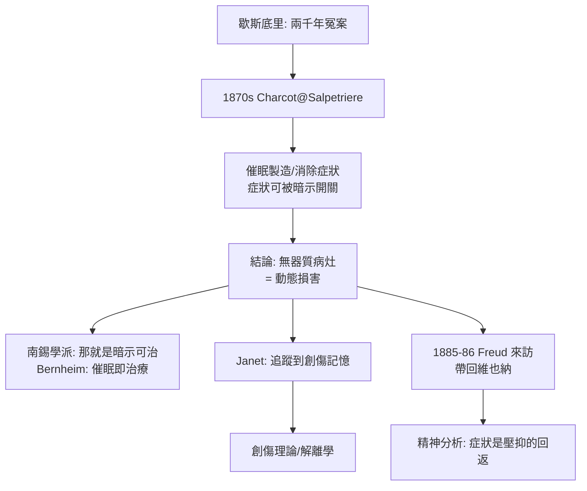

## 1878 - 夏科與沙爾佩提耶的歇斯底里劇場（催眠、大發作與「癥結在腦還是在心」的第一偵查）

## 案件摘要

**本案的偵探把歇斯底里病人推上講台，在滿堂醫生面前用催眠製造與消除症狀——他沒能抓到兇手，卻教出了抓到兇手的徒弟。**

1870 年代起，巴黎沙爾佩提耶醫院（Salpêtrière，收容逾 5000 名貧病女性）的神經科教授 Jean-Martin Charcot 展開對**歇斯底里（hysteria）**的系統研究：以攝影與繪圖記錄「大發作（grande hystérie）」的四階段，並用催眠在病人身上**人工製造**與**取消**癱瘓、失明、抽搐等症狀。1882 年他向科學院報告：催眠不是騙術，是可實驗的心理現象。本案是精神醫學史上第一次「症狀可以被暗示開關」的實驗展示——它催生了兩個後裔：法國的創傷性歇斯底里理論，與維也納的佛洛伊德精神分析（見 `1895-歇斯底里研究與精神分析誕生.md`）。

## 前因 -- 為什麼會有這個案子

- **歇斯底里的兩千年冤史**。自希波克拉底（hystera＝子宮，誤認為游走子宮作祟）以來，歇斯底里被當成女性專屬的「子宮病」；中世紀歸於魔鬼（見 `1484-獵巫手冊與精神疾病的魔鬼化.md`）。
- **沙爾佩提耶的病人海**。收容貧苦無依女性：癲癇、梅毒性癱瘓（見 `../性病的歷史/1913-野口英世解開麻痺性痴呆之謎.md`，GPI 與此同院）、老人病，以及大量症狀撲朔迷離的「假性癲癇」——歇斯底里與癲癇的鑑別是當時最棘手的鑑識問題。
- **催眠術的前科**。Mesmer 的「動物磁氣」（1770s）被王家委員會（1784，Franklin 主導）判為想像力效應，催眠從此帶著江湖騙術的案底；Braid 的催眠（1843）與 Liébeault、Bernheim 的南錫學派暗示說（1880s）逐步洗白。
- **神經病理學的黃金年代**。Charcot 以 ALS（運動神經元病）等臨床病理對照研究聞名；他的偵查方法：**病人活著時觀察症狀，死後解剖定位病灶**。但歇斯底里沒有病灶——這正是本案的難點。

## 線索與推理 -- 數學式、程式、理論

**線索一：實驗性的症狀開關。** Charcot 與其助手 Paul Richer 展示：在催眠下於受試者手臂畫一記號，即可造成麻醉區；用磁鐵「轉移」症狀位置；醒後以口令刪除症狀。以邏輯形式寫下他的推理：

$$ \text{若症狀可被暗示創造與刪除} \Rightarrow \text{症狀的因果鏈不含結構性病灶} $$

這排除了「子宮」與器質損傷兩種解釋——歇斯底里是一種**心理—神經動態疾病**，Charcot 稱之為「動態損害（lésion dynamique）」：功能層面真實存在，解剖刀找不到。

**線索二：遺傳退化的框架。** Charcot 的病因學填空仍是當代主流的「遺傳性退化（dégénérescence）」理論（Morel, 1857）：歇斯底里發生於神經體質脆弱者，創傷只是誘發。這一框架日後被精神分裂症（見 `1908-布洛伊勒命名精神分裂症.md`）與犯罪人類學大量濫用——退化論是 19 世紀精神醫學最龐大的一宗錯誤歸因。

**線索三：創傷的伏筆。** Charcot 的學生 Pierre Janet 對病人 Lucine 等人的研究發現：歇斯底里症狀常與**被遺忘的創傷記憶**相連，治療＝把記憶重新整合（「心理分析」一詞的最早使用之一）。Janet 的解離理論，是創傷記憶研究的直系祖先。

**線索四：劇場的雙面性。** 每週二晚間的「臨床講座（leçons du mardi）」座無虛席；病人 Blanche Wittman 以「歇斯底里大發作明星」聞名，被攝入經典照片（Charcot 手扶半昏厥的她）。後世史學質疑：病人的發作是否已被病房文化**訓練與表演**？——症狀本身可以是社會劇場的產物，這個疑問要等到羅森漢實驗（見 `1973-羅森漢實驗與診斷的極限.md`）才被系統化重演。

## 結案 -- 後果與影響

- **歇斯底里去性別化的起點**。Charcot 指出男性亦有歇斯底里（鐵路脊椎案例），動搖「子宮病因」兩千年敘事；「轉化症（conversion disorder）」一詞今日仍用於 DSM-5。
- **精神分析的直接誕生證據**。佛洛伊德 1885–86 留學 Charcot 門下，帶回「症狀有意義」的信念；1889 年又赴南錫學習催眠——夏科的講台是精神分析的實驗室前身。
- **心身醫學與創傷研究**。Janet 的解離理論、鐵路事故的「創傷性神經症」（Erichsen, Oppenheim）共同鋪路，遙遙通向 PTSD（1980 年 DSM-III 正式納入）。
- **催眠的學術平反**。催眠從江湖案底洗為科學議題；今日催眠在疼痛控制與治療性暗示中仍有正規位置。
- **一句話結案**：Charcot 證明了症狀可以被「話語」開關，卻把病因留白——留白處正是下一案（壓抑、潛意識、轉移）的案發現場。

## 關鍵人物與文獻

- **Jean-Martin Charcot（1825–1893）**——沙爾佩提耶神經科教授；ALS、Charcot 關節、Charcot 三徵皆以其命名。
- **Paul Richer（1849–1933）**——助手，*Études cliniques sur l'hystéro-épilepsie*（1881）附大量圖像紀錄。
- **Pierre Janet（1859–1947）**——哲學家轉精神科；*L'automatisme psychologique*（1889）；解離理論之父。
- **Hippolyte Bernheim（1840–1919）**——南錫學派，*De la suggestion*（1884）；「暗示」概念的正規化。
- **Blanche Wittman（1859–1913）**——「沙爾佩提耶的歇斯底里之王」；後於該院放射科任職，死於放射線傷害。
- 原始文獻——Charcot, *Leçons sur les maladies du système nerveux*（1885–87 英譯）；Georges Didi-Huberman, *Invention of Hysteria*（1982）對攝影檔案的再偵查。
- 現代註腳——功能神經症狀障礙（FND）研究近十年復興：fMRI 顯示病人運動控制網路確有異常——「無病灶」的結論被改判為「病灶在動態網路」，Charcot 的直覺獲得遲到一百年的物證。
