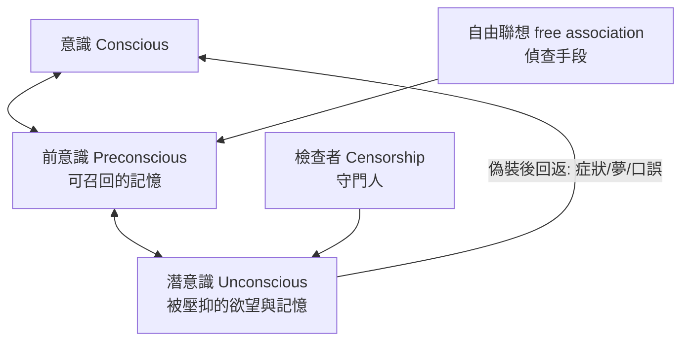

## 1895 - 《歇斯底里研究》與精神分析的誕生（布洛伊爾的 Anna O. 與「談話治療」的第一起破案）

## 案件摘要

**本案的偵探發現：治好病人的不是藥，是讓她說出「被忘記的故事」——症狀是沒有說出口的話，治療是把話還給它。**

1895 年，維也納醫生 Josef Breuer 與 Sigmund Freud 出版《歇斯底里研究》（*Studien über Hysterie*）。書中核心個案 Anna O.（真名 Bertha Pappenheim）在 1880–82 年間，於「談話治療（talking cure，她自己的命名）」中，將各症狀（癱瘓、失語、拒食、幻視）逐一追溯到「案發當時」的事件與情緒，說出後症狀消退——Breuer 稱之為「淨化（catharsis）」或「煙囪清掃」。Freud 從本案提煉出關鍵假設：**症狀背後有被壓抑的記憶與意義**——精神分析由此立案。

## 前因 -- 為什麼會有這個案子

- **Charcot 的遺產**（見 `1878-夏科與沙爾佩提耶的歇斯底里劇場.md`）：歇斯底里無器質病灶、症狀可被暗示開關；但病因仍是空白。
- **生理學家的轉行**。Freud（1856–1939）出身神經學：1884 年發表可卡因研究（失策成為其終身污點）、1885 年夏科門下進修、回維也納後以兒科腦癱研究維生——他的顯微鏡技術一流，卻被迫轉向「看不見的病灶」。
- **Anna O. 原始案件（1880–82）**。21 歲的 Bertha Pappenheim 在父親病重期間出現嚴重症狀群；Breuer 每日到診，她把每日「失蹤的時間」（白日夢狀態）在傍晚用講故事的方式復原，症狀竟隨敘事而消——她稱之為 chimney-sweeping。
- **歇斯底里的經濟學背景**。維也納中產階級女性被排除於教育與職業之外，症狀常被解讀為「閒出來的病」——後世史家（如 Elaine Showalter）追問：症狀是否也是對受困人生的無意識抗議？

## 線索與推理 -- 數學式、程式、理論

**線索一：症狀的時間指紋。** Anna O. 的症狀嚴格對應案發時間：某日她守護病榻時聽見隔壁孩子彈鋼琴（實際家中無琴），此後「聽覺過敏」每次都在特定情境復發。Breuer 的推理規則：

$$ \text{症狀} = f(\text{被遺忘的創傷場景}), \quad \text{敘事復原場景} \Rightarrow \text{症狀消退} $$

這是精神醫學史上第一份「症狀—記憶」對應表：症狀不是隨機噪音，是**加密的檔案**。

**線索二：從淨化到壓抑。** Freud 與 Breuer 在書中提出理論：當情緒未被正常宣洩（abreaction），能量轉化為症狀。但很快 Freud 發現病人總在講述中**繞開關鍵情節**——阻抗（resistance）的存在證明不是「忘記」，而是「不願記得」：**壓抑（Verdrängung）**假說誕生。意識地形圖隨之成形：



**線索三：偵查工具的發明。** 精神分析的技術包在 1890 年代–1900 年代成套定型：

```python
# 精神分析偵查流程（1895-1905 版）
def psychoanalysis(patient):
    patient.lie_on_couch(); detective.sits_behind()   # 移除視線壓力
    while patient.has_symptoms:
        for memory in patient.free_associate():       # 自由聯想
            if memory.hits_resistance():              # 阻抗點 = 熱區
                interpret(memory, "此處與被壓抑內容相鄰")
        transference = patient.projects(detective)    # 移情: 童年關係重演
        interpret(transference, "移情即證據, 也是戰場")
    return "症狀的意義被言語化 → 能量鬆綁"
```

**線索四：夢與症狀同源。** 《夢的解析》（1900）把夢定義為「通往潛意識的皇家大道」：夢是欲望的（偽裝）滿足，其加密機制（凝縮、轉移、象徵）與神經症狀同構——偵探意識到：症狀、夢、口誤、笑話是**同一套密碼系統**的四種輸出。

**線索五：本案的瑕疵與翻供。** 20 世紀檔案研究（Henri Ellenberger, 1972）發現：Anna O. 治療結束時並未痊癒，數月後仍住院（嗎啡與氯醛成癮，可能以「戒癮計畫」結束）；她日後成為德國猶太婦女運動的創級領袖——「治癒」敘事由 Freud 1892 年的轉述塑造。此外「壓抑創傷」在 1897 年被 Freud 自己部分改判為「幼兒性幻想」說——偵探在中途修改了案情。

## 結案 -- 後果與影響

- **「症狀有意義」成為深度心理學的第一公理**。無論壓抑理論本身後續如何被檢驗，精神症狀需要被「詮釋」而非僅被「鎮壓」，已永久改變精神醫學。
- **診間革命**。50 分鐘、躺椅、每週多次的治療框架統治 20 世紀前半的門診精神醫學；心理治療從此成為可授證、可訓練的專業。
- **文化的全面滲透**。潛意識、防衛機轉、移情、Freudian slip 進入文學（喬伊斯、湯瑪斯曼）、電影（希區考克）與日常語言——本案是醫學史上「偵查方法」外溢成世界觀的罕見案例。
- **批評與邊界**。記憶恢復運動（1980s–90s）濫用「壓抑創傷」造成冤案與家庭破裂，迫使美國心理學界釐清：創傷記憶與暗示性記憶的鑑識標準；性別學者批判歇斯底里敘事的父權框架；生物精神醫學 1980 年代後奪回主流（見 `1980-DSM-III與生物精神醫學的轉向.md`）。
- **一句話結案**：Anna O. 說「談話治療」時，實際上頒布了一條偵查原則——**先聽，再診**；這條原則日後屬於所有好的精神科醫生，不論他們信哪一派理論。

## 關鍵人物與文獻

- **Josef Breuer（1842–1925）**——維也納內科醫師，呼吸生理（Hering-Breuer 反射）研究者；與 Freud 決裂於 1896（理論分歧＋傳聞的移情糾紛）。
- **Sigmund Freud（1856–1939）**——精神分析創立者；《夢的解析》(1900)、《日常生活的精神病理學》(1901)、性學三論 (1905)；1938 年逃離納粹至倫敦，下顎癌中去世。
- **Bertha Pappenheim / Anna O.（1859–1936）**——後創辦猶太婦女聯盟（JFB），反人口販賣先驅；德國 500 馬克鈔票人物之一（1989–2002）。
- 原始文獻——Breuer & Freud, *Studien über Hysterie*（1895）；Freud, *The Interpretation of Dreams*（1900）。
- 現代註腳——創傷聚焦治療（如 PE、EMDR）以實證方式重演「敘事化創傷記憶」的原則；談話治療一百三十年後仍在診間運轉——本案的偵查技術，比它的理論更長壽。
