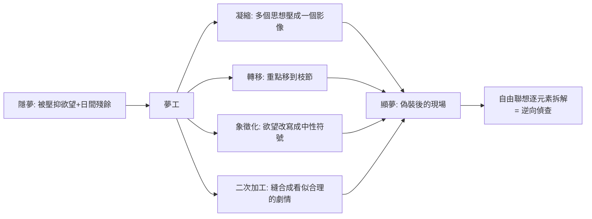

## 1900 - 《夢的解析》出版（解夢作為偵查技術：潛意識的密碼本首度公開）

## 案件摘要

**本案偵探宣稱：每個夢都是一起已被掩蓋的案件，而夢境內容是兇手偽裝後留下的現場——解夢，就是把偽裝層層剝開。**

1900 年 11 月 4 日，Freud 的《夢的解析》（*Die Traumdeutung*，版權頁印 1899）在維也納上市。首印 600 冊，八年才售罄，學界近乎沉默——卻成為 20 世紀影響最深遠的書之一。核心命題：**夢是通往潛意識的皇家大道**；夢是（被壓抑）欲望的偽裝滿足，其偽裝規則（凝縮、轉移、象徵化、二次加工）與神經症狀的加密機制同構。本案使「夢」從占卜對象轉為臨床證據，也把精神分析從歇斯底里專科擴張為普遍的心理學體系。

## 前因 -- 為什麼會有這個案子

- **解夢的兩千年前科**。從但以理解夢、《周公解夢》到 Artemidorus《解夢書》，夢長期屬於預言與神諭領域；醫學上僅有 Galen 偶爾以夢輔助診斷（夢見疾病部位）。
- **1895 年 7 月 23–24 日：Freud 自己的「夢標本」。** 他夢見為女病人 Irma 注射——自我分析揭示夢是他對同行責難與自我愧疚的**願望性平反**。此夢成為書中第 12 頁起的世紀級案例。
- **理論基礎已備**。《歇斯底里研究》（1895）確立壓抑與症狀意義；1897 年 Freud 開始系統性自我分析，每日記夢——偵探以自己為首批案卷。
- **科學與神祕學的夾縫**。19 世紀末實驗心理學（Wundt）不處理夢的意義；靈學家則過度解讀——Freud 搶占中間地帶：夢是**心理事實**，可用因果方法偵查。

## 線索與推理 -- 數學式、程式、理論

**線索一：夢的加密管線。** Freud 的模型：夢有兩層——**顯夢（manifest）**＝醒來記得的畫面；**隱夢（latent）**＝被壓抑的欲望內容。連結兩層的是「夢工（dream work）」：



**線索二：偵查的運算。** 解夢不是查符號字典，而是對顯夢的**每個元素**做自由聯想，串聯出聯想鏈：

```python
# Freud 夢的偵查流程
def decode_dream(manifest_dream):
    latent_thoughts = []
    for element in manifest_dream:
        chain = patient.free_associate(element)   # 元素→聯想鏈
        latent_thoughts += hot_nodes(chain)       # 阻抗/情感高溫處
    wish = infer_common_desire(latent_thoughts)   # 收斂出核心欲望
    return {"顯夢": manifest_dream,
            "隱夢": latent_thoughts,
            "判決": f"夢 = 對「{wish}」的(偽裝)願望滿足"}
```

**線索三：心理裝置的物理化。** 書末提出第一心理裝置圖（ψ 系統）：感知端 → 記憶系統 → 運動端，中間有「檢查者（censor）」篩選通路；睡眠時運動端斷路，能量以**倒退（regression）**方向回流成幻象——這是試圖把心靈畫成迴路圖的最早嘗試，形式上預示了日後的神經網路與「預測加工」想象（雖然內容物早已換血）。

**線索四：檢驗案例的普及策略。** Freud 大量使用日常小夢（口渴者的水夢、早晨憋尿的起床夢）證明「夢即願望滿足」；並以焦慮夢（檢查者失敗、偽裝不足）作為反例的內建解釋——理論的防禦工程嚴密，但也因此留下「不可證偽」的長期爭議（Popper 的著名批評）。

## 結案 -- 後果與影響

- **精神分析的體系化**。本書與《性學三論》（1905）構成理論雙柱；1902 年「週三心理學會」、1908 年 Salzburg 首屆大會、1910 年國際精神分析協會（IPA）成立——從一間診室長成國際運動。
- **人文學科的重力場**。超現實主義（Ernst 的繪畫、布紐爾《安達魯之犬》直接引用解夢）、文學批評、人類學（Freud 對 Totem 與 Taboo 的越界推論）皆以本書為重力源；羅夏墨跡（1921）與投射測驗是「偽裝心理可被解讀」的實作化後裔。
- **臨床的雙面遺產**。夢的報告成為動力取向治療的標準素材；但「解夢師權威」也造成過度詮釋的歷史傷害（病人被「告知」自己的潛意識內容）。
- **科學的再偵查**。現代睡眠科學（Aserinsky & Kleitman 1953 發現 REM 睡眠）把夢重置於生理學：REM 與夢境報告高度相關、夢亦有情緒調節與記憶鞏固功能——「夢有意義」獲部分平反，但「夢是偽裝的欲望」降級為文化史命題。
- **一句話結案**：Freud 的密碼本內容多半被淘汰，但他改寫了一條偵查公理——**人對自己說的話，必須經過鑑識才可信**；這條公理至今仍在心理學、司法心理與自我敘事的每個現場發揮效力。

## 關鍵人物與文獻

- **Sigmund Freud（1856–1939）**——本書傾注其 1897–1899 自我分析的成果；晚年稱《夢的解析》為其「畢生僅有一次的頓悟之作」。
- **Wilhelm Fliess（1858–1928）**——柏林耳鼻喉科醫師、Freud 的密友與筆友；《夢的解析》大量思想在其通信中孵化（「Irma 夢」亦與 Fliess 的鼻子—性器理論有關）；1900 年夏天兩人在 Achensee 「徹底解夢」的旅行成為精神分析史的傳奇片段，1904 年友誼決裂。
- **Josef Popper-Lynkeus、Nietzsche、Schopenhauer**——Freud 自承的先行者（意志與非理性心理的哲學基礎）。
- 原始文獻——Freud, *Die Traumdeutung*（1900）；*The Complete Letters of Sigmund Freud to Wilhelm Fliess 1887–1904*（1985 出版）。
- 現代註腳—— Hobson 的「啟動—合成」假說（1977）主張夢是腦幹隨機訊號被皮質強行敘事化的產物；與 Freud 的敘事偵查立場對立，但雙方共享一點：夢的劇情由心理機器生成，值得被讀懂。
