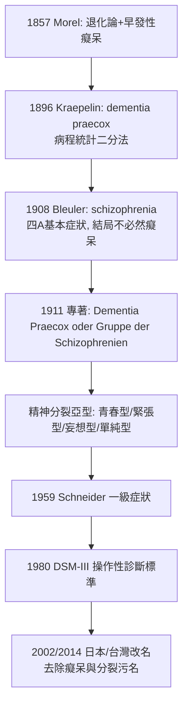

## 1908 - 布洛伊勒命名精神分裂症（拆解「早發性癡呆」：分裂的心，而不是碎的腦）

## 案件摘要

**本案推翻了一個錯誤的嫌疑人描述：病人不是「註定變成癡呆的早衰者」，而是心智在特定功能上「分裂」的人——一個詞的更換，改寫了百萬人的命運敘事。**

1896 年，Emil Kraepelin 在《精神醫學教科書》中把青春型癡呆、緊張症與妄想症合併為**早發性癡呆（dementia praecox）**：早發、慢性退化、結局是精神荒蕪。1908 年，蘇黎世 Burghölzli 醫院院長 Eugen Bleuler 在柏林演說中正式提出新名**精神分裂症（schizophrenia，希臘語「分裂的心智」）**，並於 1911 年出版專著：核心不是退化與癡呆，而是**心理功能的分裂**（思想、情感與行為失去一貫連結）與**基本症狀四 A**（聯想鬆散、自閉、矛盾、情感平淡）。本案是診斷命名學的經典偵查——名字即預後，預後即命運。

## 前因 -- 為什麼會有這個案子

- **Morel 的退化論（1857）**。「早發性癡呆（démence précoce）」一詞由法國醫生 Bénédict Morel 創用，服務於遺傳退化理論：病人家系一代比一代墮落（見 `1878-夏科與沙爾佩提耶的歇斯底里劇場.md`）。
- **Kraepelin 的臨床統計革命**。Kraepelin（1856–1926）在 Heidelberg 以 Zählkarten（計數卡片）長期追蹤數千病例，把混亂的「精神病」二分為：**早發性癡呆**（惡化）與**躁鬱病**（發作—緩解）——精神疾病的診斷從症狀表面轉向**病程與結局**，這是診斷偵查學的大躍進。
- **Bleuler 的臨床現場**。Bleuler（1857–1939）1900 年代執掌 Burghölzli（蘇黎世大學醫院，900 病床）；他的病房裡有大量「早發性癡呆」病人並未如教科書所說退化到底——其中不少可工作、有情感、恢復社交。
- **精神分析的同盟與緊張**。Bleuler 1904 年即在 Burghölzli 引入精神分析（Jung 為其同事），Freud 1907 年起與他密切通信；他相信妄想與幻聽**有意義、可詮釋**，與 Kraepelin 的器質悲觀論相左。

## 線索與推理 -- 數學式、程式、理論

**線索一：預後數據與命名的不符。** Bleuler 的推理鏈：

$$ \text{診斷名稱含「癡呆」} \Rightarrow \text{暗示必然退化} \quad \text{但臨床數據顯示: 相當比例緩解或不全恢復} $$

$$ \therefore \text{名稱錯誤，需更換核心概念} $$

他主張把「退化結局」從定義中刪除，改以**結構特徵**定義——診斷從「判死刑」改為「描述狀態」。

**線索二：基本症狀與附屬症狀的層級。** Bleuler 區分：

```python
# Bleuler 1911 症狀分層
def diagnose_schizophrenia(patient):
    fundamental = ["聯想鬆散(AS)"      # 思維的連結斷裂
                  ,"自閉症樣退縮(Aut)" # 內向的邏輯世界
                  ,"矛盾情緒(Amb)"     # 同時愛恨同一對象
                  ,"情感平淡(Aff)"]    # 情感反應的鈍化
    accessory = ["幻聽","妄想","緊張症狀"]  # 重要但非特異
    # 判決規則: 四A(尤其聯想鬆散)為核心; 幻聽妄想可在其他病出現
    return "精神分裂症" if count(fundamental, patient) >= 3 else "再偵查"
```

注意：附屬症狀（幻聽、妄想）反而成為日後 DSM 操作性定義的主軸（易於量化），基本症狀則被邊緣化——這是診斷學史上「可測量者取代核心者」的著名案例。

**線索三：自閉（autism）一詞的誕生。** Bleuler 創造「autism」描述病人退入內在世界的傾向——此詞日後被 Kanner（1943）與 Asperger（1944）挪用於兒童疾患，成為另一個診斷家族的名稱；一個偵探的新詞，分裂成兩個案卷系統。

**線索四：精神的「分裂」被誤讀。** Bleuler 明言 schizo 指心理功能的**離解（spaltung）**，不是人格分裂；但大眾文化長期把 schizophrenia 與多重人格混同（《化身博士》效應）——命名者的原意與詞的社會生命脫鉤，污名反而借新名重生：2002 年日本改名「統合失調症」、2014 年台灣改名「思覺失調症」，正是對本案命名後果的百年補救。



**線索五：神經發育假說的遠程伏筆。** Bleuler 指出病前人格常有「分裂樣」底色、症狀多在青春期後發作——這些觀察在百年後被重組為**神經發育假說**：精神分裂症源自腦發育早期（含圍產期）的微妙偏差，青春期突觸修剪（pruning）放大為臨床發作（Weinberger, 1987; Murray, 1988）。遺傳度約 80%（雙生子研究），但同卵雙生一致率僅約 50%——基因裝上子彈，環境扣扳機。

## 結案 -- 後果與影響

- **精神醫學的兩大譜系確立**。Kraepelin 的診斷框架（描述性、病程為本）＋Bleuler 的意義詮釋取向，構成此後百年的張力；DSM 站在 Kraepelin 一側，精神動力學傳統承襲 Bleuler 一側。
- **預後敘事的解放與傷害**。去掉「必然癡呆」是解放；但「分裂的心」在 20 世紀被媒體與犯罪報導嚴重污名化——「有精神分裂症＝危險」的統計誤導（絕大多數病人無暴力）至今仍需反覆澄清。
- **病因偵查的接力**。退化論（錯）→ 精神分裂性母親（Fromm-Reichmann 的家庭成因說，錯並傷人）→ 多巴胺假說（見 `1952-氯丙嗪與多巴胺假說的誕生.md`）→ 神經發育＋基因組學（如 DISC1、GRIN2A、C4 補體基因與突觸修剪，2016）——本案的「兇手畫像」至今仍在逐版修訂。
- **治療的世紀進度條**。胰島素昏迷、電痙攣（見 `1938-電痙攣治療的誕生.md`）、額葉切除的悲劇（見 `1935-額葉切除術的悲劇.md`）、氯丙嗪（1952）、氯氮平（1989）、長效針劑與社區照護——精神分裂症從「收容終身」變成多數可社區生活；認知症狀與陰性症狀仍是未破的尾案。
- **一句話結案**：Bleuler 教會診斷學一件大事——**名字承載預後，預後承載命運**；改一個詞，比改一顆藥，有時救得更多。

## 關鍵人物與文獻

- **Eugen Bleuler（1857–1939）**——Burghölzli 院長（1898–1927）；學生包括 Jung、Rorschach、Erich Fromm；女兒 Manfred Bleuler 續掌該院研究。
- **Emil Kraepelin（1856–1926）**——《精神醫學教科書》八版（1883–1915）；1920 年代起對阿茲海默（Alois Alzheimer 為其同事）研究亦有奠基之功。
- **Kurt Schneider（1887–1967）**——1959 年提出「一級症狀」（思想被插入/被廣播、爭論性幻聽等），成為 DSM-III 精神分裂症標準的骨架。
- 原始文獻——Bleuler, *Dementia Praecox oder Gruppe der Schizophrenien*（1911）；Kraepelin, *Psychiatrie*, 5. Aufl.（1896）。
- 現代註腳——DSM-5（2013）刪除亞型（青春型/緊張型等），改以症狀維度評分——Bleuler 的「光譜」直覺在百年後重返主流；ICD-11 亦引入精神病症狀維度。
