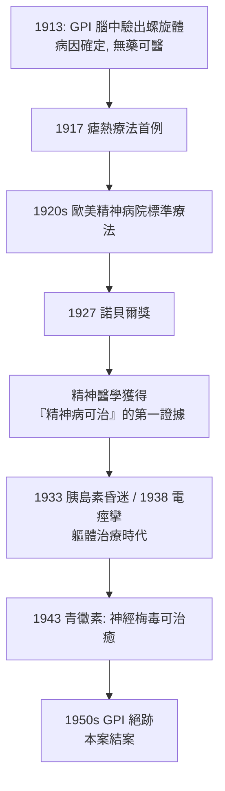

## 1917 - 瘧熱療法治癒瘋狂（GPI 的以毒攻毒：第一個「能治好精神病」的證據）

## 案件摘要

**本案偵探故意讓病人染上瘧疾——用一場可控的高燒，燒死藏在腦裡、讓人發瘋的梅毒螺旋體；精神病學第一次證明：瘋狂可以被治好。**

1917 年 6 月，維也納神經精神科教授 Julius Wagner-Jauregg 對麻痺性痴呆（GPI，見 `../性病的歷史/1913-野口英世解開麻痺性痴呆之謎.md` 的病學史）病人注射間日瘧患者的血液，引發週期性高燒（$ 39\text{–}41°C $，維持數個發作週期），再以奎寧治癒瘧疾。首批病人中出現明確緩解，1920 年代成為歐美精神病院標準療法，1927 年獲諾貝爾生理學或醫學獎——這是精神疾病**首次擁有有效的生物學治療**。1943 年青黴素上場後，發燒療法光榮退役；本案在精神醫學史上的意義是破除宿命論：「瘋人院裡沒有希望」這一判決被正式推翻。

## 前因 -- 為什麼會有這個案子

- **GPI 佔領精神病院**。19 世紀末，GPI 佔歐洲男性精神病房住院者的 5–10%，發病後 2–5 年死亡，無藥可醫；而 1905 年螺旋體已被發現、1913 年野口英世已在其腦中驗出病原——**病因明確，卻無武器**（Salvarsan 難過血腦屏障）。
- **發燒治病的古老直覺**。古希臘醫生已觀察瘧疾發燒使癲癇緩解；Hippocrates 文集有相關記載；1813 年起有醫生以瘧疾發燒治精神病——直覺存在了一個世紀，缺的是可重複的協議。
- **Wagner-Jauregg 的三十年堅持**。他 1887 年即發表「以瘧疾發燒治 GPI」的構想；1890 年代先試用結核菌素（失敗）；1917 年因一戰戰俘帶來間日瘧原蟲而重啟方案。
- **倫理邊界的先鋒爭議**。故意感染病人（可致死）在當時已引發辯論；Wagner-Jauregg 的辯護：GPI 死亡率 100%，瘧疾死亡率（未治癒時）遠低——風險效益比成立。

## 線索與推理 -- 數學式、程式、理論

**線索一：熱力學偵查。** 螺旋體不耐熱（$ >38\text{–}39°C $ 即受損），GPI 病人的自然發燒能力又不穩定；治療協議本質上是一個「退火演算法」：

$$ T(t) \geq T_{\text{lethal}}(\text{spirochete}) \quad \text{持續} \; n \; \text{次發作}, \quad T_{\text{safe}}(\text{病人}) \; \text{不超限} $$

```python
# 1917 瘧熱療法協議復原
def malaria_therapy(patient):
    inject(patient.blood_from, "間日瘧病人")     # 接種 ~0.5-1 mL 感染血
    wait(patient, "潛伏期 ~10-14 天")
    for cycle in range(6, 12):                  # 6-12 次發作
        while patient.temp >= 39: monitor(patient)
    quinine(patient)                            # 奎寧終止瘧疾
    return {"GPI緩解率": "約 1/3 顯著改善(癱瘓停步、妄想消退)"}
```

**線索二：為何「治好瘋狂」是核爆級證據。** 當時精神病院的主導理論（退化、體質、道德缺陷）皆暗示**不可逆**。GPI 被發燒逆轉，等於用臨床事實駁倒宿命論：精神症狀的背後是**可干預的生理過程**。這為後續所有軀體治療（胰島素昏迷、電痙攣、額葉切除——見 1933/1938/1935 各案）提供了合法性模板：**既然瘋狂可被物理手段逆轉，就值得再試下一種物理手段**——本案既是里程碑，也是後續悲劇的授權書。

**線索三：戰爭神經症的陰暗側錄。** 同一時期，Wagner-Jauregg 在一戰期間對「戰爭歇斯底里」（砲彈震盪、失明、癱瘓）的士兵施行強電流「提醒療法」，配以嚴厲訓示——1920 年代他被控虐待，1924 年委員會調查結案無罪（Freud 出庭作證說明歇斯底里的心理機制）——偵探的另一份案卷，暴露「治療」與「強制」的邊界何等脆弱。

**線索四：流行病學的收官。** 青黴素（1943 Mahoney 治梅毒，見性病史 `1943-青黴素治癒梅毒`）＋梅毒血清篩檢＋戰後產前篩檢，使 GPI 病例在 1950 年代近乎消失——「精神病院頭號絕症」被傳染病學整個拔除；今日精神科病房裡已難見一例。



## 結案 -- 後果與影響

- **精神醫學的自信回歸**。諾貝爾獎給了精神科第一尊科學獎盃；「器質性精神醫學」與生物精神醫學的路線自此有戰績背書，與精神分析的詮釋路線分庭抗禮。
- **發燒療法家族**。傷寒疫苗發燒療法（1919 起用於 GPI 與「舞蹈症」）隨之流行；「以可控生理應激治精神症」的思路延伸至睡眠剝奪療法（1970s 對憂鬱，現代仍用於產後憂鬱）——本案的方法學直系仍在運轉。
- **倫理制度的先聲**。故意感染的同意程序、瘧原蟲蟲株庫（美國州立精神病院曾設「瘧疾治療中心」，並為梅毒治療提供瘧原蟲直至 1960s），成為 20 世紀後半人體試驗倫理（紐倫堡守則 1947、赫爾辛基宣言 1964）的臨床前例。
- **一句話結案**：本案的偵查秘密極其樸素——**先弄清兇手（螺旋體），再找兇手的弱點（怕熱）**；精神醫學史上第一次，「瘋」是果，「病」是因，而因可以被消滅。

## 關鍵人物與文獻

- **Julius Wagner-Jauregg（1857–1940）**——維也納大學神經精神科教授；1927 諾貝爾獎；納粹時期曾入黨（1940），其政治史在 2010 年代被重審，維也納以 Döbling 醫院命名爭議為縮影。
- **野口英世**（前案偵探）——1913 年的病原定位使本案的「兇手弱點」偵查成為可能。
- **Cornelia B. Lange**、各國瘧疾治療中心醫師群——1920s–40s 數以千計 GPI 病人的執行者。
- 原始文獻——Wagner von Jauregg, *Über die Einwirkung der Malaria auf die progressive Paralyse*（1918）；1927 Nobel Lecture。
- 現代註腳——「熱療」概念在腫瘤學復活（全身熱療＋化療）；而神經梅毒在 HIV 世代小幅回升（見性病史 1981 之後），青黴素 G 靜脈 14 日仍為標準——本案的臨床尾聲尚未完全翻頁。
