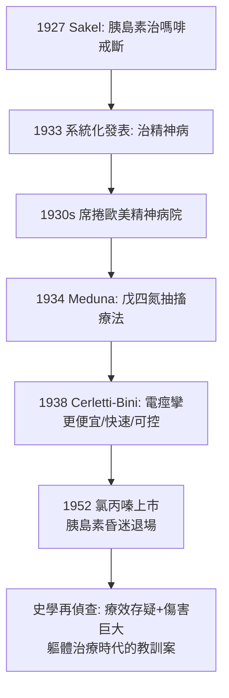

## 1933 - 胰島素昏迷治療（Sakel 的休克偵查：用低血糖「重開機」瘋狂的大腦）

## 案件摘要

**本案偵探把胰島素當成重開機鍵：讓病人反覆墜入低血糖昏迷，據稱癮君子戒了鴉片、瘋人恢復了清明——精神病學的「軀體治療時代」由本案正式開幕。**

1933 年，維也納神經科醫生 Manfred Sakel 在 Lichterfelde 療養院系統化發表**胰島素休克治療**：每日給精神病（尤其精神分裂症）病人注射漸增劑量的胰島素，誘發低血糖昏迷（$ \text{血糖} < 40 \text{ mg/dL} $），維持約 30–60 分鐘後以鼻胃管葡萄糖喚醒；每療程 30–60 次昏迷。Sakel 宣稱約 70% 病人改善、早期病例效果尤佳。本案席捲全球精神病院二十年，直到氯丙嗪（1952）問世才退場——它治好的與它傷害的，共同改寫了精神醫學對「治療」的定義。

## 前因 -- 為什麼會有這個案子

- **偶然的起點**。Sakel 1927 年起在柏林為**嗎啡成癮**者做胰島素低血糖治療（減緩戒斷痛苦），意外發現合併精神症狀者清醒後「頭腦變清晰」——從戒斷輔助到精神病治療，是一條臨床偶然鏈。
- **GPI 瘧熱療法的示範效應**（見 `1917-瘧熱療法治癒瘋狂.md`）：精神病症狀可被軀體手段逆轉——「休克／強刺激可重置大腦」成為時代假說。
- **Meduna 的平行案件**。匈牙利 Ladislas Meduna 1934 年提出癲癇與精神分裂互斥的（錯誤的）流行病學觀察，發明戊四氮（cardiazol）藥物抽搐治療——「抽搐治精神病」的另一條路線，直通 1938 年電痙攣（見 `1938-電痙攣治療的誕生.md`）。
- **精神病院的絕望土壤**。早發性癡呆（當時概念）被視為絕症，任何「新武器」都獲得急迫的掌聲；對照組與安慰劑方法論尚未成為臨床規範。

## 線索與推理 -- 數學式、程式、理論

**線索一：Sakel 的理論。** 他假設毒血症（toxohormone）由腦細胞分泌致幻，低血糖**麻痺並重整**這些細胞，使其「重新接線」：

$$ \text{昏迷深度（分期）} \uparrow \;\Rightarrow\; \text{皮質功能暫停} \;\Rightarrow\; \text{病理性連結中斷、功能重整} $$

昏迷分級（嗜睡 → 木僵 → 昏迷）被精細監控——這是當時少見的「劑量—反應」意識，也是其致命風險所在：分級失誤即腦損傷。

**線索二：療效的真偽鑑定。** 後世再偵查指出多項混淆變項：

```python
# 胰島素昏迷「療效」的成分分解（後見之明）
def dissect_apparent_efficacy(cohort_1930s):
    return {
        "急性/初期病例占比高": "最易自發緩解的族群被優先收治",
        "高度照護與關注": "每日數小時一對一監護 = 加強版 moral treatment",
        "期望效應+選擇性報告": "失敗與死亡案例未系統發表",
        "真實效應": "部分緊張症/急性精神病可能確有改善, 機制至今不明",
    }
```

無對照試驗年代（RCT 標準要到 1948 年鏈黴素試驗才確立），本案的證據等級無法與今日比擬——但 1940 年代的對照研究（如 Ackner 的機器模擬深度鎮靜對照）已顯示效果可疑。

**線索三：風險的帳本。** 每一療程的風險是結構性的：延長昏迷不可逆腦損傷、癲癇持續狀態、肺水腫、猝死；文獻估計治療相關死亡率約 0.5–1% 至 1.8%（各院差異大），並有長期記憶損害報告。1930s–50s 全球數以萬計病人（美國 1940s 一度是精神病院最普及的「重療法」），意味著總傷亡規模龐大——**以重開機之名，行高風險關機之實**。



**線索四：為何仍被視為轉折點。** 本案（與同期的抽搐治療）證明精神科可以**有治療可賣、有病房可規劃、有療程可計價**——專業地位大增；但「療效證據弱＋風險高」的組合，也種下 1960s 反精神醫學運動（見 `1961-反精神醫學運動的證詞.md`）的批判彈藥。

## 結案 -- 後果與影響

- **軀體治療時代的開幕與閉幕**。本案與電痙攣、腦白質切除（見 `1935-額葉切除術的悲劇.md`）並列 1930s「三大軀體療法」；三者的共同教訓——**在機制不明時大規模施行的強力干預，遲早要用倫理與流行病學來還債**。
- **電痙攣的基因**。胰島素昏迷的昏迷概念＋Meduna 的抽搐概念，經 Cerletti 與 Bini 合併成電痙攣——比胰島素昏迷便宜、快、死亡率低，1950s 後取代之；ECT 至今仍以改良形式（肌肉鬆弛劑＋麻醉＋單側/超短脈衝）用於重度憂鬱與緊張症，是本案的直系存續。
- **臨床試驗方法的催產**。本案「大家說有效」的十年，成為戰後臨床流行病學的反面教材；1962 年美國 Kefauver 修正案要求藥效證明，精神藥理學率先進入對照試驗紀元。
- **一句話結案**：胰島素昏迷案的偵查教訓比其療效更有價值——**「戲劇性的好轉」需要先問：好轉的是病，還是照護、是緩解機率、還是敘事**；這一問，成為今日實證精神醫學的入門第一課。

## 關鍵人物與文獻

- **Manfred Sakel（1900–1957）**——維也納出生、柏林執業；1936 年移居美國（紐約 Bellevue）；1938 年赴哈佛講學途中定居美國，戰後主張其療法仍優於藥物。
- **Ladislas J. Meduna（1896–1964）**——神經解剖學家轉精神科；1935 年首例戊四氮抽搐；後移居美國，1950 年獲 Lasker 獎（在癲癇病理與抽搐療法的貢獻）。
- **Ackner 與英國研究群**——1957 年前後的對照研究（深度胰島素鎮靜 vs 模擬）動搖本案療效，加速退場。
- 原始文獻——Sakel, *Neue Behandlungsmethode der Schizophrenie*（1935）；Meduna, *Die Konvulsionstherapie der Schizophrenie*（1937）。
- 現代註腳——低血糖的腦代謝研究意外造福神經影像（PET 上昏迷病人皮質代謝圖）；而「重開機」隱喻在 2000s 以 ketamine（NMDA 拮抗，2000 年起對難治型憂鬱的快速起效）身上重演——快速戲劇性改善，依舊伴隨「機制不明」的熟悉氣味。
