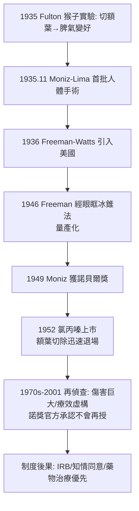

## 1935 - 額葉切除術的悲劇（Moniz 的手術刀與 Freeman 的冰錐：一場被諾貝爾獎蓋章的醫療災難）

## 案件摘要

**本案的偵探沒有找到兇手，就宣判切除大腦部分組織可以「治好」精神病——十三年後，這把刀切過全球數萬人的額葉，1949 年還獲頒諾貝爾獎；這是精神醫學史上最沉重的錯案。**

1935 年 11 月，葡萄牙神經學家 António Egas Moniz 與神經外科醫師 Almeida Lima 完成首批**額葉前部切開術（leucotomy）**：切斷額葉與丘腦之間的白質連結，宣稱可使躁動與妄想病人「平靜」。1936 年起，美國神經科醫生 Walter Freeman 與外科醫師 James Watts 推廣之，1946 年 Freeman 發明十秒鐘、不需手術室的**經眼眶冰錐切除術（transorbital lobotomy）**。至 1950 年代，全球（美國約 4 萬、英國約 1 萬、北歐數千）病人被切除額葉；1952 年氯丙嗪問世（見 `1952-氯丙嗪與多巴胺假說的誕生.md`）後迅速退場，但諾貝爾獎從未收回。

## 前因 -- 為什麼會有這個案子

- **兩隻脾氣變好的猴子**。1935 年倫敦第二屆神經學大會上，John Fulton 與 Carlyle Jacobsen 報告：切除黑猩猩額前葉後，原為挫折狂怒的猴子 Becky「變得平靜，似乎不介意做錯事」。Moniz 當場提問：能否用於人？
- **精神病院的黑暗土壤**。1930s 美國精神病院人滿為患、無藥可用、電痙攣尚未成熟；「治好少數 vs 平靜多數」的制度壓力，使「讓病人不吵」被視為進步。
- **Moniz 的理論包裝**。他主張強迫觀念與妄想是「固定於額葉的病理性迴路」，切斷白質即可「釋放」病人；他甚至提出額葉白質是「較晚分化、與病態相連」的組織——以當代神經學術語為手術背書。
- **Moniz 的個人傳奇與盲點**。頸動脈造影（1927）發明者、被病人槍擊致半癱（1939）、諾獎得主（1949）——聲望本身成為本案的護甲：批評者要對抗的是一整座獎項。

## 線索與推理 -- 數學式、程式、理論

**線索一：手術的粗糙與評估的缺失。** 首批 20 例（1935–36）：7 例改善、7 例不變、6 例「退化」——Moniz 卻以「改善了躁動」總結為成功。評估缺少：術前術後標準化評分、對照組、長期隨訪；「病人安靜了」與「病人好轉了」被混為一談。

**線索二：Freeman 的量產流水線。** 1946 年 Freeman 的經眼眶法：以碳錐（orboclast）從眼窩上緣敲入，擺動切斷白質——

```python
# Freeman 式「門診手術」流程（史實復原, 僅供警世）
def transorbital_lobotomy(patient):
    patient.shock_stimulus()           # 電擊致短暫抽搐/失去知覺
    hammer_orboclast(above_eye, 24)    # 敲入眼眶上方
    sweep_blade()                      # 擺動切斷額葉白質
    return "耗時 <10 分鐘, 無需開顱, Freeman 自行巡迴各院操作"
```

Freeman 駕車巡迴各州精神病院，一日可做十餘例；Watts 因不滿其越權（非外科醫師執刀）與他拆夥——手術已脫離外科監管，成為精神病院內的日常作業。

**線索三：真正的結局（長期隨訪）。** 戰後再偵查（尤其 1970s–90s 英國 cohort 隨訪）給出清單：人格改變（情感鈍化、抑制力喪失、計畫能力受損）、癲癇（約 5–15%）、死亡（早期系列約 3–6%，含腦出血）；對精神分裂症的核心症狀（幻聽、妄想）基本**無效**——被「治好」的其實是病房的麻煩，不是病人的病。著名的受害者之一 Rosemary Kennedy（美國總統之妹，1941 年 23 歲受術，術後失語需終身照護）成為本案最有力的社會證據。

**線索四：為何諾獎會給錯。** 1949 年諾貝爾委員會表彰 Moniz「額葉白質切除對某些精神病的治療價值」——彼時抗精神病藥尚未上市、隨訪證據仍稀、且評審未曾實地考察。2001 年諾獎官方文件承認此案「今日不會被授予」；1997 年學界曾發起撤獎聯署未果——**權威機構的授印，不能替代證據的偵查**。



## 結案 -- 後果與影響

- **精神外科的殘存與限縮**。改良式立體定向手術（如 1960s 的 capsulotomy）僅餘極少數難治型強迫症案例，且須倫理委員會逐案審查——本案把「手刀治精神病」永久鎖進高欄。
- **知情同意與研究倫理的制度化**。本案與塔斯基吉（見性病史 `1932-塔斯基吉梅毒實驗`）、GPI 瘧熱療法並列，推動戰後 IRB 制度、知情同意文件、以及「新療法須先有臨床試驗」的規範——精神醫學從本案學會：**病人是最脆弱的受試者，其同意需要最嚴格的保護程序**。
- **藥物革命的道德動能**。氯丙嗪 1952 年的橫空出世，部分動力來自「終於不必再動刀」的集體如釋重負；精神藥理學由此奪得主流。
- **文化的創傷記憶**。《飛越瘋人院》（1975，McMurphy 被切除額葉）把本案刻進大眾記憶，成為反精神醫學運動（見 `1961-反精神醫學運動的證詞.md`）最有力的敘事武器之一。
- **一句話結案**：額葉切除案的偵查失誤在於**用行為管理替代了病因偵查**——「他不再吵了」被記成「他痊癒了」；精神醫學史上每一個「症狀消失＝治癒」的快判，都該重讀本案卷宗。

## 關鍵人物與文獻

- **António Caetano Egas Moniz（1874–1955）**——神經學家、政治家（曾率葡萄牙代表團參加巴黎和會）；1939 年被不滿病人開槍致半身不遂，仍繼續研究；1955 年去世，諾獎未撤。
- **Walter Freeman II（1895–1972）**——美國首位受訓神經外科的精神科醫師；巡迴式 lobotomy 推廣者；退休後仍開車全國追訪舊病人。
- **James W. Watts（1904–1994）**——合作神經外科醫師，堅持正規手術室，1947 與 Freeman 分道。
- **John Fulton（1899–1960）**——耶魯神經生理學家；猴子實驗無意間成為本案「上游證據」。
- 原始文獻——Moniz, *Essai d'un traitement chirurgical de certaines psychoses*（1936）；Freeman & Watts, *Psychosurgery*（1942）。
- 現代註腳——深腦刺激（DBS）於 2000s 對難治型憂鬱/強迫症的探索，被媒體稱為「新 lobotomy」——本案陰影使每項精神科介入神經手術都需自證與本案不同；這是錯案留下的永久路障，也是永久護欄。
