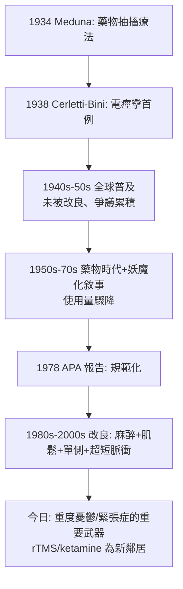

## 1938 - 電痙攣治療的誕生（Cerletti 的電擊：在羅馬屠宰場獲得靈感的「重置開關」）

## 案件摘要

**本案偵探在羅馬屠宰場看見以電擊致昏的豬，決定把電流引進精神病院——八十年後，這個方式經過麻醉改造，仍是重度憂鬱最有效的治療之一；它同時也是被文學與恐懼妖魔化最深的一種。**

1938 年 4 月，羅馬大學神經精神病學教授 Ugo Cerletti 與 Lucio Bini 首次以交流電誘發**抽搐**治療精神病人：首位病人（被稱為 EN.C.，39 歲米蘭工程師，急性精神病症狀）經 11 次治療後明顯改善出院。電痙攣治療（ECT）取代更危險的胰島素昏迷（見 `1933-胰島素昏迷治療.md`），席捲全球；1950s 藥物時代後一度沒落，1980s 起以改良技術（麻醉＋肌鬆＋精確參數）重返實證地位——本案是「治療被發明時粗暴、被改良後有效、被敘事永久定影」的罕見三段式案件。

## 前因 -- 為什麼會有這個案子

- **Meduna 的抽搐假說**。1934 年 Meduna 以戊四氮（cardiazol）誘發抽搐治精神分裂症，立論於（錯誤的）「癲癇與精神分裂互斥」觀察——但治療在緊張症與憂鬱狀態確有反應，抽搐療法成為新戰場。
- **戊四氮的恐怖**。藥物誘發抽搐前有數十秒「預兆性恐懼」，病人極度畏懼；且抽搐難以控制——需要更可控的誘發方式。
- **Cerletti 的屠宰場偵查**。Cerletti 長期研究癲癇與電刺激；1936 年起其團隊以犬實驗失敗（心室顫動死亡）後，於羅馬屠宰場觀察到：以電極置於豬顳部可致昏而不致死——**穿顱電流可以安全通過**的物證就在肉品生產線上。
- **倫理審查的缺席**。首例人體試驗未經現代意義的倫理審查；Bini 與 Cerletti 對「先在死刑犯身上試」曾有討論（法醫學者建議），最終直接對病人施術——1930s 的臨床倫理空窗。

## 線索與推理 -- 數學式、程式、理論

**線索一：參數的工程偵查。** 首例以 80–110 V 交流電 0.1–0.5 秒；團隊經數月犬實驗確定「誘發全身抽搐而不致心室顫動」的參數窗：

$$ U_{\text{seizure}} \leq U(t) < U_{\text{fibrillation}} $$

這一「治療窗」的工程化，使 ECT 比藥物抽搐更可控——本案的技術優勢是它存活八十年的第一理由。

**線索二：機制假說的演變史。** 「抽搐為何能治精神病」的偵查至今未完全結案，但假說已多輪翻案：

| 年代 | 主導假說 | 判決 |
|---|---|---|
| 1930s | 抽搐「重置」病理性迴路；癲癇與精神分裂互斥 | 互斥說被證偽 |
| 1940s–70s | 記憶中斷＝「治療性遺忘」；人格重整 | 偽裝成理論的副作用合理化 |
| 1980s–2000s | 神經遞質（單胺）系統的重整、抗癲癇耐受 | 部分成立 |
| 2010s– | 神經可塑性：BDNF↑、海馬神經新生、前額—邊緣迴路連通性改變、抗發炎 | 當前主流（影像＋動物模型支持） |

**線索三：治療譜的意外收斂。** ECT 對精神分裂症效果有限（Bleuler 之子 Manfred Bleuler 等的長期追蹤），對**重度憂鬱（尤其伴木僵、拒食、高自殺風險）與緊張症**效果顯著且快速——

```python
# ECT 適應症的實證排行（現代共識）
ect_indications = {
    "重度憂鬱症(藥物無效/高自殺風險)": "有效率 ~70-80%, 為所有治療之最",
    "緊張症(含致命性木僵)": "首選之一, 可救命",
    "產後精神病/嚴重產後憂鬱": "快速起效, 利於哺乳期安全(短暫停哺)",
    "躁狂重症": "有效",
    "精神分裂症": "僅輔助(對緊張型亞型稍佳)",
}
# 諷刺對照: 1940s 它曾被當成精神分裂症萬能藥大規模濫用
```

**線索四：副作用的誠實帳本。** 記憶副作用是本案的永久疤痕：定向障礙（治療後數小時至數日）、自傳式記憶喪失（部分病人長期報告）、極少數心血管意外死亡（現代麻醉下死亡率約 $ 2\text{–}4/10\text{萬} $ 次，與一般麻醉相當）。1980s 起的改良（右單側、超短脈衝電流）大幅縮減認知副作用——**副作用可控化的改良，與「不承認副作用」的歷史否認，是兩種截然不同的偵查態度**。



## 結案 -- 後果與影響

- **雙重遺產：救命與傷疤**。ECT 至今每年全球數十萬人次；對拒食與高自殺風險的憂鬱病人，它常是從死亡邊緣拉回的最快手段——而《飛越瘋人院》《計程車司機》等作品中的野蠻形象，使無數可能受益者拒絕治療：**治療的形象問題本身成為公衛問題**。
- **精神科治療的規範模板**。APA 1978 年 ECT 報告、後續的知情同意書、家屬參與、治療前神經心理評估——本案把「高風險高療效治療如何合規使用」寫成教科書，深腦刺激、ketamine 皆援引此模板。
- **腦刺激療法的族譜**。ECT 之後：重複經顱磁刺激 rTMS（2008 年 FDA 核准治憂鬱）、迷走神經刺激 VNS、深腦刺激 DBS、2000s 以來 ketamine/esketamine（2019 FDA 核准鼻噴劑）——「以物理/化學手段快速重置情緒迴路」的家族，血統直達本案。
- **一句話結案**：ECT 案證明了一件矛盾的事——**一個機制不明、形象恐怖的治療，可以在證據與倫理雙軌的持續偵查下，成為安全而有效的救命工具**；本案的教訓不是「不要電擊」，而是「不要在未改良、未同意、未隨訪的狀態下電擊」。

## 關鍵人物與文獻

- **Ugo Cerletti（1877–1963）**——羅馬大學教授，癲癇實驗研究先驅；晚年自述屠宰場靈感；其孫亦為神經科學家。
- **Lucio Bini（1908–1964）**——助手與共同發明人，實際設計儀器與參數；1950 年代因酗酒與抑鬱淡出學界。
- **Ladislas Meduna（1896–1964）**——抽搐療法創始人（戊四氮），ECT 的上游偵探。
- **Lothar Kalinowsky（1899–1992）**——ECT 的國際推廣者與技術改良者，戰後 APA/ECNP 的技術標準人物。
- 原始文獻——Cerletti & Bini, *L'elettroshock*（1938–40）；American Psychiatric Association, *Electroconvulsive Therapy* Task Force Report（1978, 2001）。
- 現代註腳——2020s 研究以 fMRI 顯示 ECT 顯著增強前額葉—島葉連通性並促進海馬體積變化，機制偵查正逼近結案；而磁驚厥治療（MST，以磁場誘發更局限的抽搐）是正在試驗的下一代——本案仍在續寫。
