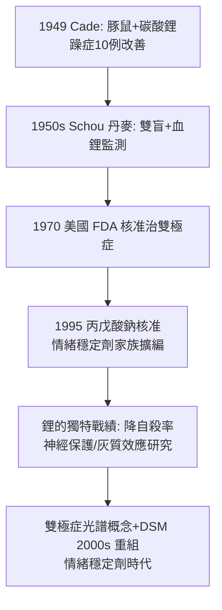

## 1949 - 鋰鹽的發現（Cade 的豚鼠尿偵查：從垃圾堆裡撿出的雙極症救命藥）

## 案件摘要

**本案偵探把躁症病人的尿液注射進豚鼠，誤讀實驗結果，卻在錯誤的推理裡撿到了正確的藥——鋰鹽，精神病學史上最便宜、也最有效的情緒穩定劑。**

1949 年，澳洲精神病院（Bundoora, Victoria）的駐院醫師 John Cade 將躁症、憂鬱症與正常人的尿液濃縮物注射入豚鼠，測試「躁症可能由體內某種致毒物質引起」的假說。為增加尿酸溶解度，他加入尿酸鋰——意外發現鋰離子本身使豚鼠鎮靜。他轉而給 10 位躁症病人口服碳酸鋰：**躁症顯著改善，部分痊癒**；9 月發表於 *Medical Journal of Australia*。這是第一個對躁鬱症有效的藥物——但由於鋰鹽無專利可賺、1940s 美國鹽替代品的致死醜聞（鋰鹽氯化物曾被當無鹽食鹽，造成數人死亡）、以及澳洲地處邊陲，本案的全球採納遲至 1970 年（美國 FDA 核准鋰鹽治雙極症）。今日鋰鹽仍是雙極症的一線治療，也是唯一被證實**降低自殺率**的情緒穩定劑。

## 前因 -- 為什麼會有這個案子

- **躁鬱症的絕境**。Kraepelin 的躁鬱病（manic-depressive insanity）雖預後優於早發性癡呆（發作—緩解型），但反覆發作仍使病人耗竭；1940s 精神病院對躁症只有束縛、電痙攣與巴比妥鎮靜。
- **Cade 的業餘精神醫學背景**。Cade（1912–1980）是軍醫，二戰被俘於新加坡樟宜戰俘營三年，戰後在資源匱乏的州立醫院工作——沒有研究經費，反而促成「尿液＋豚鼠」這種最低成本偵查。
- **體液論的幽靈再現**。Cade 假設「躁症病人體內有一種致躁毒素，憂鬱者則缺乏」——這是體液論（見 `-0400-希波克拉底與體液論的憂鬱症.md`）在 20 世紀的復古迴聲，只是這次他真的去測了。
- **鋰的前科檔案**。1949 年同時期，美國因「無鹽食鹽」（氯化鋰）致死案例被通報，FDA 禁令的氛圍使鋰在美國染上污名；而歐陸已有鋰治「痛風性憂鬱」（Lange 兄弟，1880s）的古老零星記錄——線索散落百年，無人連線。

## 線索與推理 -- 數學式、程式、理論

**線索一：豚鼠實驗的連環巧合。** Cade 的偵查鏈是一連串巧合的疊加：

```python
# 1948-49 Cade 的意外鏈
def cade_discovery():
    urine_extract = inject_into_guinea_pigs(concentrated_urine)
    # 1. 病人尿(任一組)都比自來水毒性高 -> 只因尿本身就是毒
    urea_toxicity = "尿酸溶解度低 -> 需溶劑"
    lithium = lithium_carbonate_as_solvent()      # 2. 選了鋰鹽做溶劑
    calmer = observe(guinea_pigs, "更溫馴、呆滯但可被喚醒")
    # 3. Cade 誤判: 以為尿酸鋰比尿酸鈉/銨更鎮靜
    #    (實為鋰離子本身的作用; 後人以等鋰對照證明)
    return "1949.2 起給躁症病人口服碳酸鋰 -> 10 例中 9 例改善"
```

每一環都可能是死路：若尿酸當年易溶，鋰不會入場；若豚鼠不夠溫馴，觀察不出差異；若 Cade 嚴謹地做溶劑對照，他會先否決自己的假說——**偵查史上，「錯誤的方法＋誠實的觀察」有時勝過正確的方法＋既定的結論**。

**線索二：臨床試驗的先驅品質。** Cade 的報告雖小（10 例），卻有清晰的劑量遞增、症狀時程描述與停藥復發觀察（部分病人停藥即復發，再給藥再改善）——這種「劑量—反應—復發」結構，是現代藥物試驗的雛形。

**線索三：機制的長期懸案。** 鋰鹽為何能穩定情緒？偵查跨半世紀：

$$ \text{鋰} \; \text{抑制肌醇單磷酸酶} \Rightarrow \text{肌醇信號通路} \downarrow \quad (\text{肌醇耗竭假說, Berridge 1989}) $$

$$ \text{鋰} \; \text{抑制 GSK-3}\beta \Rightarrow \text{晝夜節律與神經可塑性調控} \quad (\text{Klein & Melton, 1996}) $$

兩條通路皆指向「雙極症＝生物節律與信號穩態失調」——而 Cade 原始的「體內毒素」假說則被淘汰：又一樁「正確藥物、錯誤理論」的偵探劇。

**線索四：血鋰監測的誕生。** 鋰的治療窗極窄（$ 0.6\text{–}1.2 \text{ mmol/L} $，中毒即 $ >1.5 $），1950s–60s 丹麥 Mogens Schou 的堅持（含雙盲試驗）＋血鋰監測技術，把「險藥」馴化為「可管理的藥」——精神科最早的「治療藥物監測（TDM）」範例。



## 結案 -- 後果與影響

- **雙極症從「絕症病程」變「可管理病程」**。Kraepelin 悲觀的躁鬱病預後被改寫；住院率與自殺率顯著下降；「情緒穩定劑」成為精神藥理學的獨立類別。
- **「便宜有效」的悖論**。鋰鹽無專利，藥廠無推廣動機——本案與 1952 年氯丙嗪一樣，證明精神科最偉大的藥物發現常不是資本的優先選項；鋰鹽被 WHO 列入基本藥物清單。
- **腎臟與甲狀腺的長期帳單**。長期使用帶來腎性尿崩症、甲狀腺功能低下、鋰中毒（脫水、NSAIDs、高齡皆可觸發）——TDM 與病人教育成為處方倫理的一部分。
- **科學的浪漫教訓**。Cade 的發現被反覆寫進「偶然性在科學中的角色」教材；但他本人晚年自述：偶然只為準備好的觀察者降臨——他在戰俘營裡學會的是資源匱乏下的動手能力。
- **一句話結案**：本案的偵查公式可以抄錄——**「先有誠實的觀察（豚鼠確實變乖了），再談理論（毒血症假說錯了也無妨）」**；精神藥理學史上最重要的兩味藥（鋰與氯丙嗪），都是在理論不明的迷霧中被觀察者抓到的。

## 關鍵人物與文獻

- **John Frederick Joseph Cade（1912–1980）**——澳洲軍醫與精神科醫師；樟宜戰俘營經歷者；1996 年入選澳洲皇家澳紐精神醫學會榮譽牆（遲到的致敬）。
- **Mogens Schou（1918–2005）**——丹麥 Aarhus 精神生物學家；其家族有雙極症史，他自述亦為鋰受益者；1970 年代鋰的長期預防試驗（含雙盲）的主要推手；「世界雙極症日」（3/30，Van Gogh 生日）由其子創立的基金會推動。
- **Frederik Lange（1864–1934）與 Georg Lange**——1880s 末丹麥兄弟以碳酸鋰治「痛風性憂鬱」——鋰的百年前史。
- 原始文獻——Cade, *Lithium salts in the treatment of psychotic excitement*, Med. J. Aust.（1949）；Schou et al., *The treatment of manic psychoses by the administration of lithium salts*（1954）。
- 現代註腳——2000s 起流行病學持續確認「飲水中微量鋰與自殺率負相關」的生態學發現；鋰的神經保護、促神經新生研究（GSK-3β、BDNF）使其成為「最老的新藥」——本案的卷宗至今仍在增頁。
