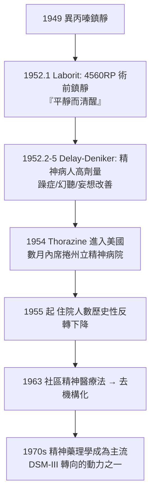

## 1952 - 氯丙嗪與多巴胺假說的誕生（冬眠靈掀開的簾幕：化學治療時代的開幕，與兇手「多巴胺」的伏筆）

## 案件摘要

**本案的偵探們原想研發麻醉輔助劑，卻在臨床意外的觀察裡抓到了精神藥理學的第一條大魚——精神病院的大門，由一枚名為「4560 RP」的化合物推開。**

1952 年 1 月，法國海軍外科醫師 Henri Laborit 在巴黎 Val-de-Grâce 軍醫院，以新合成酚噻嗪類藥物**氯丙嗪（chlorpromazine，Rhône-Poulenc 編號 4560 RP）**減輕手術病人的術前焦慮，並注意到病人「平靜而清醒、對手術毫不在意」。1952 年 2 月起，巴黎精神病院醫師 Jean Delay 與 Pierre Deniker 在 Sainte-Anne 醫院以高劑量氯丙嗪治療精神病人——**躁症與急性精神病症狀顯著改善**。1952 年 5 月上市（商品名 Largactil，「廣效之藥」）；1954 年進入美國（Thorazine）。精神病院的住院人數自此轉折下降，精神醫學進入藥物時代；而 1963–1975 年間，抗精神病藥「都作用於多巴胺」的偵查線索逐步收攏成**多巴胺假說**——本案是精神醫學由「詮釋」轉向「神經化學」的樞紐。

## 前因 -- 為什麼會有這個案子

- **抗組織胺的意外支線**。1940s 法國 Rhône-Poulenc 化學家 Paul Charpentier 合成一系列酚噻嗪衍生物；1949 年異丙嗪（promethazine）顯示強鎮靜作用——公司轉而尋找「人工冬眠」複方（降低手術休克的體溫代謝法）。
- **Laborit 的敏銳**。Laborit（1914–1995）非精神科醫師，他在手術記錄中寫下「病人焦慮消失、意識保留」——一個外科醫師對「精神狀態改變」的觀察，成為本案的第一條線索。
- **精神病院的絕望背景**。1930s–50s 三大軀體療法（胰島素昏迷、電痙攣、額葉切除——見 1933/1938/1935 各案）風險高、爭議大；美國州立精神病院在院人數 1955 年達歷史峰值（約 55.9 萬人）——任何新武器都會被瘋狂搶用，這次終於是真的武器。
- **法國精神科的官僚阻力**。Delay 與 Deniker 面對的是「藥物治精神＝不嚴肅」的學界氛圍，以及 1952 年 5 月上市初期定價與適應症的爭論——第一個月銷量慘淡，之後臨床口碑如野火。

## 線索與推理 -- 數學式、程式、理論

**線索一：臨床觀察到藥物革命的傳導鏈。**



**線索二：多巴胺假說的拼圖過程。** 氯丙嗪「為何有效」的偵查分三步收網：

```python
# 多巴胺假說的證據鏈 (1952-1980)
def dopamine_hypothesis():
    evidence = []
    evidence += ["1955: 氯丙嗪副作用=類帕金森(運動系統受抑制) -> 提示基底核"]
    evidence += ["1957-58: Arvid Carlsson 證明多巴胺是獨立神經遞質(非僅NE前體)"]
    evidence += ["1963: Seeman 等顯示抗精神病藥阻斷多巴胺受體"]
    evidence += ["1973: Snyder/Seeman: 效力與 D2 受體親和力高度相關(r~0.9)"]
    evidence += ["1974-75: 安非他命濫用致精神病症狀(多巴胺釋放藥)"]
    evidence += ["1978: Crow/Subramaniam: 病人腦脊液/死後腦多巴胺代謝異常報告"]
    return "結論: 精神分裂症陽性症狀 = 中腦邊緣多巴胺功能過強"
```

$$ \text{抗精神病藥效力} \propto \frac{1}{\text{臨床劑量}} \approx \text{D2 受體阻斷強度} $$

這條數學式（Seeman 的經典相關圖）是本案的定罪證據——Carlsson 因多巴胺訊號研究獲 2000 年諾貝爾獎。

**線索三：藥物與病院的雙重釋放。** 氯丙嗪的效果是「鎮靜多餘、抗精神病有效」——它不是單純鎮靜劑（病人清醒時妄想也消退），這一鑑別點使它與酒精、巴比妥、鴉片有本質不同：**精神藥理學第一次擁有「特異性」證據**。住院人數曲線在 1955 年後的長期下坡，是多巴胺假說成形前最直觀的「物證」。

**線索四：副作用的帳單同步累積。** 椎體外症候群（EPS：帕金森樣、靜坐不能、急性肌張力失調）與遲發性運動不能（tardive dyskinesia，長期用藥後的不自主動作，常不可逆）隨普及而大量出現——多巴胺假說因此更具體（基底核 D2 阻斷＝EPS），但也暴露「陽性症狀改善、運動系統受害」的結構性代價。1980s 後的氯氮平與第二代藥物（見 `1987-百憂解與精神藥理學的黃金年代.md`）試圖支付更低的帳單。

## 結案 -- 後果與影響

- **精神醫學的專業翻身**。有了可處方、可研究、可量化的治療，精神科脫離「只會談話」的定位；1970s 起神經遞質研究、藥理遺傳學、隨機對照試驗全面進場——DSM-III（見 `1980-DSM-III與生物精神醫學的轉向.md`）的轉向有本戰績背書。
- **去機構化的啟動器**。藥物＋社區照護政策（見 `1963-去機構化與社區精神醫療.md`）使在院人數於 1955–1990 年間下降逾 90%——但「出院」不等於「被接住」，本案的另一半後果（遊民、監獄精神病收容）要在三十年後才被完整清點。
- **製藥業的重心轉移**。氯丙嗪的商業成功使製藥業設立精神藥理部門（Geigy 的丙咪嗪 1957、Ciba 的利血平研究、Hoffmann-La Roche 的安定類 1960s）——精神藥理學黃金年代（1950–1980）由本案開幕。
- **一句話結案**：Laborit 的「平靜而清醒」六個字，是本案最關鍵的一條線索——**真正的偵查功力，在於從最平常的臨床現象裡讀出「這不尋常」**；而兇手「多巴胺過多」的畫像雖然日後被修訂（D2 過度簡化、需加入前額葉低多巴胺與神經發育背景），大案仍是已破。

## 關鍵人物與文獻

- **Henri Laborit（1914–1995）**——軍醫、神經生理學家；「人工冬眠」概念推動者；1981 年出演電影《我的美國舅舅》飾演自己（其抑制／激活理論成為電影骨架）。
- **Jean Delay（1907–1987）與 Pierre Deniker（1917–1998）**——Sainte-Anne 醫院精神科；1952 年發表抗精神病效果的正式臨床報告；兩人被普遍視為抗精神病藥的臨床發明人。
- **Paul Charpentier（1915–1999）**——Rhône-Poulenc 化學家，4560 RP 的合成者；幾乎無人記得其名——本案最沉默的偵探。
- **Arvid Carlsson（1923–2018）**——瑞典藥理學家；1957 年證明多巴胺為獨立神經遞質，2000 年諾貝爾獎（利血平的多巴胺耗竭模型是連接本案與化學的橋樑）。
- **Philip Seeman（1934–2021）**——多巴胺 D2 受體親和力—效力相關圖的作者；後提出「快速解離（fast-off-D2）」解釋第二代藥物。
- 原始文獻——Delay & Deniker, *Le traitement des psychoses par une méthode médicamenteuse dérivée de l'hibernothérapie*（1952）；Seeman et al., *Antipsychotic drug doses and neuroleptic D2 receptors*（1976）。
- 現代註腳——2010s 起的「抗精神病藥劑量最小化」趨勢、氯氮平對難治型的不可取代性、以及多巴胺假說的現代化版本（多巴胺突觸的區域特異性失調模型）——本案的卷宗仍是精神分裂症藥理學的第一頁。
