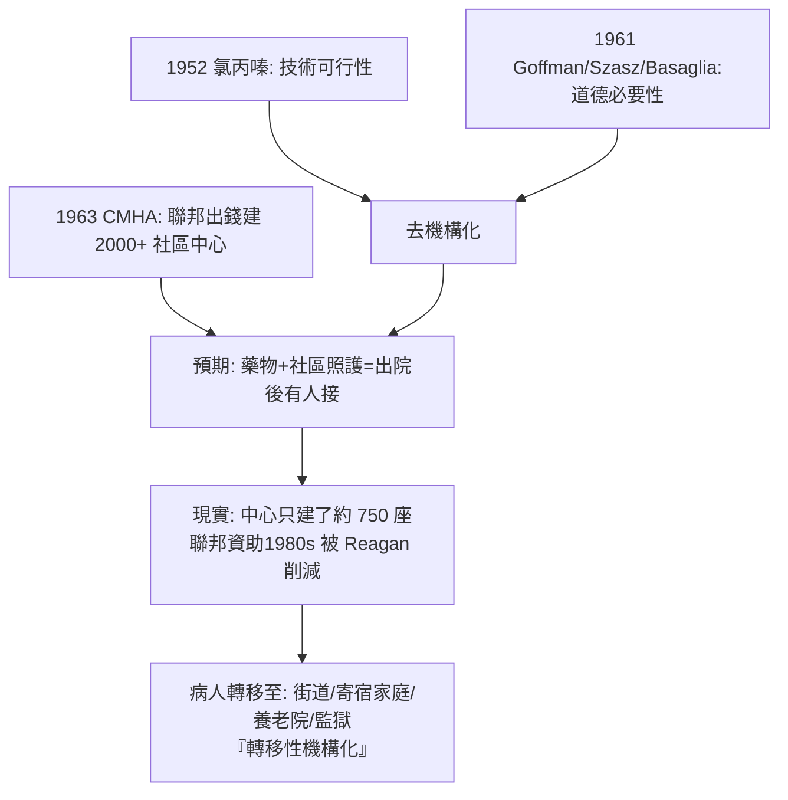

## 1963 - 去機構化與社區精神醫療（JFK 的最後一份法案：把精神病院的圍牆推開，然後呢？）

## 案件摘要

**本案是一場半途而廢的大規模轉移：把五十五萬人搬出精神病院，卻沒有蓋好安置他們的社區——理想的偵查方向正確，執行現場留下三十年的爛尾。**

1963 年 10 月 31 日，美國總統甘迺迪簽署《社區精神醫療中心建設法》（Community Mental Health Act, CMHA），宣布以社區型精神醫療取代州立精神病院收容——這是他在職最後簽署的法案之一（三週後遇刺）。法案構想：各社區建設精神醫療中心，提供門診、日間照顧、危機介入、住院與諮詢教育五項功能。與此同時，氯丙嗪（1952，見 `1952-氯丙嗪與多巴胺假說的誕生.md`）等藥物使出院在醫學上成為可能；社會學批判（Goffman, 1961，見 `1961-反精神醫學運動的證詞.md`）使其在道德上成為必要；財政誘因（聯邦出錢建社區中心、州政府甩掉精神病院開支）使其在政治上成為必然。三者合流，啟動了 20 世紀最大規模的精神照護轉型——**去機構化（deinstitutionalization）**。

## 前因 -- 為什麼會有這個案子

- **1955 年的峰值**。美國州立精神病院在院人數達 55.9 萬歷史最高點；每千人口住院率是英法的三倍以上；州政府財政被壓垮，機構內條件惡化（Goffman 的田野就在這樣的院內）。
- **藥物的技術解鎖**。氯丙嗪（1954 進美國）與利血平使急性症狀可控；1955 年起在院人數曲線歷史性反轉——「出院」第一次有大規模可行性。
- **社會學與法學的壓力**。全控機構批判＋1954 年起 Durham rule 等刑法判決鬆動「無責任能力」的粗暴邏輯；Szasz 的「強制即暴政」論在法律界找到回聲。
- **總統的私人動機**。甘迺迪家族的 Rosemary（總統之妹）1941 年接受額葉切除（見 `1935-額葉切除術的悲劇.md`）術後終身失能——家史的傷口使本案在白宮有內應。

## 線索與推理 -- 數學式、程式、理論

**線索一：轉移的雙引擎。** 去機構化不是單一法案的產物，是兩台引擎的合力：

**線索二：數字的偵查。** 在院人數：1955 年 55.9 萬 → 1980 年約 13.2 萬 → 2000s 不足 5 萬（下降逾 90%）。但同時期：

$$ \Delta(\text{精神病院人口}) \approx -50\text{萬}, \quad \Delta(\text{監獄受刑人精神疾病比例}) \approx +\text{數十萬} $$

2006 年美國司法部統計：州監獄受刑人中約 24% 有「嚴重精神疾病」——精神病院被「關閉」，其人口由監獄部分接收，成為所謂 **「The New Asylums」（新瘋人院）**。遊民研究中，慢性嚴重精神疾病者佔遊民人口約 20–25%（洛杉磯 Skid Row 為縮影）。

**線索三：責任結構的漏洞偵查。** 州立精神病院的預算由州政府負責（可一刀裁減）；社區中心的承諾由聯邦「建設費」支付，但**營運費**一直沒有穩定的支付方——Medicaid（1965）明文排除「大型機構」的住院補助（IMD exclusion），無意間加速關院，卻未補上社區現金流。偵查結論：**制度設計獎勵了「把人搬出來」，沒有獎勵「把人照顧好」**。

**線索四：部分成功的案卷。** 去機構化並非全盤失敗：大量病人確實在社區中過著比機構更完整的生活（支持性就業、個案管理、長效針劑、照護者團體）；英國「Care in the Community」（1983 起）與義大利 Basaglia 法（見 `1961-反精神醫學運動的證詞.md`）顯示「關院＋強社區」的組合可以成功——成敗的變項不是「要不要關」，而是**社區服務有沒有先建好**（英國的「bridge builders」隨訪模式、義大利的 Trieste 經驗）。

## 結案 -- 後果與影響

- **「旋轉門」與監獄化**。急性住院—出院—復發—再住院的循環；「刑事化（criminalization）」成為 2000s 精神醫學的頭號制度議題——心理健康法庭（mental health court）、警員危機介入訓練（CIT）是補救工程。
- **病識感與「不受照顧的自由」之辯**。非自願社區治療（outpatient commitment, 紐約 Kendra's Law 1999）的爭議，是 Szasz 式自由與照護責任的戰場延續。
- **社區精神醫學的正規化**。個案管理（case management）、ACT（assertive community treatment, 1970s Madison 模式）、復元取向（recovery model, 1990s 起）——把「生活品質」而非「症狀」定為目標的轉向，是本案最健康的遺產。
- **一句話結案**：本案的偵查教訓是「轉移問題 ≠ 解決問題」——**推倒圍牆之前，必須先蓋好圍牆外的世界**；1935 年額葉切除案證明「沒有治療的制度會傷人」，1963 年本案證明「沒有制度的治療也會傷人」。

## 關鍵人物與文獻

- **John F. Kennedy（1917–1963）**——1963.2 致國會精神疾病與智能障礙特別咨文；其妹 Rosemary 的遭遇是家史伏線。
- **Robert Felix（1904–1990）**——NIMH 首任院長，CMHA 的總設計師，被稱為「社區精神醫學之父」；晚年自承法案「倉促」。
- **Goffman / Szasz / Basaglia**——本案的批判理論供應商（見 `1961-反精神醫學運動的證詞.md`）。
- **E. Fuller Torrey（1937– ）**——去機構化失敗論的最有力著作者（*The Insanity Offense*, 2008）；亦為嚴重精神疾病研究基金會（Treatment Advocacy Center）創辦人。
- 原始文獻——*Community Mental Health Act*（Public Law 88-164, 1963）；Grob, *The Mad Among Us*（1994）；Torrey, *The New Asylums* 系列研究。
- 現代註腳——2020s 美國 988 自殺防治專線與「6166 諮詢師草案」重啟「社區危機系統」議題；台灣 2019 年《病人權利保障法》修法推動與「精神衛生法」修法（2022）強化社區支持——各國仍在替 1963 年的爛尾樓補鋼筋。
