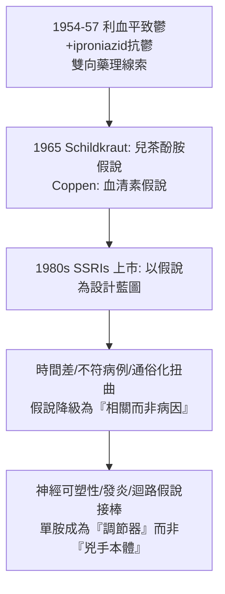

## 1965 - 單胺假說的誕生（Schildkraut 的化學指紋：憂鬱症是去甲腎上腺素的匱乏嗎？）

## 案件摘要

**本案把「憂鬱」從靈魂的暗夜搬進突觸的縫隙：如果讓人振奮的藥都抬高單胺類遞質，那麼憂鬱會不會就是單胺的匱乏？——一個優雅的假說統治了五十年，也一路被追緝修正。**

1965 年，麻州總醫院精神科醫師 Joseph Schildkraut 發表《The catecholamine hypothesis of affective disorders》（*Am. J. Psychiatry*），提出：憂鬱症與**兒茶酚胺（尤其去甲腎上腺素）在腦內功能性匱乏**相關，躁症則與過量相關。同年英國 Alex Coppen 提出對應的血清素（5-HT）假說。假說的上游證據早已埋好：1950s 利血平（降血壓藥）使部分病人嚴重憂鬱，而它耗竭單胺儲存；異菸鹼醯異丙肼（iproniazid，抗結核藥）使病人情緒高昂，而它抑制單胺氧化酶（MAOI）——**「藥物—情緒」的雙向線索在 1965 年被串成完整的因果假說**。單胺假說催生了 SSRIs（百憂解，1987）等整個世代抗憂鬱藥，其修正版（受體調節、神經可塑性、發炎假說）至今仍是憂鬱症生物學研究的主軸骨架。

## 前因 -- 為什麼會有這個案子

- **利血平的意外證詞（1954–57）**。印度蛇木鹼利血平（reserpine）作為降血壓藥與抗精神病藥上市後，臨床報告 15% 以上使用者出現嚴重憂鬱；動物實驗顯示它使腦內 5-HT、多巴胺、去甲腎上腺素被排空——「耗竭單胺 → 憂鬱」的因果提示。
- **iproniazid 的反證（1952–57）**。抗結核藥 iproniazid 使結核病房「異常快樂」，Crane 1957 年報告其抗憂鬱效果；Zeller 證明其抑制 MAO、減少單胺分解——「增加單胺 → 抗憂鬱」。
- **丙咪嗪的入案（1957–58）**。瑞士 Geigy 的 Kuhn 臨床發現三環抗憂鬱藥丙咪嗪（imipramine）對憂鬱有效（原為氯丙嗪類似物候選）；其作用機制（阻斷單胺再回收，Axelrod 1961）又指向同一方向。
- **Julius Axelrod 的突觸解剖學**。1960s 初，Axelrod（1970 諾獎）闡明去甲腎上腺素的再回收（uptake）機制——為「再回收抑制＝治療」提供分子基礎，也為百憂解（SSRI）的設計藍圖埋線。

## 線索與推理 -- 數學式、程式、理論

**線索一：雙向藥理的一致性檢驗。** Schildkraut 的推理本質是一張「藥效—遞質」相關表：

```python
# 1965 單胺假說的證據矩陣
evidence = {
    "利血平: 耗竭單胺        -> 致憂鬱": "正",
    "MAOI(升單胺)            -> 抗憂鬱": "正",
    "三環藥(阻再回收,升單胺) -> 抗憂鬱": "正",
    "安非他命(釋放單胺)      -> 提神/致躁": "正",
    "電痙攣: 增加單胺敏感性  -> 抗憂鬱": "正",
}
# 全部同向 -> 假說成立(但注意: 相關不等於因果!)
```

$$ P(\text{憂鬱}) \; \propto \; \frac{1}{[\text{兒茶酚胺}]_{\text{突觸有效濃度}}} $$

這條反比關係的「化學指紋」是本案的核心陳述——優雅、可檢驗、可製藥。

**線索二：假說的裂縫（偵查的反轉段）。** 1970s–90s 的偵查發現致命漏洞：

- **時間差**。藥物數小時內即升高突觸單胺，抗憂鬱效果卻需 2–6 週——單胺升高不可能是直接原因。
- **不符合者**。可卡因強力阻斷單胺再回收，卻不是抗憂鬱藥；部分病人單胺代謝物（如 MHPG、5-HIAA）並未偏低。
- **「化學不平衡」的通俗化扭曲**。假說被藥廠行銷與媒體簡化為「憂鬱=血清素不足，吃藥補血清素」——2000s 起學界一再澄清此為過度簡化；2022 年 Umberto Moncrieff 等的系統性回顧直接挑戰「血清素假說」的實證基礎，引發軒然大波——兇手畫像再次被要求重繪。

**線索三：修正版假說的接力。** 當代偵查方向已從「遞質含量」轉向「系統調節」：

| 修正假說 | 核心主張 | 代表證據 |
|---|---|---|
| 受體調節說（1970s） | 治療效力在於受體下調/上調的慢適應 | β 受體下調與臨床起效同步 |
| 神經可塑性／神經營養說（1997–） | 憂鬱伴海馬萎縮與 BDNF 下降；治療促神經新生 | 抗憂鬱藥與運動皆升 BDNF（Duman） |
| 發炎假說（2000s–） | 細胞激素升高誘發憂鬱樣行為 | 干擾素治療致憂鬱；發炎指標亞型 |
| 神經迴路說（2010s–） | 症狀對應特定網路失調（如預設模式網路） | fMRI/DBS 定位 |
| 預測編碼/計算精神醫學（2020s） | 憂鬱＝獎賞預測誤差的學習偏誤 | 強化學習模型擬合 |



**線索四：診斷與藥物的互相塑造。** 單胺假說的成功反過來重塑診斷：DSM-III（1980）把「重度憂鬱症」定為可操作的分類（見 `1980-DSM-III與生物精神醫學的轉向.md`），部分原因正是藥物試驗需要可標準化的人群——**假說、藥物與診斷手冊三方互餵**，構成現代精神醫學的產業結構。

## 結案 -- 後果與影響

- **抗憂鬱藥的黃金時代**。MAOI → 三環 → SSRI（1987 百憂解，見 `1987-百憂解與精神藥理學的黃金年代.md`）→ SNRI → esketamine（2019），治療選項爆炸；MDD 成為全球用藥量最大的精神診斷。
- **「化學不平衡」的社會敘事**。本案使憂鬱症去道德化（不是意志薄弱，是生化失調）——污名下降；但同時帶來「人身為化學機器」的還原論焦慮，以及 2000s 對藥廠行銷倫理的追訴（Paxil 案、兒童抗憂鬱風險披露訴訟）。
- **科學的誠實修訂**。2022 年血清素回顧爭議後，主流共識收斂為：單胺系統參與憂鬱的症狀調節與藥物作用，但憂鬱症不是「血清素不足病」——**假說被降級為工具，而非真相**；這正是本案留給所有醫學假說的示範：理論是偵查的地圖，不是案件本身。
- **一句話結案**：Schildkraut 沒有抓到兇手本體，但他畫出了兇手的**活動範圍**（單胺突觸）——五十年的藥物、診斷與爭論都在這個範圍內推進；偵查的進步，常常表現為「把嫌疑人列表越畫越精確」。

## 關鍵人物與文獻

- **Joseph J. Schildkraut（1934–2006）**——Harvard/NIMH 出身；1965 年論文為精神藥理學被引次數最高文獻之一；本人晚年多次公開強調「這是假說不是定論」。
- **Alex Coppen（1923–2016）**——英國 MRC 臨床精神病學組；血清素假說的同案偵探。
- **Arvid Carlsson（1923–2018）**——單胺遞質化學的奠基者（2000 諾獎）。
- **Julius Axelrod（1912–2004）**——再回收機制與 MAO 研究（1970 諾獎）；其實驗室培養出新一代神經藥理學家。
- **Umberto Moncrieff（Mark Horowitz 等, 2022）**——血清素假說系統性回顧的挑戰者，觸發本案的百年重審。
- 原始文獻——Schildkraut, *Am. J. Psychiatry*, 122:509（1965）；Coppen, *Br. J. Psychiatry*（1967）；Moncrieff et al., *Molecular Psychiatry*（2022）。
- 現代註腳——psilocybin 裸蓋菇素（5-HT2A 激動劑）的難治型憂鬱試驗（2016–2023 COMPASS/Johns Hopkins）把「血清素」再次推上第一線，但理論已換成「神經可塑性視窗＋心理治療整合」——單胺假說的第四代後裔正在出庭作證。
