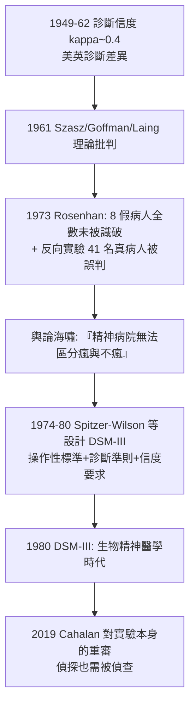

## 1973 - 羅森漢實驗與診斷的極限（八個假病人闖進十二間精神病院：診斷權威的世紀壓力測試）

## 案件摘要

**本案的偵探派了八個「臥底正常人」住進精神病院，用一個謊言（「我聽見空砰的聲音」）測試整個診斷體系——結果：沒有一家醫院識破，平均住院 19 天，全部出院診斷為「精神分裂症緩解期」。**

1973 年 1 月，史丹佛心理學家 David Rosenhan 在《Science》發表《On Being Sane in Insane Places》：8 名假病人（含 Rosenhan 本人、心理學家、精神科住院醫師、畫家、家庭主婦等，3 女 5 男）分別在 12 間州立與大學醫院掛號，主訴僅一句幻聽，其餘病史與生活史皆完全誠實；入院後一切言行正常。結果 7 人診斷精神分裂症、1 人躁鬱症；平均住院 19 天（7–52 天），共服下 2100 顆藥丸；出院診斷皆為「in remission」——**疾病痊癒了，但「正常人」的身分直到出院都沒有恢復**。研究同時附上反向實驗：知名教學醫院被警告有假病人後，41 位真病人中有 41 位（顯著比例）被院方醫師懷疑為臥底——診斷在兩個方向上都失準。本案直接點燃了 DSM-III（1980）診斷革命（見 `1980-DSM-III與生物精神醫學的轉向.md`）。

## 前因 -- 為什麼會有這個案子

- **反精神醫學的時代風向**。Szasz（1961）、Goffman（1961）、Laing（1961）已把精神醫學推上被告席（見 `1961-反精神醫學運動的證詞.md`）——但多為理論批判，缺一個可操作的實證實驗。
- **標籤理論的學術氛圍**。符號互動論（Howard Becker, 1963）主張「偏差者是被定義出來的」；Rosenhan 的問題極為鋒利：**「正常」與「異常」的判斷，究竟源自病人特質，還是判斷的脈絡？**
- **診斷信度的醜聞數據**。1949–1962 年的多項跨國研究顯示，美英精神科醫師對同一病人的診斷一致率（kappa）僅約 0.4 甚至更低——同一個人，在紐約是精神分裂症、在倫敦是躁鬱病（1960s US-UK 診斷計畫的著名發現）。
- **Rosenhan 的個人位置**。他是心理學家兼律師，曾在法院作為專家證人出庭——對「診斷標籤的法律後果」極為敏感；他後來自述靈感來自目睹聆訊中「醫生一句話即定義人」的瞬間。

## 線索與推理 -- 數學式、程式、理論

**線索一：實驗設計的偵查邏輯。**

$$ H_0: \text{診斷由病人特質決定} \quad \text{vs.} \quad H_1: \text{診斷由情境標籤決定} $$

```python
# 1973 羅森漢實驗流程
def pseudopatient_protocol(person):
    call_hospital_appointment()               # 真實預約(勿浪費急診資源)
    complain("我聽見 'empty/hollow/thud' 的聲音")  # 唯一謊言: 模糊而非怪異
    answer_history_honestly()                 # 其餘一切誠實
    after_admission():
        behave_completely_normal()            # 停止幻聽主訴, 一切合作
        keep_notes_openly("筆記 openly 記錄, 工作人員稱之 'writing behavior'")
    return wait_for("何時被識破? / 以何種診斷出院?")
```

結果的兩個爆炸點：(1) 沒有一例被識破，連真正病友都辨識出來（「你沒瘋，你是記者或教授」）；(2) 正常行為被病理化解讀——病人先在等候區寫筆記被記為「writing behavior」，排隊領藥被記為「口欲與藥物依賴」。

**線索二：反向實驗的精妙。** Rosenhan 通知某知名教學醫院：三個月內將送入假病人。該院隨後收治 193 人，其中 41 人被至少一位醫師與 19 位被一位醫師＋一位醫護人員「自信地」判定為假病人——**實際上這個月一個假病人都沒有送出**。診斷的敏感度與特異度在兩個方向同時崩塌：對真病人過於寬容，對「疑似臥底」又過於多疑。這是對「評分者效應」的雙面測量。

**線索三：病理化日常行為的機制解釋。** Rosenhan 援引「情境的力量」（Milgram 1971、Zimbardo 1971 同期實驗）：醫護人員身處機構角色，其注意力被「病人」標籤結構化——

| 病人行為（正常） | 病歷中的病理化解讀 |
|---|---|
| 開放地記筆記 | 「writing behavior」— 強迫性書寫 |
| 排隊領藥 | 「oral-acquisitive nature」— 口欲性格 |
| 無聊地走動 | 「anxiety/nervousness」 |
| 與醫師閒聊自己婚姻 | 「ambivalence」（矛盾情感） |
| 想早點離開 | 「oral-acquisitive / 病識缺乏」 |

**線索四：後世的重審與翻案爭議。** 2019 年記者 Susannah Cahalan（《The Great Pretender》）追查原始檔案，發現僅能證實 2–3 位假病人的存在、資料缺失嚴重——實驗本身可能被美化了。無論原始數據的真實性如何，本案的**思想影響**已被歷史確認：它與 US-UK 診斷差異研究一起，成為 DSM-III 拋棄精神動力診斷、改採操作性行為標準的直接催化劑。



## 結案 -- 後果與影響

- **診斷標準的操作化革命**。Spitzer 等人的 Feighner 標準（1972）與 RDC（1978）先後提出可操作的診斷條目，DSM-III（1980）完成體制化——本案是「診斷必須可重複、可檢驗」的最強宣傳。
- **倫理與病歷文化的改變**。診斷溝通的透明化、治療計畫的書面化、與病人對診斷的討論義務逐步成為規範；「標籤的殺傷力」進入醫學教育。
- **永久的方法論遺產**。本案成為社會心理學與醫學社會學的標準教材，與 Milgram、Zimbardo 並列「情境力量三部曲」；它也預告了 2000s「醫學化」與「過度診斷」批判的語言。
- **實驗倫理的反身性**。2019 年的重審提醒：**揭露體系缺陷的偵探，同樣可能美化案情**——科學史必須同時偵查證據與偵探。
- **一句話結案**：羅森漢案的真正判決不是「精神病醫師都是糊塗蛋」，而是——**在缺乏可操作標準時，診斷是情境與期望的產物**；DSM-III 的一切工程，都是為了把這個洞補起來。

## 關鍵人物與文獻

- **David L. Rosenhan（1929–2012）**——史丹佛心理學與社會學教授；律師背景；本案為其生涯代表作（也是唯一代表作——晚年其履歷爭議亦被 Cahalan 揭露）。
- **Robert Spitzer（1932–2015）**——哥倫比亞生物統計學家，DSM-III 的總工程師；他公開承認 Rosenhan 的報告是他推動診斷革命的動力之一。
- **Susannah Cahalan（1985– ）**——《腦火》（Brain on Fire, 2012）作者（本身經歷抗 NMDA 受體腦炎的誤診）；2019 年《The Great Pretender》對本案的檔案級重查。
- 原始文獻——Rosenhan, *On Being Sane in Insane Places*, Science, 179:250（1973）；Spitzer et al., *Research Diagnostic Criteria*（1978）。
- 現代註腳——2010s 的「廣譜診斷膨脹」爭論（ADHD、自閉症光譜、創傷後壓力）以更精密的統計工具重演本案問題：**標準變準了，閾值仍由人劃**——羅森漢的放大鏡從未真正放下。
