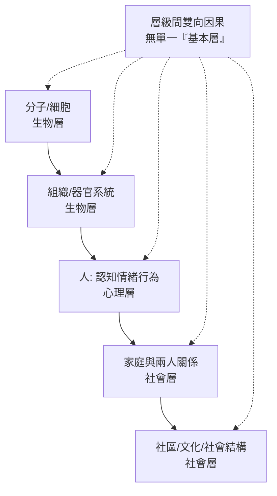

## 1977 - 恩格爾與生物—心理—社會模式（Engel 的折中判決：心與腦不必二選一）

## 案件摘要

**本案的偵探不辦個案，而是審判兩個陣營的訴訟——還原論（一切皆腦）與精神分析（一切皆心）打了半世紀，Engel 判決：兩者都對了一半，缺的第三極是「社會」。**

1977 年 4 月，羅徹斯特大學內科與精神科教授 George L. Engel 在《Science》發表《The need for a new medical model: a challenge for biomedicine》，提出**生物—心理—社會模式（biopsychosocial model）**：疾病應同時在生物學（基因、神經遞質、器官）、心理學（認知、情緒、行為、人格）、社會學（家庭、文化、貧窮、歧視）三個層次上理解與治療。本案是對 1970s 精神醫學內戰（生物精神醫學 vs 反精神醫學 vs 精神分析）的制度性調停——DSM-III 時代（1980 起）的生物轉向與心理治療的並存，皆以此模式為意識形態屋頂。它也成為 21 世紀被引用最多、也批評最多的醫學「模式」之一。

## 前因 -- 為什麼會有這個案子

- **還原論的勝利與侷限**。1970s 精神藥理學（見 1952/1965 各案）的戰果，使「疾病＝生化異常」的還原論在精神科抬頭；但同時：同卵雙生子精神分裂症一致率僅 ~50%、抗憂鬱藥對安慰劑優勢有限的爭論持續——純生物模式解釋力不足。
- **精神分析診斷體系的崩塌**。DSM-II（1968）仍以動力學術語書寫；Rosenhan 實驗（1973）與診斷信度醜聞（kappa≈0.4）摧毀其信度基礎——需要一個能容納新科學、又不否定心理與社會的框架。
- **Engel 的雙棲資歷**。Engel（1913–1999）先為內科醫師，再受訓為精神分析師；1950s 即研究潰瘍性結腸炎與哀傷生理學（「放棄—絕望反應」）——他一生都在「心身醫學」的交界偵查，模式是三十年田野的總結。
- **社會醫學與公衛的平行線**。1960s–70s 流行病學已證明社會階層、失業、孤立對健康的獨立效應（Whitehall 研究 1967 起）；模式只是把公衛常識帶進臨床房間。

## 線索與推理 -- 數學式、程式、理論

**線索一：層級系統模型。** Engel 的核心是「連續統（continuum）」概念：



$$ \text{臨床結果} = f(\text{生物因素}, \text{心理因素}, \text{社會因素}, \text{三者的交互作用}) $$

交互作用項才是模式的靈魂：同一基因風險（生物），在支持性家庭（社會—心理）與在長期暴力環境中，臨床表現完全不同——Engel 以此拒絕「身心二分」的整套哲學。

**線索二：臨床操作化。** Engel 給出的是「問診方法論」而不只是口號：

```python
# Engel 式會談的四層掃描
def biopsychosocial_interview(patient):
    bio    = ["症狀/病程/家族史/用藥/物質使用", "實驗與影像(必要時)"]
    psycho = ["症狀對生活的意義", "因應風格/童年依附/認知模式", "病識與動機"]
    social = ["家庭系統與角色", "工作/經濟/居住/法律狀態", "文化對症狀的解釋模型"]
    return {
        "診斷": synthesize(bio, psycho, social),
        "治療": [ "生物: 藥物/軀體治療",
                  "心理: 心理治療/衛教/自助技能",
                  "社會: 家族工作/社福連結/就業支持" ],
        "原則": "治療計畫必須包含三層中的每一層(或明述為何不必)",
    }
```

**線索三：案例示範——胸痛的偵查。** Engel 以「45 歲男性胸痛」演示：只查冠狀動脈（生物）會漏掉病人剛失業（社會）、自述「胸口像被家人拋棄般壓住」（心理—文化隱喻）——三層證據合起來才是完整案情。此示範被醫學教育廣泛引用，成為 OSCE 會談訓練的模板。

**線索四：批評的火力偵查。** 21 世紀的再偵查指出模式的弱點：**模糊與不可否證**——任何結果都可被三層「各分一點責任」，難以產生精確預測；Ghaemi（2009）批評其「不過是全都要的 eclecticism」；但也有辯護者（Bolton & Gillett, 2019）以系統理論重構其因果鏈。模式的真正功用在**教育與倫理**（防止診間的單維化），而非科學預測——這是本案最誠實的定罪範圍。

## 結案 -- 後果與影響

- **醫學教育的全面入法**。1970s–90s 全球醫學院把 BPS 模式寫入課綱；羅徹斯特學派（Engel, Quill, Morgan）出版系列教學文獻；「全人醫療」成為評鑑指標。
- **精神科的意識形態屋頂**。DSM-III 的生物轉向與心理治療傳統在 BPS 標題下並存；ICD/DSM 的多軸診斷（DSM-III~IV 的 Axis IV 社會心理問題、Axis V 整體功能）是模式的制度化身（DSM-5 2013 移除多軸，但保留社會心理「其他條件」編碼——屋頂被部分拆除）。
- **復元取向與以人為本服務**。1990s 起的 recovery model（復元模式）把希望、自主、社會角色放回目標——精神科照護的倫理語言直接繼承 BPS。
- **一句話結案**：Engel 的判決沒有宣布誰贏，而是改寫了訴訟規則——**病人的案情必須在所有層次上同時蒐證**；這使精神醫學免於在「只會開藥」與「只會談話」之間二選一，儘管三十年的臨床現實常常還是在二選一。

## 關鍵人物與文獻

- **George L. Engel（1913–1999）**——羅徹斯特大學內科與精神科教授；GPEP 報告（1977，AAMC）與其 Science 論文同年，模式迅速制度化。
- **John Romano（1908–1994）**——Engel 的導師與合作者，羅徹斯特「醫學—精神科合併會診」制度的建立者。
- **Adolf Meyer（1866–1950）**——約翰霍普金斯精神科主任；「心理生物學（psychobiology）」強調個人生活史與器官的統一——Engel 自認其直系傳人；Meyer 的「生活圖表（life chart）」是 BPS 會談的祖父版。
- **Michael Ghaemi（1959– ）**——當代主要批評者（*The Rise and Fall of the Biopsychosocial Model*, 2009）。
- 原始文獻——Engel, *Science*, 196:129（1977）；Bolton & Gillett, *The Biopsychosocial Model of Health and Disease*（2019, Open Book）。
- 現代註腳——2020s 的「精準精神醫學」與數位表型（smartphone digital phenotyping）試圖把 BPS 的三層變成可計算的變數組；「社會處方（social prescribing）」在英國 NHS 建制化（醫師開「藝術課/志工服務」處方）——Engel 的第三層，正在以處方箋的形式回歸。
