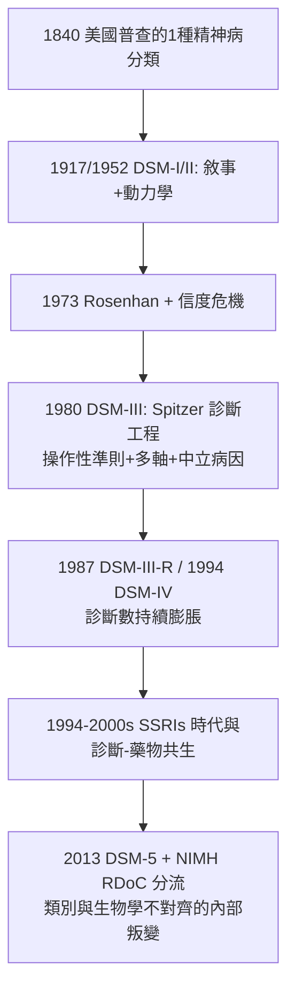

## 1980 - DSM-III 與生物精神醫學的轉向（Spitzer 的診斷工程：把「瘋狂」變成可以數的題庫）

## 案件摘要

**本案是一場巨大的翻修工程：把沿用三十年的敘事式診斷拆掉，重建成 494 頁、265 個診斷、每項皆有明確數字準則的操作手冊——診斷從「醫師的藝術」變成「可檢驗的清單」，精神醫學由此轉身為生物科學。**

1980 年，美國精神醫學會（APA）出版《精神疾病診斷與統計手冊》第三版（DSM-III），主編 Robert Spitzer。三項革命：(1) **操作性行為準則**——每個診斷列出明確症狀數與時程（如 MDD 需 9 項症狀中 5 項、持續 2 週）；(2) **多軸系統**——臨床症候群、人格與智能障礙、軀體疾病、社會心理壓力、整體功能分開評估；(3) **拋棄精神動力病因學**——手冊只描述「是什麼」，不宣稱「為什麼」。結果：診斷信度（kappa）從 0.4 級躍升至 0.7–0.8 級，藥物試驗獲得可標準化人群，精神醫學在美國醫學界的地位重挫後回升。本案是 20 世紀精神醫學最大的制度性改造——也是 21 世紀診斷膨脹爭議的起點。

## 前因 -- 為什麼會有這個案子

- **信度危機的鐵證**。1949–1962 年研究顯示跨醫師診斷一致率低（kappa≈0.4）；1973 年 Rosenhan 實驗（見 `1973-羅森漢實驗與診斷的極限.md`）使醜聞公共化；美英診斷差異（美國過診精神分裂症、英國過診躁鬱）顯示「氣氛決定診斷」。
- **理論內戰的僵局**。精神分析（心理成因）、生物精神醫學（生化成因）、反精神醫學（否認疾病）三方互斥；Spitzer 的解法是**中立化**：手冊只登記可觀察行為，理論問題留給研究者——「無理論的描述」成為最大公約數。
- **Feighner 標準的先行者**。1972 年華盛頓大學 John Feighner 等（含 Samuel Guze、Eli Robins）發表 15 個診斷的操作性準則（「聖路易學派」的新生物醫學模式）；1978 年 Spitzer 的 RDC 擴充之——DSM-III 是它們的工程化成品。
- **制度動機**。健保給付需要診斷碼；藥廠試驗需要同質人群；軍隊與司法需要可標準的判準——**管理式醫療（managed care）的時代正在敲門**。

## 線索與推理 -- 數學式、程式、理論

**線索一：操作性準則的邏輯。** 每個診斷變成一組布林判斷：

```python
# DSM-III 式診斷的演算法化 (以重度憂鬱發作為例)
def diagnose_MDD(symptoms, duration_weeks):
    criteria = {
        "憂鬱情緒":   False, "興趣喪失(anhedonia)": False,
        "體重/食慾改變": False, "失眠或嗜睡": False,
        "精神動作遲滯或激動": False, "疲倦": False,
        "無價值感/罪惡感": False, "專注力下降": False,
        "自殺意念": False,
    }
    n = sum(criteria.values())
    if n >= 5 and duration_weeks >= 2 and functional_impairment():
        return "重度憂鬱發作"
    # 附註: 需排除物質/內科因素(排除性判準)
```

$$ \text{診斷} = \text{症狀計數} \geq \text{閾值} \;\wedge\; \text{時程} \geq \text{最低限} \;\wedge\; \text{排除項未觸發} $$

這使診斷可以由兩位醫師獨立重複、由機器輔助、由統計聚合——信度革命的核心。

**線索二：多軸系統的偵查分工。**

| 軸 | 內容 | 承繼的傳統 |
|---|---|---|
| I | 臨床症候群（MDD、思覺失調…） | Kraepelin 病程學＋Feighner 準則 |
| II | 人格障礙、智能障礙 | 動力學傳統的行為化殘餘 |
| III | 一般軀體疾病 | 醫學鑑別（如甲狀腺、GPI 傳統） |
| IV | 社會心理壓力源 | Engel 的社會層（見 `1977-恩格爾與生物心理社會模式.md`） |
| V | 整體功能評估（GAF） | 結局測量 |

**線索三：預期不到的副作用（偵查的反轉段）。** 手冊無意間釋放了三股力量：

1. **診斷膨脹**。閾值與時程可被動調：DSM-III 的 265 診斷 → DSM-IV（1994）的 297 → DSM-5（2013）的 300+；亞閾值症狀被吸進診斷類別（如破壞性情緒失調障礙）。
2. **藥物—診斷共生**。可標準化人群使上市更快；上市成功又強化類別的「真實感」——2000s 對藥廠資助 DSM 專家的披露規則（DSM-5 要求公開利益衝突）是遲來的防火牆。
3. **文化輸出**。DSM 類別隨美國醫學影響力全球化；人類學家（Arthur Kleinman）警告「症狀的文化翻譯」被忽略（如「 neurasthenia」在中國、「ataque de nervios」在拉美）——診斷帝國主義成為新的批評戰場。

**線索四：生物精神的戰績與空窗。** DSM-III 使「精神疾病像其他醫學疾病一樣有準則」成為反污名論述；但三十年後科學家自承：DSM 類別與基因組、神經迴路**不對齊**（異質性過高）——2010 年 NIMH 院長 Thomas Insel 宣布 RDoC（Research Domain Criteria）計畫，改以神經生物學維度（如覺醒系統、認知系統）組織研究——DSM-III 與其子 DSM-5 的類別城牆，正被自己資助的科學從內部拆解。



## 結案 -- 後果與影響

- **精神醫學的制度重生**。信度提升使精神科可參與 RCT、meta-analysis、指引制定的現代醫學建制；美國精神科住院醫師的招募與地位顯著改善——本案是「被科學拯救的專業」。
- **研究的雙面刃**。操作性診斷使流行病學（ECA 1980s、NCS 1990s）可執行；但同一工具也製造了「每個人都有一個診斷」的時代焦慮——「正常人病理化」成為 2000s 的批評主題（Allen Frances，DSM-IV 主編，成為 DSM-5 擴張的最著名反對者）。
- **哲學的長尾**。「疾病是自然類別還是社會建構」的爭論以新形式續訂：DSM 類別的異質性、共病的高頻率、維度 vs 類別的百年拉鋸（Bleuler 1908 已有光譜直覺，見 `1908-布洛伊勒命名精神分裂症.md`）——診斷哲學至今未結案。
- **一句話結案**：DSM-III 用「可數」換走了「可信」，又用「可信」招來了「可膨脹」——**診斷手冊是偵查的檔案櫃，不是真相本身**；當檔案櫃開始自己生成案件，就是 RDoC 與復元模式必須出場的時刻。

## 關鍵人物與文獻

- **Robert Spitzer（1932–2015）**——哥倫比亞大學；DSM-III 主編；生前多次自省手冊的膨脹副作用；2013 年他與 DSM-IV 主編 Allen Frances 對 DSM-5 的公開批評成為科學自我修正的著名場景。
- **Melvin Sabshin（1924–1999）**——APA 醫療總監（1974–97），DSM-III 的政治與財務操盤手。
- **Feighner / Guze / Robins（聖路易學派）**——1972 年準則的作者群；「新生物精神醫學」的思想供應鏈。
- **Thomas Insel（1951– ）**——NIMH 院長（2002–2015）；2013 年 DSM-5 出版前夕公開宣布 NIMH 不再以 DSM 類別資助研究，轉向 RDoC——本案建成的城牆被官方宣布另起新樓。
- 原始文獻——American Psychiatric Association, *DSM-III*（1980）；Feighner et al., *Arch. Gen. Psychiatry* 26:57（1972）；Kupfer, First & Regier, *A Research Agenda for DSM-V*（2002）。
- 現代註腳——ICD-11（2022 生效）採取與 DSM-5 相近但更精簡的類別；數位症狀測量（生態瞬時評估 EMA）與計算精神醫學正把「2 週、5/9 症狀」的靜態閾值，替換為個人化的動態軌跡——診斷的下一場工程已經開工。
