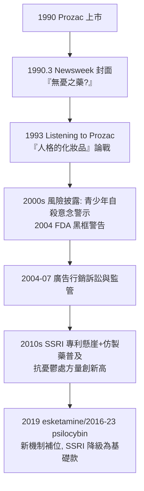

## 1987 - 百憂解與精神藥理學的黃金年代（Prozac 上架：血清素成為大眾文化，憂鬱症成為可談論的病）

## 案件摘要

**本案的偵探在垃圾桶裡翻出了世界的下一種藥：一個被判定失敗的化合物，十年後成為史上第一個年銷超過 20 億美元的處方藥，並把「憂鬱症」三個字帶進了每一間客廳。**

1987 年 12 月 29 日，美國 FDA 核准 Eli Lilly 的**氟西汀（fluoxetine，商品名 Prozac／百憂解）**——第一個選擇性血清素再回收抑制劑（SSRI）。其研發源自 1970 年代 Bryan Molloy 與 Ray Fuller 在 Lilly 實驗室的分子改造：目標是「只攔血清素、不動去甲腎上腺素」的更安全三環替代品（他們從抗組織胺苯海拉明的分子骨架出發；有論述稱原型分子 phenoxypropylamine 曾被同事棄置，Molloy 從「垃圾桶」裡重拾改造——本案著名的軼事）。1990 年上市後，《新聞週刊》1990 年 3 月以 Prozac 為封面，《Listening to Prozac》（Peter Kramer, 1993）成為暢銷書，憂鬱症首次成為可公開討論、可示範、可代言的疾病。本案是精神藥理學黃金年代（1952–1990，始於氯丙嗪，見 `1952-氯丙嗪與多巴胺假說的誕生.md`）的終章與大眾化轉折。

## 前因 -- 為什麼會有這個案子

- **三環抗憂鬱藥的代價**。TCAs（丙咪嗪 1957 起）有效率僅約 60–70%，且有抗膽鹼副作用（口乾、便秘、青光眼風險）、心臟毒性（過量即致死，QT 延長與傳導阻滯）、姿勢性低血壓——「安全的抗憂鬱藥」是明確的研發缺口。
- **單胺假說的工程化**（見 `1965-單胺假說的誕生.md`）。Axelrod 的再回收機制（1961）提供了設計藍圖：阻斷 5-HT 轉運體（SERT）即提升突觸血清素——分子設計有了明確靶點。
- **Zimelidine 的先行與退場**。瑞典 Astra 的 zimelidine（1982）為第一個上市 SSRI，卻因罕見致命副作用（Guillain-Barré 症候群）於 1983 年下架——靶點被證明可行，安全競賽開跑。
- **行銷環境的解鎖**。1980s 美國開放藥品面向消費者的廣告（DTCA）；醫管組織（HMO）偏好「一病一藥、一天一次」的處方經濟學——百憂解的安全故事與用藥簡便，恰好落在風口。

## 線索與推理 -- 數學式、程式、理論

**線索一：分子工程的選擇性偵查。** Molloy 與 Fuller 的策略：從已知藥理骨架做結構—活性掃描：

```python
# 1970s Lilly SSRI 設計流程
def design_ssri():
    scaffold = diphenhydramine_like  # 苯海拉明類骨架
    for analog in enumerate_analogs(scaffold):
        sert_ic50 = assay_sert(analog)      # 血清素轉運體親和力
        net_ic50 = assay_NET(analog)        # 去甲腎上腺素轉運體
        musc    = assay_muscarinic(analog)  # 抗膽鹼(避免)
        if sert_ic50 < 20e-9 and net_ic50/sert_ic50 > 100 and musc < 1e-5:
            yield analog                    # 高選擇性 = 候選藥
    # 1974 年篩得 fluoxetine (LY-110140) -> 1976 進入人體試驗
```

$$ \text{選擇性} = \frac{IC_{50}(\text{NET})}{IC_{50}(\text{SERT})} \gg 1 \quad \Rightarrow \quad \text{「只動血清素」的設計目標} $$

**線索二：上市前後的臨床證據。** 1980s 的試驗顯示：對重度憂鬱，fluoxetine 與 TCAs 療效相當（ $ \approx 60\% $ 緩解），優勢在耐受性與過量安全性——「病人自殺時手邊的藥不容易殺死自己」在精神科是重大差異。1990s 起的薈萃分析則揭示陰影：**在輕中度憂鬱，SSRI 與安慰劑的差距有限**（Kirsch 1998/2008 的著名分析），優勢集中在重度——「奇蹟藥」敘事與數據的落差，成為 2000s 藥廠行銷爭議的核心。

**線索三：文化的反噬與遺產。** 1990s 本案的社會史比臨床史更戲劇化：



批評陣營（David Healy 的醫學史書寫、Kirsch 的安慰劑分析、Marcia Angell 於 NYRB 的系列文章）把本案定義為「疾病與藥物的相互發明」；辯護陣營則指出：SSRI 對強迫症、恐慌、廣泛性焦慮、經前不悅症的真實療效，與「憂鬱症可談論化」對就醫率的提升——兩面皆是本案卷宗。

**線索四：後續家族與退場的黃金年代。** SSRI 家族（paroxetine 1992、sertraline 1991、citalopram 1998）與 SNRI（venlafaxine 1993）席捲 1990s；1987 年之後，精神藥理學再無「以舊機制、創世界銷售紀錄」的巨星——黃金年代在本案落幕，繼任者（氯氮平 1989 對難治型精神分裂、risperidone 1993、ketamine/esketamine 2000s–2019、psilocybin 臨床試驗）進入「機制多元、單品難爆」的後黃金時代。

## 結案 -- 後果與影響

- **憂鬱症的可見性革命**。 celebrities 公開服藥（1990s 起陸續）、工作場所談論心理健康、WHO 1990 年代起把憂鬱列為全球疾病負擔首位之一——去污名的社會工程以前所未有的規模展開。
- **「人格化妝品」的哲學案**。Kramer 提出的問題——如果藥能改變「誰在思考」，治療與增強的界線在哪？——成為 21 世紀認知增強、注意力藥物、情緒優化的倫理前奏。
- **風險的帳本**。SSRI 的性功能障礙（約 30–50% 使用者報告）、情感鈍化、停藥症候群（discontinuation syndrome，藥廠較早稱「停藥反應」而拒用「戒斷」一詞，成為爭議點）、青少年自殺意念警示（2004 黑框警告，後經修正評估為風險—未治療風險的權衡題）——每一筆都寫進了本案的附錄。
- **一句話結案**：百憂解案的偵查本質是一場「選擇性」的勝利——**分子學會了只攔一種轉運體；社會則學會了只談一種情緒**。兩者都大幅前進，也都留下了選擇性忽略的盲區：分子的盲區在其他神經系統，社會的盲區在那些不適合被敘事包裝的痛苦。

## 關鍵人物與文獻

- **Bryan Molloy（1939–2004）**——Lilly 有機化學家，fluoxetine 的合成者；自述靈感流程的低調科學家。
- **Ray Fuller（1935–2015）**——Lilly 神經藥理學家，選擇性策略的推動者；亦為度洛西汀（Cymbalta）的藥理設計者。
- **David Wong**——Lilly 藥理學家，1974 年確認 fluoxetine 的 SERT 選擇性（含量測定與作用機制的關鍵偵探）。
- **Peter D. Kramer（1948– ）**——精神科醫師、作家；*Listening to Prozac*（1993）把本案推進大眾文化與哲學辯論。
- **Irving Kirsch（1943– ）**——安慰劑研究者；2008 年 PLoS Medicine 薈萃分析（FOIA 取得未發表試驗數據）是本案科學面的最重要再偵查。
- 原始文獻——Stark et al., *J. Med. Chem.*（1985, fluoxetine 藥理）；Wong et al.（1974–85 系列）；Kirsch et al., *PLoS Med.* 5:e45（2008）。
- 現代註腳——2023 年英國 NHS 開始的社會處方與談話治療優先政策、2020s 裸蓋菇素在 Oregon 與澳洲的合法化進程——本案建立的「以藥物定義疾病的時代」，正在被多軌治療主義部分修正；但 SSRI 仍是全球處方量最大的精神藥物類別，百憂解的卷宗仍是精神藥理學最受翻閱的一冊。
