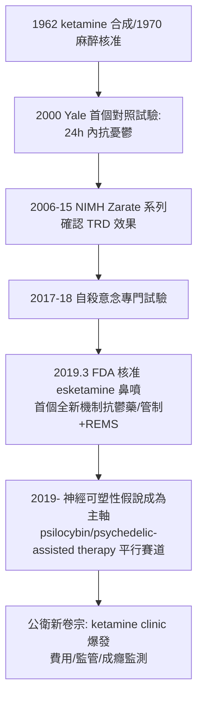

## 2019 - Ketamine 與 esketamine 的快速起效革命（數小時拉回自殺邊緣的人：抗憂鬱藥理論的第三次換軌）

## 案件摘要

**本案的兇手換人了：單胺退場，谷氨酸登場——一種麻醉劑與派對毒品（K 他命），被證明能在數小時內緩解用了三十年仍無效的憂鬱，甚至壓下自殺意念；抗憂鬱治療的「起效時間」被永久改寫。**

2000 年，耶魯 John Krystal 與 Dennis Charney 團隊發表首個對照試驗：單次靜脈注射亞麻醉劑量 **ketamine**（$ 0.5 \text{ mg/kg} $，40 分鐘），對難治型憂鬱症在 24–72 小時內顯著改善——遠快於 SSRI 的 2–6 週。2006 年起系列試驗（Zarate, NIMH）確認對難治型憂鬱與**自殺意念**的快速效果。2019 年 3 月，FDA 核准 esketamine（S-鏡像異構物，Janssen，鼻噴劑，商品名 Spravato）為全球首個「難治型憂鬱」與「伴自殺意念之 MDD」的新機制藥物。本案是自 1987 年百憂解（見 `1987-百憂解與精神藥理學的黃金年代.md`）以來第一個全新機制的抗憂鬱藥，也把「谷氨酸—突觸可塑性」推上病因偵查的中心舞台。

## 前因 -- 為什麼會有這個案子

- **治療抵抗的困境**。STAR\*D（2006，史上最大抗憂鬱階梯試驗，3671 人）顯示：第一種藥物緩解率僅約 1/3，四輪治療後累計緩解率約 67%，且每輪遞減——三分之一病人屬「難治型憂鬱（TRD）」，而 SSRI 家族對此束手。
- **時間差的再次揭露**。單胺假說（1965，見 `1965-單胺假說的誕生.md`）解釋不了為何「增加單胺要數週才見效」——快速的 esketamine 證明大腦存在「被快速觸發」的抗憂鬱通路，只是三十年來的藥物沒有打中它。
- **氯胺酮的雙重前科**。1962 年合成（Calvin Stevens）、1970 年 FDA 核准為分離性麻醉劑（戰場麻醉神器，越戰大量使用）；1980s 起成為俱樂部毒品「K 他命」——它必須同時洗掉「毒品」的污名才能入藥。
- **谷氨酸系統的解禁**。1990s 神經科學確認谷氨酸是中樞最普遍的興奮性遞質，NMDA 受體與突觸可塑性（LTP/LTD）研究成熟——「把抗憂鬱研究從單胺搬去谷氨酸」的理論彈藥已備。

## 線索與推理 -- 數學式、程式、理論

**線索一：機制鏈的偵查（當代精神藥理學最完整的一條因果線）。**

$$ \text{ketamine} \xrightarrow{\text{阻斷 NMDA}} \text{中間神經元去抑制} \xrightarrow{\text{谷氨酸爆發}} \text{AMPA 受體激活} $$

$$ \xrightarrow{\text{mTOR 通路}} \text{BDNF/突觸蛋白} \uparrow \xrightarrow{\text{突觸生成(synaptogenesis)}} \text{前額—邊緣迴路可塑性修復} $$

這條鏈在動物模型（Li Nanping & Duman 的 PFC 錐體細胞棘突實驗，2010）與人類 EEG/fMRI 中都有對應證據——「抗憂鬱＝修復突觸連接」的**神經可塑性假說**由本案正式接棒，單胺降級為「調節器」。

**線索二：臨床數據的形狀。** 單次輸注的反應曲線：

```python
# ketamine 單劑效應輪廓 (亞麻醉劑量 0.5 mg/kg over 40 min)
def ketamine_curve(t_hours):
    # 0-1h: 解離感/血壓升高(監測項) ; 4-24h: MADRS 急速下降
    # 72h: 效應峰值區 ; 7-14 天: 單劑效應消退
    return "單劑緩解率 ~50-70% (TRD), 效應持續 ~1 週 -> 需重複給藥維持"
```

效果「快而短」成為本案最大工程難題：治療必須重複（每週兩次的 esketamine 鼻噴＋兩小時診間監測），費用與可及性立刻成為公衛議題——「快」解決了自殺風險的時間緊迫，「短」留下了維持治療的商業與倫理爭論。

**線索三：自殺意念的專門證據。** 2017–2018 年的兩項關鍵試驗（Janssen 的 esketamine 對「即將發生的自殺風險」試驗、Wilkinson 的 Yale ketamine 對自殺意念試驗）顯示 4–24 小時內自殺意念評分顯著下降——精神醫學第一次擁有針對「急性自殺危機」本身的快速作用藥物（此前只有住院、約束與等待）。

**線索四：倫理與濫用的雙軌偵查。** esketamine 被 FDA 列為管制藥物（Schedule III），必須在 REMS 註冊診間使用、給藥後監測兩小時（解離與血壓）；同時美國的「ketamine clinic」產業以標示外使用爆發式增長（2019 年後數百間診所），價格、監管、成癮風險不一——本案在醫學獲准的同時，立刻開啟了「快速抗憂鬱藥的市場失序」新卷宗。與此平行：psilocybin（5-HT2A 激動劑，2016–2023 多項 II 期成功）以「迷幻劑輔助心理治療」路線重演本案結構——1960s 的迷幻藥研究（Humphry Osmond 的 psychedelic 一詞、加拿大 Weyburn 療養院試驗）在五十年後以 RCT 之姿重返。



## 結案 -- 後果與影響

- **病因學的第三次換軌**。憂鬱症的偵查主軸：體質與道德（19 世紀）→ 單胺匱乏（1965）→ **突觸可塑性與迴路功能**（2010s–）。單胺假說未被推翻，而是被重新安置為「上游調節器」——精神藥理學證明了一個結構性事實：**「有效藥物的機制地圖」不等於「疾病的地圖」**。
- **難治型憂鬱的制度性確認**。TRD 成為正式適應症類別，健保與試驗設計圍繞它重組（歐洲 EMA 2019 同步核准）；「治療階梯」新增「急性危機快速介入」這一格。
- **藥物與心理治療的再融合**。esketamine 的 REMS 要求心理監測、psilocybin 的設計更是「藥物＋數次整合性心理治療」——1977 年 Engel 的生物—心理—社會模式（見 `1977-恩格爾與生物心理社會模式.md`）在新藥的協議書裡獲得實作化的回歸。
- **一句話結案**：ketamine 案的偵查教訓是——**舊藥的新用途，常常等的不是新化學，而是新問題的命名**（難治型憂鬱、急性自殺意念）；當臨床把問題精確化，垃圾堆與麻醉車上的舊化合物，都可能成為下一代的救命藥。1949 年 Cade 的鋰鹽（見 `1949-鋰鹽的發現.md`）如此，2019 年的 ketamine 亦然。

## 關鍵人物與文獻

- **John Krystal（1958– ）**——耶魯精神科主任、VA 國家 PTSD 中心主任；2000 年首試驗的主要研究者。
- **Dennis Charney（1951– ）**——時任 NIMH Mood and Anxiety Disorders 計畫主持人；與 Zarate 共同推動系列試驗；後任 Mount Sinai 精神科院長。
- **Carlos Zarate（1955– ）**——NIMH 臨床科學家；TRD 與自殺意念試驗的主力；ketamine 神經生物學與副作用風險分層的關鍵作者。
- **Ronald Duman（1954–2020）**——耶魯神經科學家；mTOR—BDNF—突觸生成機制鏈的動物實驗奠基者（2010 *Nature Medicine* 系列論文）。
- **Calvin Stevens**——Parke-Davis 化學家，1962 年合成 ketamine（本名曾以「CI-581」試驗）。
- 原始文獻——Berman et al., *Biol. Psychiatry*（2000）；Zarate et al., *Arch. Gen. Psychiatry*（2006）；Duman, Aghajanian et al., *Nature Medicine*（2012 綜述）；Popova et al., *Am. J. Psychiatry*（2019, esketamine TRD 試驗）。
- 現代註腳——2020s 的下一批候選：NMDA 靶點的口服藥（AXS-05、rapastinel）、精神速效「無解離感」設計、psilocybin 的 III 期（2023–25）、以及數位表型監測給藥安全——本案開啟的「以可塑性為靶點」賽道，仍在加速。
