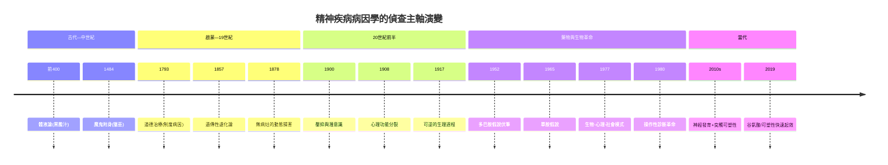

# 精神科的歷史：從體液論的憂鬱、獵巫的火刑、皮內爾的鑰匙，到氯丙嗪、DSM、百憂解與 ketamine 的偵查長卷

> 本書以「推理探案」的體例，為人類精神醫學史上的每個關鍵事件寫一篇 wiki：
> 謎題是什麼（瘋狂、憂鬱、躁鬱、精神分裂）？兇手是誰（黑膽汁、魔鬼、退化基因、多巴胺、血清素、社會制度）？
> 偵探是誰（希波克拉底、皮內爾、夏科、佛洛伊德、布洛伊勒、Cade、Delay、Spitzer、Kramer、Krystal）？
> 每篇檔名以年份開頭（4 位數，負年以 `-` 開頭，西元前補零如 `-0400`）。

## 雙線主軸

| 線 | 演變 |
|---|---|
| **病因理論線** | 神罰附身 → 體液失調（黑膽汁）→ 魔鬼與女巫 → 遺傳性退化 → 潛意識與壓抑 → 神經遞質（多巴胺、單胺）→ 神經發育與突觸可塑性 → 生物—心理—社會整合 |
| **治療與制度線** | 神殿驅邪 → 獵巫火刑 → 瘋人院大禁閉 → 皮內爾解鎖與道德治療 → 軀體治療（瘧熱、胰島素昏迷、電痙攣、額葉切除）→ 藥物革命（鋰鹽、氯丙嗪）→ 去機構化 → 診斷標準化（DSM）→ 大眾化（百憂解）→ 病人權利與快速起效新藥 |

---

## 年表（非常詳細版）

### 第一篇：古代與中世紀——瘋狂的第一份自然化偵查與魔鬼化冤案

| 年份 | 事件 | 意義 | wiki |
|---|---|---|---|
| 約前 400 | 希波克拉底學派：《論神聖病》把癲癇與瘋狂自然化；憂鬱歸因黑膽汁過多 | 精神疾病第一次離開神殿、進入醫學 | [-0400-希波克拉底與體液論的憂鬱症](-0400-希波克拉底與體液論的憂鬱症.md) |
| 約前 350 | 亞里斯多德學派《問題集》XXX：「天才多憂鬱質」命題 | 憂鬱成為西方文化的核心隱喻 | 同上 |
| 2 世紀 | 蓋倫系統化體液論＋腦室學說；統治醫學 1500 年 | 體液論治療（放血、瀉藥）沿用至 19 世紀 | 同上 |
| 1484 | 教宗詔書 *Summis desiderantes affectibus* 授權獵巫 | 幻聽、抽搐、木僵被解讀為魔鬼附身 | [1484-獵巫手冊與精神疾病的魔鬼化](1484-獵巫手冊與精神疾病的魔鬼化.md) |
| 1486 | 《錘煉女巫》出版：刑求、定罪的「鑑識手冊」 | 不可證偽的封閉司法系統；4–6 萬人處死 | 同上 |
| 1563 | Johann Weyer 主張受審者是病人不是罪犯 | 「瘋人非罪人」的最早醫學平反，被列禁書 | 同上 |
| 1656 | 法國大禁閉：Hôpital Général，瘋人與乞丐同籠 | 收容制度取代驅魔；瘋癲成為社會問題 | [1793-皮內爾解開鎖鏈](1793-皮內爾解開鎖鏈.md) |

### 第二篇：啟蒙與 19 世紀——解鎖、劇場與退化論

| 年份 | 事件 | 意義 | wiki |
|---|---|---|---|
| 1789–1796 | Chiarugi（托斯卡尼）禁鎖鏈；Tuke 創 York Retreat（1796） | 道德治療的平行案件 | [1793-皮內爾解開鎖鏈](1793-皮內爾解開鎖鏈.md) |
| 1793 | Pinel 在 Bicêtre 解開鎖鏈（與 Pussin）；1795 轉 Salpêtrière | 瘋人是可對話的病人；個案紀錄誕生 | 同上 |
| 1801 | Pinel《精神疾病的醫學哲學論述》：五類分類法 | 精神醫學的分類學起點 | 同上 |
| 1838 | 法國精神病院法（Esquirol 主導） | 精神病院成為「治療的器官」；專科化 | 同上 |
| 1857 | Morel 遺傳性退化論 | 19 世紀精神醫學最龐大的錯誤歸因框架 | [1878-夏科與沙爾佩提耶的歇斯底里劇場](1878-夏科與沙爾佩提耶的歇斯底里劇場.md) |
| 1870s | 夏科在沙爾佩提耶研究歇斯底里；催眠「製造與取消症狀」 | 「症狀可被暗示開關」的實驗展示 | 同上 |
| 1882 | 夏科向科學院報告催眠為可實驗現象 | 催眠學術平反；Janet 開始創傷記憶研究 | 同上 |
| 1885–86 | 佛洛伊德留學 Charcot 門下、後赴南錫學催眠 | 精神分析的直系技術來源 | [1895-歇斯底里研究與精神分析誕生](1895-歇斯底里研究與精神分析誕生.md) |
| 1893–96 | Breuer 的 Anna O. 案整理；Freud 提出「壓抑」 | 「症狀＝被壓抑記憶的回返」假說成形 | 同上 |
| 1896 | Kraepelin 發表早發性癡呆與躁鬱病二分法 | 診斷以「病程與結局」為本；診斷統計革命 | [1908-布洛伊勒命名精神分裂症](1908-布洛伊勒命名精神分裂症.md) |

### 第三篇：精神分析世紀與軀體治療時代

| 年份 | 事件 | 意義 | wiki |
|---|---|---|---|
| 1900 | Freud《夢的解析》：顯夢/隱夢、夢工、檢查者 | 解夢成為潛意識的偵查技術 | [1900-夢的解析與解夢偵查技術](1900-夢的解析與解夢偵查技術.md) |
| 1902–1910 | 週三心理學會 → 國際精神分析協會（IPA） | 精神分析從診室長成國際運動 | 同上 |
| 1908 | Bleuler 柏林演說命名 schizophrenia；1911 出版專著 | 「四 A 基本症狀」；去掉「必然癡呆」的死刑 | [1908-布洛伊勒命名精神分裂症](1908-布洛伊勒命名精神分裂症.md) |
| 1911 | Bleuler 創造 autism（自閉）一詞 | 日後分裂為精神分裂症與自閉症兩個家族 | 同上 |
| 1913 | 野口英世在 GPI 病人腦中驗出梅毒螺旋體 | 「瘋」是果、「病」是因的鐵證 | [1917-瘧熱療法治癒瘋狂](1917-瘧熱療法治癒瘋狂.md) |
| 1917 | Wagner-Jauregg 瘧熱療法首例（1927 諾獎） | 精神疾病第一個有效生物學治療 | 同上 |
| 1933 | Sakel 胰島素昏迷治療系統化發表 | 軀體治療時代開幕；療效與傷害的雙面案 | [1933-胰島素昏迷治療](1933-胰島素昏迷治療.md) |
| 1934 | Meduna 戊四氮抽搐療法 | 「抽搐治精神病」路線 | [1938-電痙攣治療的誕生](1938-電痙攣治療的誕生.md) |
| 1935 | Moniz–Lima 首批額葉白質切除（11 月） | 1949 年獲諾貝爾獎的世紀錯案 | [1935-額葉切除術的悲劇](1935-額葉切除術的悲劇.md) |
| 1936–1946 | Freeman 引入美國（1936）、經眼眶冰錐法（1946） | 手術量產化；Rosemary Kennedy 案 | 同上 |
| 1938 | Cerletti 與 Bini 首例電痙攣治療（4 月，羅馬） | 屠宰場靈感；此後八十年仍為重度憂鬱利器 | [1938-電痙攣治療的誕生](1938-電痙攣治療的誕生.md) |
| 1941 | Rosemary Kennedy 接受 lobotomy | 手術傷害的社會證據 | [1935-額葉切除術的悲劇](1935-額葉切除術的悲劇.md) |
| 1949 | Cade 發表鋰鹽治躁症（MJA, 9 月） | 第一個情緒穩定劑；唯一證實降自殺率的藥 | [1949-鋰鹽的發現](1949-鋰鹽的發現.md) |
| 1949 | Moniz 獲諾貝爾生理學或醫學獎 | 權威蓋章錯案的頂點 | [1935-額葉切除術的悲劇](1935-額葉切除術的悲劇.md) |
| 1954–1970 | Schou 雙盲試驗＋血鋰監測；1970 美國 FDA 核准 | 鋰鹽全球正名；TDM 誕生 | [1949-鋰鹽的發現](1949-鋰鹽的發現.md) |

### 第四篇：藥物革命、去機構化與批判運動

| 年份 | 事件 | 意義 | wiki |
|---|---|---|---|
| 1952 | Laborit 術前發現（1 月）；Delay–Deniker 精神科臨床報告（5 月） | 氯丙嗪＝抗精神病藥的誕生 | [1952-氯丙嗪與多巴胺假說的誕生](1952-氯丙嗪與多巴胺假說的誕生.md) |
| 1954 | Thorazine 進入美國；利血平的致鬱報告累積 | 精神病院人口曲線反轉；單胺線索埋線 | 同上 / [1965-單胺假說的誕生](1965-單胺假說的誕生.md) |
| 1955 | 美國州立精神病院在院人數峰值 55.9 萬 | 去機構化的起點壓力 | [1963-去機構化與社區精神醫療](1963-去機構化與社區精神醫療.md) |
| 1957 | Kuhn 發現丙咪嗪；Carlsson 證明多巴胺為獨立遞質 | 抗憂鬱藥誕生＋多巴胺化學入案 | [1965-單胺假說的誕生](1965-單胺假說的誕生.md) |
| 1957–58 | Snyder/Seeman 前身：抗精神病藥阻斷多巴胺受體 | 多巴胺假說的物證鏈 | [1952-氯丙嗪與多巴胺假說的誕生](1952-氯丙嗪與多巴胺假說的誕生.md) |
| 1961 | Szasz《精神疾病的迷思》、Goffman《瘋人院》同年出版 | 反精神醫學運動的兩份控方證詞 | [1961-反精神醫學運動的證詞](1961-反精神醫學運動的證詞.md) |
| 1961–1978 | Basaglia 運動 → 義大利 Law 180 關閉精神病院 | 精神疾病被重新定義為社會排除問題 | 同上 |
| 1963 | 甘迺迪簽署社區精神醫療中心建設法（10/31） | 去機構化的政策開幕；爛尾樓的藍圖 | [1963-去機構化與社區精神醫療](1963-去機構化與社區精神醫療.md) |
| 1965 | Schildkraut 兒茶酚胺假說；Coppen 血清素假說 | 憂鬱症生物學偵查的理論框架 | [1965-單胺假說的誕生](1965-單胺假說的誕生.md) |
| 1970s | 監獄與街頭接收出院病人；「旋轉門」現象 | 轉移性機構化；心理健康法庭與 CIT 的伏筆 | [1963-去機構化與社區精神醫療](1963-去機構化與社區精神醫療.md) |
| 1975 | 《飛越瘋人院》奧斯卡五獎；*O'Connor v. Donaldson* 判決 | 額葉切除的記憶＋病人權利的法律革命 | [1935-額葉切除術的悲劇](1935-額葉切除術的悲劇.md) / [1961-反精神醫學運動的證詞](1961-反精神醫學運動的證詞.md) |

### 第五篇：診斷革命、生物精神醫學與大眾化

| 年份 | 事件 | 意義 | wiki |
|---|---|---|---|
| 1973 | Rosenhan「On Being Sane in Insane Places」發表（1 月，《Science》） | 8 假病人全數未被識破；診斷信度醜聞公共化 | [1973-羅森漢實驗與診斷的極限](1973-羅森漢實驗與診斷的極限.md) |
| 1972–1978 | Feighner 標準（1972）→ RDC（1978） | 操作性診斷準則的先行工程 | [1980-DSM-III與生物精神醫學的轉向](1980-DSM-III與生物精神醫學的轉向.md) |
| 1977 | Engel《Science》提出生物—心理—社會模式 | 心與腦的世紀內戰被判「三層同時蒐證」 | [1977-恩格爾與生物心理社會模式](1977-恩格爾與生物心理社會模式.md) |
| 1980 | DSM-III 出版（Spitzer 主編）：265 診斷＋多軸＋操作性準則 | 診斷信度革命；精神醫學轉身為生物科學 | [1980-DSM-III與生物精神醫學的轉向](1980-DSM-III與生物精神醫學的轉向.md) |
| 1980s | PTSD（1980 DSM-III）、廣泛性焦慮等新類別入冊 | 診斷膨脹時代的開端 | 同上 |
| 1987 | FDA 核准氟西汀（Prozac／百憂解，12/29） | 第一個 SSRI；安全抗憂鬱藥時代 | [1987-百憂解與精神藥理學的黃金年代](1987-百憂解與精神藥理學的黃金年代.md) |
| 1990 | 《新聞週刊》Prozac 封面 | 憂鬱症成為大眾可談論的疾病 | 同上 |
| 1993 | Kramer《Listening to Prozac》暢銷 | 「人格化妝品」的哲學論戰 | 同上 |
| 1994 | DSM-IV 出版（297 診斷） | 診斷持續膨脹；Frances 日後自省 | [1980-DSM-III與生物精神醫學的轉向](1980-DSM-III與生物精神醫學的轉向.md) |
| 2000 | Carlsson 等獲諾貝爾獎（多巴胺訊號） | 精神藥理學的科學加冕 | [1952-氯丙嗪與多巴胺假說的誕生](1952-氯丙嗪與多巴胺假說的誕生.md) |
| 2004 | FDA 對青少年抗憂鬱藥發黑框警告 | 藥廠行銷與風險披露的時代爭議 | [1987-百憂解與精神藥理學的黃金年代](1987-百憂解與精神藥理學的黃金年代.md) |
| 2006–2008 | STAR\*D 結果；Kirsch 安慰劑薈萃分析 | 難治型憂鬱與 SSRI 有限優勢的再偵查 | [2019-ketamine與esketamine的快速起效革命](2019-ketamine與esketamine的快速起效革命.md) |
| 2013 | DSM-5 出版；NIMH 同步宣布 RDoC 轉向 | 類別診斷與生物學不對齊的內部叛變 | [1980-DSM-III與生物精神醫學的轉向](1980-DSM-III與生物精神醫學的轉向.md) |
| 2019 | Cahalan《The Great Pretender》重查羅森漢檔案 | 偵探也需被偵查 | [1973-羅森漢實驗與診斷的極限](1973-羅森漢實驗與診斷的極限.md) |

### 第六篇：可塑性時代——谷氨酸、迷幻劑與未完的卷宗

| 年份 | 事件 | 意義 | wiki |
|---|---|---|---|
| 2000 | Krystal 團隊首個 ketamine 對照試驗 | 數小時內抗憂鬱的物證 | [2019-ketamine與esketamine的快速起效革命](2019-ketamine與esketamine的快速起效革命.md) |
| 2006–2015 | NIMH Zarate 系列確認 TRD 效果；Duman 機制鏈 | 神經可塑性假說接棒單胺假說 | 同上 |
| 2016–2017 | C4 基因與突觸修剪（精神分裂症）；psilocybin II 期 | 神經發育假說與迷幻劑輔助治療的回歸 | [1908-布洛伊勒命名精神分裂症](1908-布洛伊勒命名精神分裂症.md) / [2019-ketamine與esketamine的快速起效革命](2019-ketamine與esketamine的快速起效革命.md) |
| 2017–2018 | esketamine 自殺意念專門試驗 | 首個針對急性自殺危機的快速藥物證據 | 同上 |
| 2019 | FDA 核准 esketamine 鼻噴劑（3 月） | 1987 年以來首個全新機制抗憂鬱藥 | 同上 |
| 2019– | ketamine clinic 產業爆發；REMS 監管 | 快速起效藥的市場失序新卷宗 | 同上 |
| 2020s | psilocybin III 期；Oregon/澳洲合法化進程；社會處方 | 生物—心理—社會三軌的新整合 | 同上 / [1977-恩格爾與生物心理社會模式](1977-恩格爾與生物心理社會模式.md) |

---

## 核心線索：理論的接力偵查

## 核心線索：治療與制度的鐘擺

| 擺幅 | 極端 | 教訓 |
|---|---|---|
| 收容 ↔ 社區 | 大禁閉（1656）→ 精神病院峰值（1955）→ 去機構化（1963–） | 推倒圍牆前，先蓋好圍牆外的世界 |
| 強力軀體治療 ↔ 保守 | 額葉切除量產（1946）→ 知情同意制度（戰後） | 「安靜了」不等於「痊癒了」 |
| 心理詮釋 ↔ 生物還原 | 精神分析診斷崩塌（1973）→ DSM-III 生物轉向（1980）→ BPS 整合（1977 並行） | 三層證據必須同時蒐集 |
| 藥物神話 ↔ 藥物懷疑 | 百憂解封面時代（1990）→ STAR\*D/Kirsch 再偵查（2006–08） | 有效的藥 ≠ 對的理論 |

---

## 本書的偵查守則（各篇通用的四段式）

每篇 wiki 皆以四段推案：

1. **案件摘要**——本案破解了什麼謎題？兇手是誰？
2. **前因**——為什麼會有這個案子？時代的謎面與技術條件。
3. **線索與推理**——證據鏈、數學式、演算法、理論模型的復原。
4. **結案**——後果與影響；正確的與錯誤的各留下什麼。

> 什麼是好的精神醫學偵查？——先確認瘋狂者是人（Pinel）、
> 先弄清兇手再找弱點（瘧熱療法）、先有誠實的觀察再談理論（Cade）、
> 名字承載預後所以慎命名（Bleuler）、診斷必須可重複（Spitzer）、
> 偵探本身也要被偵查（Rosenhan/Cahalan）。

---

## 延伸閱讀（同系列）

- [性病的歷史](../性病的歷史/README.md)——與本書共享 1913／1917 兩案：野口英世的螺旋體與瘧熱療法，是精神醫學與傳染病學的交界偵查。
