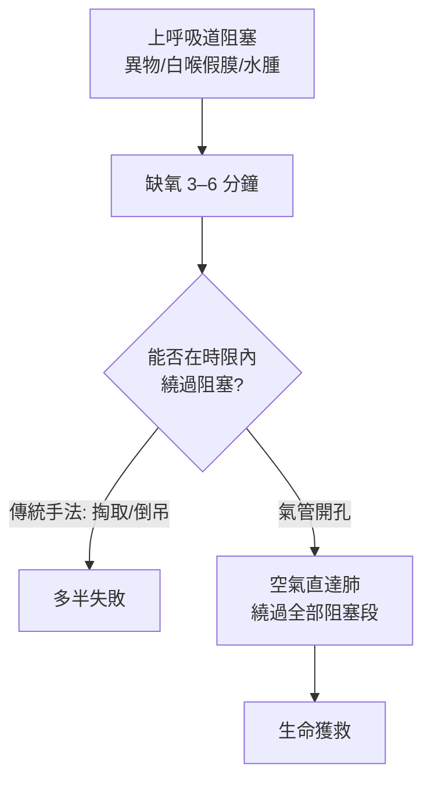

## -0100 - 阿斯克列皮亞德斯與最早的氣切傳說（在喉嚨上開一扇門）

## 案件摘要

**本案的兇器是窒息，而第一把刀的傳說來自羅馬的希臘醫生。**

公元前 1 世紀，生於比提尼亞的阿斯克列皮亞德斯（Asclepiades of Bithynia）被多份古代史料記載為「曾於喉部開孔以救回窒息者」的第一人。氣管切開術（tracheotomy）——在氣管上開一個洞讓空氣繞過阻塞直接進肺——是外科史上最有道德重量的手術之一：刀下不是病灶，而是一個人呼吸的最後一條路。本案追溯這個「在喉嚨上開門」的構想如何被恐懼阻擋近兩千年。

## 前因 -- 為什麼會有這個案子

- 喉部異物、白喉假膜（希波克拉底與 Aretaeus 描述的「敘利亞潰瘍」很可能即白喉）、會厭炎與創傷，都會在數分鐘內造成窒息——古代醫生目睹卻束手無策。
- 亞歷山卓學派的解剖學（Herophilus、Erasistratus）已確認氣管與肺的連通，「從氣管進氣可救肺」在解剖學上並非不可想像。
- 但蓋倫時代的權威氛圍反其道而行：蓋倫明言氣切「無益且危險」，此判決像一道禁令壓在西方外科上長達千年。
- 阿斯克列皮亞德斯本人以「溫和療法」（ diet、酒、音樂）聞名，卻傳出這樁最激烈的手術——傳說與史實的界線本案必須誠實標註。

## 線索與推理 -- 數學式、程式、理論

氣切救命的核心不是解剖學而是**生理學的前提**：必須先知道「呼吸是空氣進入肺，而非『靈氣』的活動」。這個觀念古代已有萌芽，但要到 17 世紀（Vesalius 的肺灌注實驗、Hooke 1667 年證明「通過切開的氣管向肺吹氣可維持生命」）才真正站穩。可用一個生死時間軸說明手術的價值：

```python
# 呼吸中斷後的存活曲線
def survive_time(minutes):
    if minutes <= 1: return "幾乎無損"
    elif minutes <= 4: return "可逆缺氧，腦損傷風險上升"
    elif minutes <= 6: return "不可逆腦損傷高危"
    else: return "臨床死亡"

for t in (0.5, 3, 5, 8):
    print(t, survive_time(t))
```



古代史料的疑點分析：記載阿氏氣切的是後世文獻（Caelius Aurelianus 的轉述系統帶有貶斥其「魯莽」的立場），且希臘羅馬醫學主流此後再無氣切的清楚病例——比較合理的解讀是：**他做過（或構思過），但技術與觀念土壤都太薄，手術隨人一起被遺忘**。這正是「孤例不立」的偵查原則：一個無人跟進的手術，等同沒有發生。

## 結案 -- 後果與影響

- 蓋倫禁令＋宗教禁忌使氣切在西方沈睡千年；Antonio Musa Brasavola 於 1546 年留下文藝復興首例紀錄（為一名膿腫患者）。
- 16–17 世紀 Fabricius（1600 年著《氣管切開術》但反對自己動刀）、Sanctorius（改良套管）、Casserius 與 Habicot（1618 年法國四例）逐步把手術「合法化」。
- 1765 年法國兒科醫生 Caron 為白喉窒息兒童氣切，開啟「氣切救小兒白喉」的戰線；但手術死亡率在 19 世紀初仍高達 50% 以上。
- 1909 年 Chevalier Jackson 以標準化技術把死亡率壓到 3% 以下（`1909-傑克遜規範氣切術.md`）；1885 年 O'Dwyer 的插管則在白喉戰場上先接管氣切的角色（`1885-歐德威白喉插管.md`）。
- 現代：氣切成為加護病房最常見的外科手術之一，亦是人工呼吸器時代的入口。從傳說中的希臘醫生到今日的 5 毫米皮膚切口，本案是「一個好點子等了一千八百年的時代」。
- 一句話結案：外科史上最簡單的切口，等了最久的人才敢下刀。

## 關鍵人物與文獻

- 阿斯克列皮亞德斯（約前 124–前 40），比提尼亞人，羅馬行醫；醫學史上的「溫和療法之父」與（可能的）氣切第一人。
- Caelius Aurelianus, *On Acute Diseases*（5 世紀拉丁文轉述）——本案主要但帶偏見的史料。
- 蓋倫對氣切的否定（《論喉部與氣管》）；Vesalius, *De humani corporis fabrica*（1543）的肺灌注插圖；Robert Hooke 1667 年皇家學會實驗。
- S. Florey, "Brief history of tracheostomy"（*Lancet*, 1976）；A. Froeschels 對古代文獻的考訂。
