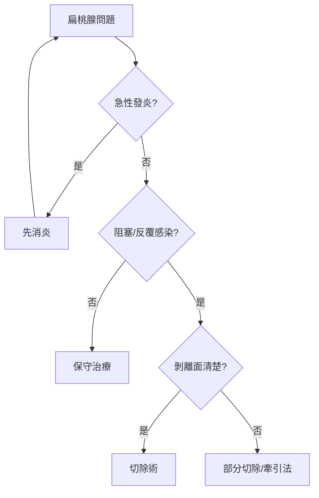

## 0030 - 塞爾蘇斯與扁桃腺切除（帝國外科手冊裡的喉嚨手術）

## 案件摘要

**本案的證物，是一本羅馬貴族寫的醫學百科——外科的第一次系統化。**

公元 1 世紀初，羅馬百科全書作者奧魯斯·塞爾蘇斯（Aulus Cornelius Celsus）在《論醫學》（*De Medicina*）第七書中，寫下了西方文獻中最完整、最可操作的扁桃腺切除術描述：什麼樣的扁桃腺該切（「發炎硬實、大小如無花果、妨礙吞嚥呼吸者」）、如何用手指與鉤子剝離、如何用小刀沿根部切除、如何止血與塗藥。更驚人的是他保留了**分級治療**的智慧——不是每顆扁桃腺都要動刀。這份兩千年前的手術指引，與現代扁桃腺切除的適應症邏輯驚人地相似。

## 前因 -- 為什麼會有這個案子

- 亞歷山卓外科傳統（Herophilus 學派）使「刀」重新回到希臘羅馬醫學；Celsus 承接的是這個技術爆發期累積的手法。
- 慢性扁桃腺炎、扁桃腺周膿腫（希臘人稱的危險「quinsy」）與肥大阻塞在古代極常見；兒童窒息於巨大扁桃腺是已知死因。
- Celsus 的《論醫學》是獻給貴族讀者的百科全書——**文風清晰、無術語堆砌**，反而成為技術得以被準確傳承的原因。
- 他前輩的記載零碎（如《希波克拉底文集》提過用指勾除扁桃腺），Celsus 的貢獻是把散落的手法整合成「適應症—步驟—併發症—保守替代」的完整流程。

## 線索與推理 -- 數學式、程式、理論

本案的「推理」不在生物學而在**決策邏輯**：什麼時候該切？Celsus 給出的判準可以用決策樹重現：

```python
def tonsillectomy_decision(tonsil):
    if not tonsil.obstructing and not tonsil.recurrent_infection:
        return "保守：含漱、局部敷藥（Celsus 的首選）"
    if tonsil.acute_inflammation:
        return "先消炎退腫，退了再切（急性期不動刀）"
    if tonsil.size >= "fig" and tonsil.firm and tonsil.encapsulated:
        return "手術：手指剝離＋小刀沿包膜切除"
    return "個案判斷"

print(tonsillectomy_decision(type("T", (), {
    "obstructing": True, "recurrent_infection": True,
    "acute_inflammation": False, "size": "fig",
    "firm": True, "encapsulated": True})()))
```



技術細節上，Celsus 描述的「以手指插入、把扁桃腺從肌肉上剝開、再沿根部切除」正是現代**包膜內剝離**（dissection）技術的原型；他還警告「切勿傷及深部血管」——儘管不知名，他已經摸到了我們今日稱為扁桃腺動脈分支的出血風險。書中同時記載了喉部息肉的摘除與異物取出，顯示這一章實為**咽喉外科的第一次系統整理**。

## 結案 -- 後果與影響

- 《論醫學》於 1443 年在米蘭被發現（文藝復興重見天日），印刷後（1478 年威尼斯版）立刻成為文藝復興外科的教科書；Paré、Vesalius 一代人是讀著 Celsus 學手術的。
- 扁桃腺切除術的歷史軌跡：中世紀 Guy de Chauliac 承襲；19 世紀 Physick 發明扁桃腺絞斷器（tonsillotome，1828）、1880 年代 Ballenger 全切除術推廣；20 世紀初美國一度「幾乎所有兒童都切」的濫切時代。
- 現代循證醫學把鐘擺拉回 Celsus 的分級智慧：Paradise criteria（1975，一年 7 次以上感染連續兩年等）重現了「不是每顆都該切」的原則——兩千年後的判準，與羅馬百科全書的精神一致。
- Celsus 也是外科史「清創、止血、縫合」三原則的整理者；扁桃腺章只是他龐大遺產的一角。
- 一句話結案：最好的外科指南不炫技，而是告訴你什麼時候不要用刀。

## 關鍵人物與文獻

- Aulus Cornelius Celsus（約前 25–約 50），《論醫學》七書（存八書），拉丁文的「醫學上的希臘化」代表。
- Guy de Chauliac, *Chirurgia Magna*（1363）中世紀承接；Philip Syng Physick 的 tonsillotome（1828，經 Kidder 改良）。
- J. L. Paradise et al., "Tonsillectomy and adenoidectomy for recurrent throat infection"（*Pediatrics*, 1975）。
- J. Scarborough, *Celsus, On Medicine, Books 5–8* 學術譯註（2016）。
