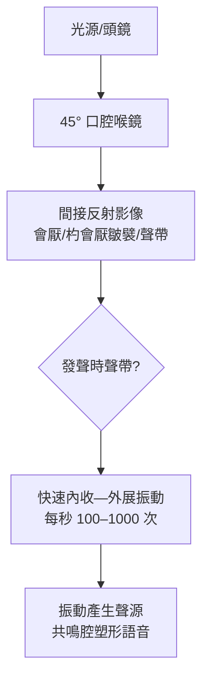

## 1854 - 賈西亞的喉鏡（一位歌者在鏡子裡看見了自己的聲帶）

## 案件摘要

**本案的偵探不是醫生，而是一位西班牙歌唱教師——案發地點是他倫敦家中的一面鏡子前。**

1854 年 9 月，曼努埃爾·帕特里西奧·羅德里格斯·賈西亞（Manuel Patricio Rodríguez García，聲樂教育家、倫敦王家音樂學院教授）在住家外散步時，看到薩伏伊宮屋頂上的日光反射，突然想到：**用一面小鏡子把光線反射進喉嚨，再以另一面鏡子觀察，應該能看見聲帶在發聲時的運動。**他返家實驗，第一次親眼看到活的聲帶開合。喉鏡（laryngoscopy）與喉科學（laryngology）就此誕生——一門醫學專科的開山第一鏡，握在歌者手中。

## 前因 -- 為什麼會有這個案子

- 歌唱教學的千年盲點：從文藝復興聲樂家 Zacconi 到 19 世紀的義大利學派，聲帶運動全靠觸摸喉頭外觀與內省推測，爭論無解（聲音究竟由會厭顫動還是聲帶閉合產生？）。
- 解剖學已備：Ferrein（1741）已提出「聲帶如琴弦」的振動理論（*la voix est un son de cordes vocales*）；Dionis、Ludwig 等的屍體喉部解剖已畫出聲帶形態——缺的只是**看見活體**。
- 技術條件恰好成熟：法國牙醫 Bozzini（1806）已構想內視鏡檢查；Babington 的「聲音鏡」（glottiscope，1829）；平行平面玻璃鏡製造技術成熟。
- 當時喉部疾病（結核、梅毒、乳頭狀瘤、白喉前夜）大量存在卻無法直視診斷——醫學需求早已排隊等這面鏡子。

## 線索與推理 -- 數學式、程式、理論

賈西亞的裝置是純光學：口腔小鏡（傾斜約 45°）＋頭鏡反射日光。光學設計可用簡式表示：

$$ \theta_{\text{反射}} = 2\theta_{\text{鏡面傾角}} \quad ; \quad \text{喉鏡像為上下左右全反之虛像} $$

```python
# 聲帶振動的「發聲—開合」模型（現代確認的振動週期）
def vocal_fold_cycle(period_ms=5):  # 男中音約 100–120 Hz
    phases = {"閉合相(聲門關)": 0.4, "開啟相(聲門開)": 0.6}
    # 女性頻率較高 → 週期較短
    for f in (100, 220, 440):
        print(f"{f} Hz: 週期 {1000/f:.1f} ms, 相位比 {phases}")

vocal_fold_cycle()
```



賈西亞 1855 年將發現投稿倫敦皇家學會（《On the function of the epiglottis》），並修正了自己 1854 年「會厭參與發聲」的初步猜想——確認**聲帶是聲源、會厭只是護欄**。醫學界反應耐人尋味：維也納的 Ludwig Türk 與 Johan Czermak（1857–58）在不知情的情況下獨立重複成功並大力推廣（Czermak 用人工光源使技術臨床化），爭議多年後學界公認**優先權屬賈西亞、臨床化功勞屬維也納學派**。這是本案的「雙偵探」結構。

## 結案 -- 後果與影響

- 喉科學作為專科誕生：倫敦喉科醫院（1863 年成立，世界首間專科醫院）、Morell Mackenzie 成為首位喉科專家（並在 1887 年為德皇威廉三世的喉癌提供照護，引發醫療—政治大風波）。
- 診斷革命：喉結核、喉梅毒、聲帶息肉、乳頭狀瘤首次可精確定位；1879 年 Kirstein 的直接喉鏡、1895 年 Killian 的懸吊喉鏡與 1897 年支氣管鏡一路延伸內視鏡疆域。
- 聲學與嗓音科學起步：Garcia 晚年（1887–1905）與 Ewald 的離體喉實驗確立**肌彈性—氣流動力學（myoelastic-aerodynamic）振動理論**的基礎；現代高速攝影與頻閃鏡（stroboscopy）仍在讀他那面鏡子的光。
- 1906 年賈西亞以百歲高齡獲皇家學會 Copley 獎章——唯一一位以「一面鏡子的發明」拿到醫學界殊榮的聲樂家。
- 一句話結案：醫學上最偉大的診斷工具之一，靈感來自想看清自己樂器的工匠精神。

## 關鍵人物與文獻

- Manuel García（1805–1906），西班牙男中音之子、聲樂世家後裔；倫敦王家音樂學院教授七十年。
- Ludwig Türk 與 Johan Czermak（維也納）——喉鏡的獨立重現與臨床推廣；Czermak 的《關於喉鏡的實際應用》（1858）。
- Morell Mackenzie, *Diseases of the Throat and Nose*（1880）——第一部系統性喉科教科書。
- Johannes Müller 與 Ernst Ewald 的喉部振動生理實驗；R. T. Sataloff 的嗓音醫學史綜述。
- M. P. R. García, "Observations on the human voice"（*Proceedings of the Royal Society*, 1855）。
