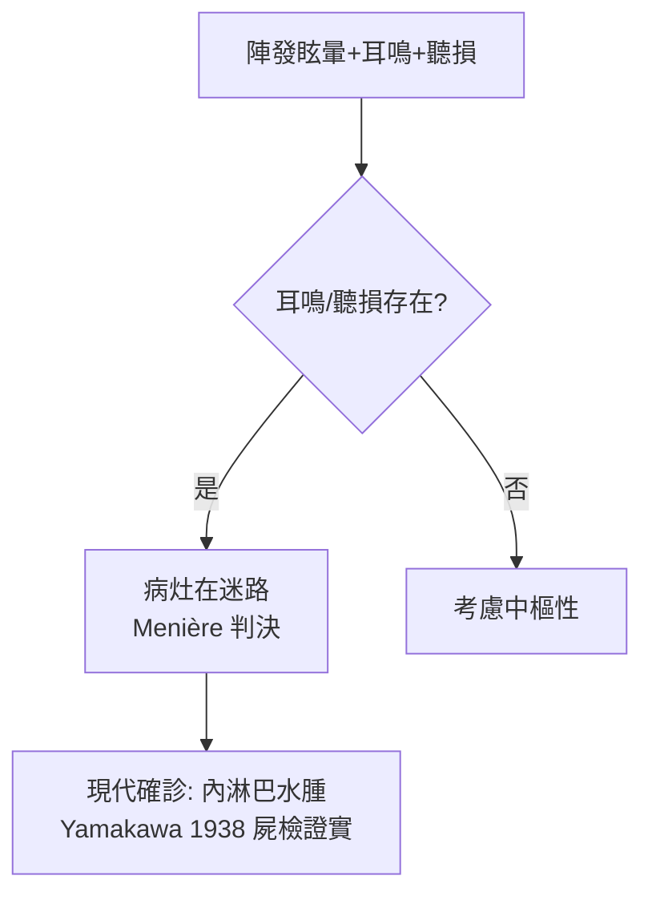

## 1861 - 梅尼埃：眩暈的病灶在內耳（把「腦子發瘋」改判成「耳朵生病」）

## 案件摘要

**本案要推翻的舊判決：天旋地轉的病人，千百年來被認為是腦中風或「神經錯亂」。**

1861 年 1 月，巴黎帝國聾啞研究所醫生普羅斯珀·梅尼埃（Prosper Menière）在法國科學院醫學部宣讀論文，提出一個大膽的病理解剖判決：陣發性眩暈、耳鳴、聽力下降三聯症的病灶，**不在腦，而在半規管與耳蝸所在的內耳迷路**。他手上有屍檢證據：一名病發猝死的年輕患者，屍檢發現半規管內充滿類似中耳炎的滲出物、腦實質卻正常。同年他死於肺炎，享年 62 歲——他的病名「Ménière's disease」成為醫學史上少數以「正確判案者」命名的疾病。

## 前因 -- 為什麼會有這個案子

- 傳統教條來自蓋倫—Aretaeus 的「眩暈＝腦部與胃部擾動」，19 世紀初神經病理學仍把眩暈歸於腦幹或「癲癇變體」。
- 梅尼埃的崗位是關鍵：聾啞研究所讓他接觸大量內耳病理材料；他熟悉 Cotugno（1760，內耳液體）與 Corti（1851，螺旋器）的解剖新知。
- 1830 年代法國的「congestion cérébrale」（腦充血）學說盛行，任何眩暈都被塞進這個籃子——梅尼埃的論文正是對這個籃子的公開抗議。
- 他此前已出版耳科專著（《聽覺的生理與病理研究》，1842），累積了把臨床與病理對上的方法。

## 線索與推理 -- 數學式、程式、理論

本案的核心推理是**鑑別診斷＋病理對位**。梅尼埃提出的三聯症與病位：

```python
def localize_vertigo(case):
    clues = []
    if case.tinnitus and case.fluctuating_hearing:
        clues.append("耳蝸/迷路受累 → 周邊性眩暈")
    if case.nystagmus and case.repeated_attacks and not case.neuro_deficit:
        clues.append("無神經缺損 → 非中樞性")
    return " ".join(clues) or "考慮中樞性: 腦幹/小腦"

class Case:
    tinnitus, fluctuating_hearing = True, True
    nystagmus, repeated_attacks, neuro_deficit = True, True, False

print(localize_vertigo(Case()))
```



現代病理學（1938 年 Hallpike 與 Yamakawa 的顳骨切片）最終確認梅尼埃病的組織學基礎是**內淋巴水腫（endolymphatic hydrops）**：內淋巴系統引流受阻或吸收失衡，膜迷路積水脹大。前庭生理上，一側迷路的壓力擾動造成兩側前庭神經放電不對稱：

$$ \text{眩暈感} \propto \left| \frac{d}{dt}\big( \Omega_{\text{左}} - \Omega_{\text{右}} \big) \right| \neq 0 \quad (\text{靜止時本應為 0}) $$

腦把「不對稱放電」解讀為「頭在旋轉」——於是病人靜止不動，世界卻天旋地轉。這正是梅尼埃判決的生理學意義：**眩暈是一種感覺器官的數學錯誤，而非靈魂的失序**。

## 結案 -- 後果與影響

- 病名確立：Trousseau 1868 年首用「maladie de Ménière」；英國術語一度誤寫為「Ménière's syndrome」，20 世紀病理學證實後「disease」回歸。
- 周邊/中樞鑑別從此成為眩暈診療的骨架：Bárány 的前庭功能檢查（1905–06，旋轉椅、溫度試驗，1914 諾貝爾獎）與 Dix–Hallpike（1952）測試，都是在梅尼埃打開的地基上蓋樓。
- 治療譜系展開：低鹽飲食（Furstenberg 1934）、內淋巴囊減壓（Portmann 1926→House 1962）、前庭神經切除、鼓室內慶大霉素——全部圍繞「內耳是病灶」這一判決。
- 1912 年 Robert Bárány 與 1952 年 Dix–Hallpike 進一步把「良性陣發性姿勢性眩暈」從梅尼埃病中分離（耳石症的 Epley 復位術 1980 年代普及）——本案最大的遺產是**眩暈的分類學**。
- 一句話結案：一位聾啞學校醫生用一次屍檢，把數百萬眩暈病人從「神經病」的名單上改判到「耳科」門診。

## 關鍵人物與文獻

- Prosper Menière（1799–1862），巴黎帝國聾啞研究所醫生；1861 年 1 月 8 日於法國科學院宣讀《On a particular type of deafness resulting from a lesion of the inner ear》。
- Aretaeus（2 世紀）與蓋倫——被推翻的舊判決。
- Domenico Cotugno（1760）、Alfonso Corti（1851）——內耳解剖的兩塊前置拼圖。
- Yamakawa（1938）、Hallpike 與 Cairns（1938）——內淋巴水腫的病理確認。
- Robert Bárány, "Untersuchungen über den vom Vestibularapparat des Ohres reflektorisch ausgelösten..."（1906）；1914 年諾貝爾生理學或醫學獎。
