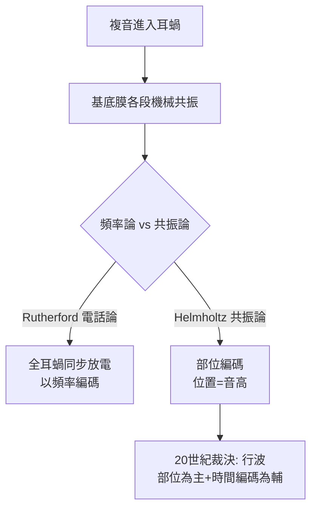

## 1863 - 黑姆霍茲的共振學說（用物理學重造一個耳蝸）

## 案件摘要

**本案的偵探是 19 世紀最強的科學頭腦之一，他要在耳蝸裡安裝一架鋼琴。**

1863 年，海德堡生理學家黑姆霍茲（Hermann von Helmholtz）出版《音的感覺》（*Die Lehre von den Tonempfindungen*），提出聽覺的**共振論（resonance theory）**：耳蝸（他認為是螺旋器與基底膜纖維）像一排長短不同的弦，各對一個特定頻率共振——高頻短弦在底圈、低頻長弦在頂圈。這是部位論的物理學定裝版，也是 19 世紀聽覺科學最具影響力的理論工程：它同時解釋了音高分辨、純音的「純」、以及復音（chord）為何能被拆解。

## 前因 -- 為什麼會有這個案子

- Du Verney（`1683-DuVerney耳蝸力學.md`）的部位論已立兩百年，但缺物理細節；Ohm（1843）提出「耳朵做傅立葉分析」的聽覺歐姆定律——理論拼圖已有數學一角。
- Corti（1851）剛發現螺旋器：內、外毛細胞、蓋膜、柱細胞的顯微結構問世，黑姆霍茲終於有可供「機械設計」的零件清單。
- 黑姆霍茲本人的裝備驚人：醫學訓練＋數學＋他發明的檢眼鏡（1851）；他以物理學家身份測量了大量弦與管樂器的聲學。
- 對手理論在場：Rutherford（1886）的頻率論（電話論）認為耳蝸以放電頻率直接複製聲波——兩派的世紀之爭即將開打。

## 線索與推理 -- 數學式、程式、理論

共振論的數學核心是受迫振動的品質因子 $Q$：要分辨相鄰半音，共振器需夠「尖」；但要跟得上快速音符，又不能太「鈍」——這個張力是理論的阿基里斯腱：

$$ f_n = \frac{1}{2\pi}\sqrt{\frac{k_n}{m_n}}, \qquad \Delta f \approx \frac{f_n}{Q} \; (\text{半音寬約 } 6\%) $$

```python
# 檢查共振論能否同時滿足「銳利」與「快速」
def resonance_tradeoff(f=1000, Q_required=17):
    bandwidth = f / Q_required            # 需要的頻寬
    decay = 2.2 / bandwidth               # 振鈴衰減時間 (s)
    note_gap = 0.05                        # 音符最短間隔 ~50 ms
    return f"1000 Hz, Q={Q_required}: 頻寬 {bandwidth:.0f} Hz, 振鈴 {decay*1000:.0f} ms vs 音符 {note_gap*1000:.0f} ms"

print(resonance_tradeoff())
# 振鈴遠長於音符間隔 → 共振論在時間解析上自相矛盾
```



黑姆霍茲用「拍頻」（beats）現象支持自己的學說：兩個相近音同時響時，人耳聽到 $|f_1-f_2|$ 的拍音——這證明耳朵有頻率解析力，且需「共振器們」的干涉來產生。他也以雙耳辨向、混音合成實驗（用泛音合成管風琴音色）支持「耳朵做傅立葉分解」。理論的失敗處在時間軸：基底膜若真是高 Q 共振器，音符切換時振鈴會糊成一團——這個矛盾要等 Békésy 的**寬調諧行波**（`1961-貝凱西行波學說諾獎.md`）與「毛細胞電學放大」（1990 年代）共同解決：耳蝸是**主動、寬調諧、有電學銳化的部位系統**，而非被動琴弦。

## 結案 -- 後果與影響

- 《音的感覺》成為聲學與心理聲學的聖經：音樂學、電信工程、心理物理學（Fechner 傳統）皆受其統治半世紀。
- Wever 與 Bray（1930）記錄到耳蝸微音電位（cochlear microphonic，波形式跟隨聲波），一度被當作電話論翻案證據，最終成為「兩種編碼並存」的橋樑。
- 實用遺產：聽力圖的頻率軸、助聽器的多頻道壓縮、人工耳蝸的電極頻率映射（`1978-克拉克多通道人工耳蝸.md`），全是「部位—頻率對應」思想的工程化。
- 黑姆霍茲的學生群（如對手 Rutherford 的批判、以及心理聲學派）讓「理論—實驗」的攻防成為聽覺科學的工作方式。
- 一句話結案：他造了一架錯誤的鋼琴，卻把整棟聽覺科學大樓的地基打對了。

## 關鍵人物與文獻

- Hermann von Helmholtz（1821–1894），《Die Lehre von den Tonempfindungen als physiologische Grundlage für die Theorie der Musik》（1863；英文版 *On the Sensations of Tone*, 1875）。
- Georg Ohm（1843）聽覺的歐姆定律；William Rutherford（1886）電話論。
- Weaver & Bray（1930）耳蝸微音電位；Georg von Békésy, *Experiments in Hearing*（1960）。
- H. A. Beagley 的聽覺理論史綜述；Peter Dallos, "Cochlear amplification"（*Nature*, 2008）——主動耳蝸的現代定論。
