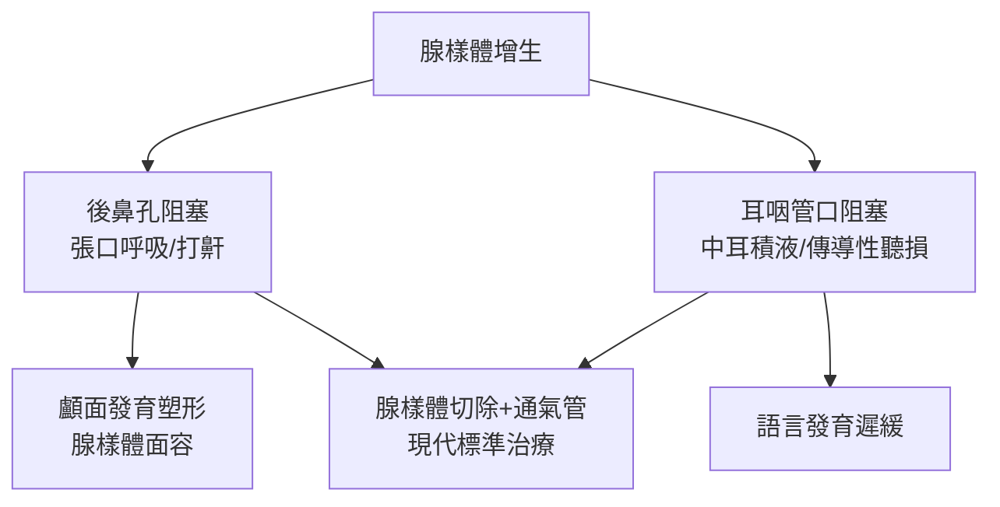

## 1868 - 梅耶的腺樣體（兒童張口呼吸的臉，藏著一塊鼻咽的肉）

## 案件摘要

**本案的「兇手」藏在鼻腔後方的死角，肉眼、鏡子與常規檢查全都看不見。**

1868 年，哥本哈根耳科醫生 Wilhelm Meyer 發表論文，命名並描述了**腺樣體（adenoid）**：鼻咽後壁的淋巴組織增生，阻塞後鼻孔與耳咽管開口。他指出這塊組織會造成兒童長期鼻塞、張口呼吸、睡眠打鼾，並塑造出著名的「**腺樣體面容**」——長臉、高拱顎、上唇短縮、下頜後縮、眼神倦怠。更重要的是他給出治療：設計環形刮刀（adenotome）經口刮除。兒童耳鼻喉科最經典的手術（腺樣體切除）就此誕生。

## 前因 -- 為什麼會有這個案子

- 腺樣體組織的存在早已被提及（1862 年 Mayer 曾描述，Meyer 與之無關），但無人把它與臨床症候群連結——鼻塞、耳聾、聽力發育遲緩在兒童科被分散診治。
- 鼻咽是「檢查黑洞」：前鼻鏡看不見、間接喉鏡進不去；後鼻鏡檢查在兒童幾乎不可行。診斷學的空白等於疾病的隱身。
- 1860 年代歐洲兒童結核與「腺體病（scrofula）」盛行，觸診頸部淋巴結與「腺樣增生」的關聯被廣泛討論。
- 耳科視角是本案的突破口：Meyer 診治大量慢性中耳炎與傳導性聽損兒童，追蹤發現他們**共同擁有鼻塞與張口呼吸**——臨床偵探的第一步是「找共因」。

## 線索與推理 -- 數學式、程式、理論

Meyer 的診斷法至今仍以其名流傳：「**後鼻指診**」——以彎曲食指從口腔繞入軟腭後方觸摸鼻咽，一指定案。他的推理鏈：

```python
def diagnose_adenoid(child):
    signs = []
    if child.mouth_breathing and child.snoring:
        signs.append("張口呼吸+打鼾 → 鼻咽阻塞")
    if child.hearing_loss and child.ear_infections:
        signs.append("耳咽管開口被堵 → 漿液性中耳炎")
    if child.long_face and child.high_arch:
        signs.append("長期口呼吸重塑顱面 → 腺樣體面容")
    return "腺樣體增生 (指診可證)" if len(signs) >= 2 else "繼續鑑別"

class Kid:
    mouth_breathing = snoring = True
    hearing_loss = ear_infections = True
    long_face = high_arch = True

print(diagnose_adenoid(Kid()))
```



生理學上，本案牽涉三個系統的耦合：**氣道力學**（鼻腔阻力 vs 口呼吸的乾燥與感染）、**耳壓力系統**（管口阻塞 → 中耳負壓 → 積液）、**顱面發育生物力學**（長期口呼吸改變舌位與咀嚼肌向量 → 顎拱窄、臉變長）。第三點今日稱為口腔正畸學的「氣道假說」，仍有學術辯論，但動物實驗（鼻塞猴的顱面畸形模型）支持其存在。

## 結案 -- 後果與影響

- 腺樣體切除術席捲 19 世紀末—20 世紀：1878 年 Ballenger 改良刮刀、1900 年代美國「腺樣體＋扁桃腺」（T&A）成為最常見兒童手術；1950–70 年代濫切高峰後，循證醫學收窄適應症。
- 漿液性（積液性）中耳炎的治療邏輯確立：腺樣體切除＋通氣管（`1954-阿姆斯特朗通氣管.md`）——本案與通氣管一案構成兒童聽力保護的雙支柱。
- 「腺樣體面容」進入正畸學與睡眠醫學：今日兒童阻塞性睡眠呼吸中止（OSA）的一線治療仍是腺樣體扁桃腺切除——一個 1868 年的觀察，餵養了 2020 年代的睡眠醫學。
- 後鼻鏡、鼻咽內視鏡（1970s）取代了 Meyer 的手指，但「看不見的解剖死角裡找病灶」的方法論精神未變。
- 一句話結案：醫學史上最成功的一筆「臨床症候群命名」——一塊肉，串起耳、鼻、臉與睡眠四個學科。

## 關鍵人物與文獻

- Wilhelm Meyer（1824–1895），哥本哈根；《On adenoid vegetations in the nasal cavity》系列論文（1868–1870），德文經典版 1870 年。
- Hans Wilhelm Meyer（1862）——較早的組織描述者（名字巧合，非同一人）。
- Ballenger（1878）與 Löwenberg 的刮刀改良；Kretschmann 的腺樣體鉗。
- J. M. McEwen 的歷史回顧 "Wilhelm Meyer and adenoids"；2010 年代 AAO-HNS 兒童 OSA 與 T&A 臨床指引。
