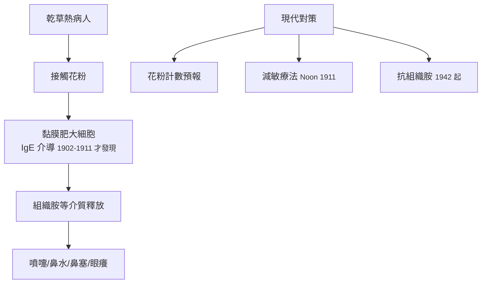

## 1873 - 布萊克利的花粉實驗（第一個把「乾草熱」的兇手抓進玻璃瓶的人）

## 案件摘要

**本案的兇手只有 0.03 毫米大，卻折磨了整個維多利亞時代的貴族夏天。**

「乾草熱」（hay fever）自 1819 年 Bostock 描述以來，病因眾說紛紜：乾草、玫瑰香氣、夏天的陽光、甚至「上流社會的神經質」。1873 年，英國醫生 Charles Harrison Blackley 發表劃時代實驗：他把自己當受試者，證明乾草熱由**禾草花粉**引起——用密封瓶收集並定量花粉計數、以皮膚劃痕試驗（scratch test，史上第一個）重現症狀、並證明加熱乾草不引起症狀。過敏性鼻炎的病因學、診斷學與「定量環境監測」方法，在同一份報告裡三箭齊發。

## 前因 -- 為什麼會有這個案子

- Bostock（1819，以自己為例的「夏卡他」描述）與 Elliottson（1830）曾提出花粉說，但缺乏定量與實驗證據，主流仍相信「香氣與炎夏」。
- 19 世紀中葉顯微鏡技術進步，花粉粒可被清楚觀察與分類——「看不見的病因」終於有辦法被拍照存證。
- Blackley 本人是乾草熱患者——醫學史上第一批「研究自己的醫生偵探」；他務農出身，熟悉乾草與牧場的季節律。
- 有趣的社會線索：乾草熱在英國貴族與鄉紳中異常流行（溫室、外來植物、鄉間度假），當時醫學界以此論證「神經質體質」——Blackley 必須先推翻這個階級偏見。

## 線索與推理 -- 數學式、程式、理論

Blackley 的證據鏈是完美的三重控制實驗：

```python
# Blackley 1873 的實驗設計（現代重構）
def experiment():
    results = {}
    results["乾草加熱後接觸"] = "無症狀 → 乾草本身無罪"
    results["香花接觸(閉眼)"] = "無症狀 → 香氣無罪"
    results["花粉定量監測 vs 症狀日誌"] = "相關 r 高 → 花粉為嫌犯"
    results["皮膚劃痕+花粉"] = "局部風團 → 直接因果"
    results["黏膜接觸花粉"] = "結膜炎+鼻炎 → 路徑確認"
    return results

for k, v in experiment().items(): print(f"{k}: {v}")
```



他還進行了花粉計數的季節監測，發現症狀高峰與禾草開花峰吻合、與溫度日照相關——這是**過敏原濃度監測**的發明。1911 年 Noon 與 Freeman 基於此發明減敏（免疫）治療；1902 年 Richet 的過敏（anaphylaxis，1913 諾獎）、1906 年 Pirquet 命名「allergy」、1921 年 Prausnitz–Küstner 被動轉移實驗、1966 年石坂夫婦發現 IgE——免疫學大廈一層層蓋在 Blackley 的花粉瓶上。

## 結案 -- 後果與影響

- 皮膚試驗成為過敏診斷的世界標準（今日的皮內/點刺試驗皆其直系）；花粉計數成為氣象服務的常規項目。
- 「過敏性鼻炎」獨立成病：1919 年以降逐漸與氣喘（isocyanate 等職業致敏、1920 年代 van Leeuwen 的「花粉症—氣喘進展」）關聯；ARIA 指引（2001）給出現代分類（間歇/持續、輕/中重度）。
- 治療世代：1942 年第一批抗組織胺（Bovet 與 Staub，1957 諾獎）、皮質類固醇鼻噴劑（1970s）、白三烯受體拮抗劑、舌下免疫治療與生物製劑。
- 本案的方法論遺產——**定量環境暴露＋人體實驗＋症狀日誌**——正是今日過敏科學與環境流行病學的基本格式。
- 一句話結案：過敏醫學的世紀，始於一位英國醫生把自己當成培養皿的那個夏天。

## 關鍵人物與文獻

- Charles Harrison Blackley（1820–1900），曼徹斯特；《Experimental Researches on the Causes and Nature of Catarrhus Aestivus》（1873）。
- John Bostock（1819）「夏卡他」首次臨床描述；Charles Eliottson（1830）花粉假說先驅。
- Leonard Noon 與 John Freeman（1911）減敏治療；Charles Richet（1913 諾獎）；Clemens von Pirquet（1906）「allergy」。
- 石坂公成與石坂照子（1966）IgE 的發現；ARIA 指引（Bousquet et al., 2001）。
