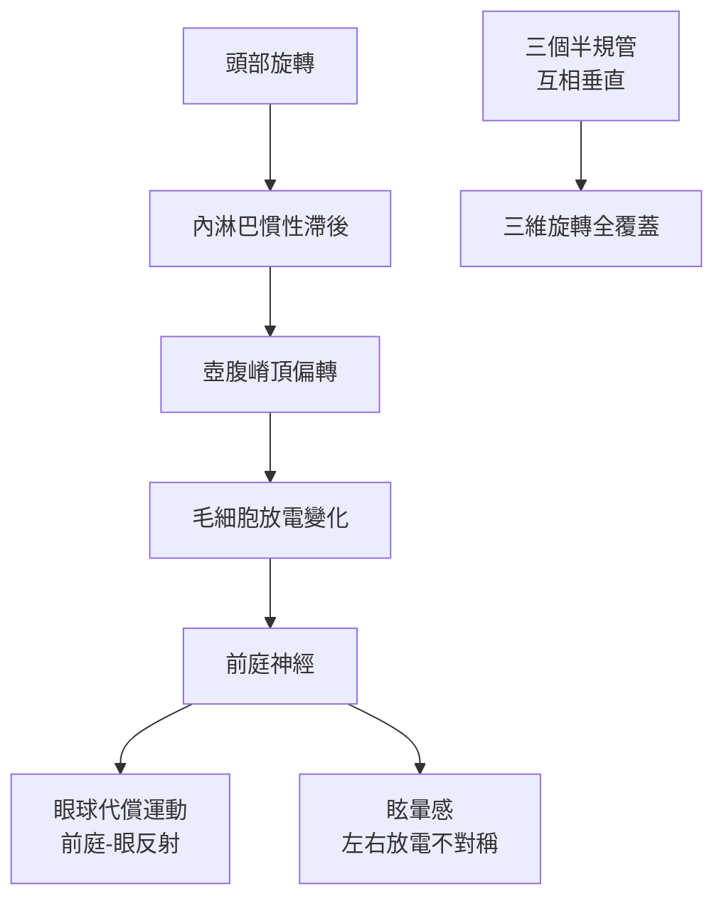

## 1875 - 馬赫與布羅伊爾：前庭器官的發現（第三個半規管身世之謎）

## 案件摘要

**本案要解開的謎題：內耳明明已有耳蝸（聽）與耳蝸神經，為什麼還藏著三個互相垂直的半規管？**

1873–75 年間，維也納物理學家恩斯特·馬赫（Ernst Mach，後以「馬赫數」聞名）與生理學家約瑟夫·布羅伊爾（Josef Breuer，佛洛伊德的精神分析啟蒙者），與紐約的亞歷山大·克雷恩（Alexander Crum Brown）幾乎同時、各自獨立提出：**半規管是頭部旋轉加速度的感測器**——管內的內淋巴因慣性滯後，推動壺腹嵴頂（crista ampullaris）偏轉，三個互相垂直的平面恰好覆蓋三維旋轉空間。前庭生理學就此誕生；耳鼻喉科從「聽覺科」升格為「平衡與聽覺科」。

## 前因 -- 為什麼會有這個案子

- 結構早就被看見：Lorenzini（17 世紀）描述半規管、Scarpa（1789）描繪前庭神經與球囊橢圓囊；但功能眾說紛紜——「平衡器官說」「聽覺輔助說」「血液供應說」並存。
- 火車與旋轉木馬的時代來臨：鐵路速度讓「暈車」「隧道內壓耳」成為大眾現象——生理學終於有了旋轉與加速度的日常實驗室。
- Goltz（1870）的鴿子實驗：切除半規管後鴿子頭姿異常、無法定向——「半規管與平衡有關」的臨床線索已現，缺的是物理學解釋。
- 馬赫本人研究多普勒效應與運動知覺；他發現「旋轉後的眩暈感持續時間」與物理預測可對上——理論與自體實驗在此交會。

## 線索與推理 -- 數學式、程式、理論

半規管本質是一組**機械性高通濾波器**——只對「加速度」起反應，穩定旋轉時信號衰減：

$$ \tau \frac{d\theta_{\text{頂帽}}}{dt} + \theta_{\text{頂帽}} = \tau \, \alpha_{\text{頭部}} \quad (\tau \approx 5\ \mathrm{s}) $$

```python
# 半規管傳遞函數：低頻衰減、只忠實追蹤中頻角加速度
def canal_gain(f):
    import math
    tau = 5.0
    w = 2*math.pi*f
    return (tau*w)/math.sqrt(1+(tau*w)**2)

for f in (0.01, 0.1, 1, 5):
    print(f"{f} Hz: 增益 {canal_gain(f):.2f}")
# 0.01 Hz: 0.31（慢性感覺遲鈍）… 1 Hz: 1.00（日常頭動最佳頻段）
```



布羅伊爾的補充同樣關鍵：他區分了半規管（動態，旋轉）與**耳石器**（橢圓囊/球囊，靜態，重力與直線加速度）的功能分工——「壺腹嵴管旋轉、耳石器管傾斜」。馬赫則用旋轉椅與「旋轉後眼震」的時間常數做定量驗證。Robert Bárány（1905–06）把這些理論變成臨床檢查：溫度試驗利用「熱使外半規管內淋巴上升」的對流原理引發眼震，開創前庭功能檢查學（1914 諾獎）。

## 結案 -- 後果與影響

- 前庭醫學誕生：Bárány 椅、眼震電圖（ENG，1930s）、視頻眼震圖（VNG）與前庭誘發肌源性電位（VEMP）——診斷工具鏈全由此發軔。
- 航空與航天的科學基礎：空間病（motion sickness）的感覺衝突理論、太空人的前庭訓練、飛行員的「黑視與空間定向障礙」預防，皆以本案理論為底。
- 臨床鑑別落地：BPPV（耳石掉入半規管）的 Epley 復位（1980s）、前庭神經炎與梅尼埃病的鑑別（`1861-梅尼埃眩暈病灶在內耳.md`），全部依賴「半規管 vs 耳石器 vs 中樞」的功能解剖。
- 有趣的副產品：Breuer 後來與佛洛伊德合著《歇斯底里研究》（1895）——同一個頭腦，先解剖了平衡，再解剖了心靈。
- 一句話結案：物理學家與精神分析之父聯手，證明人類頭顱裡裝著一具三軸陀螺儀。

## 關鍵人物與文獻

- Ernst Mach（1838–1916），《Grundlinien der Lehre von den Bewegungsempfindungen》（1875）。
- Josef Breuer（1842–1925）——半規管生理與《歇斯底里研究》雙棲傳奇。
- Alexander Crum Brown（1874）獨立推論；Friedrich Goltz（1870）鴿子切除實驗。
- Robert Bárány, "Physiologie und Pathologie des Bogengangapparates"（1907）；1914 年諾貝爾獎。
- S. M. Highstein, R. R. Fay, A. N. Popper, *The Vestibular System*（2004）中的歷史章節。
