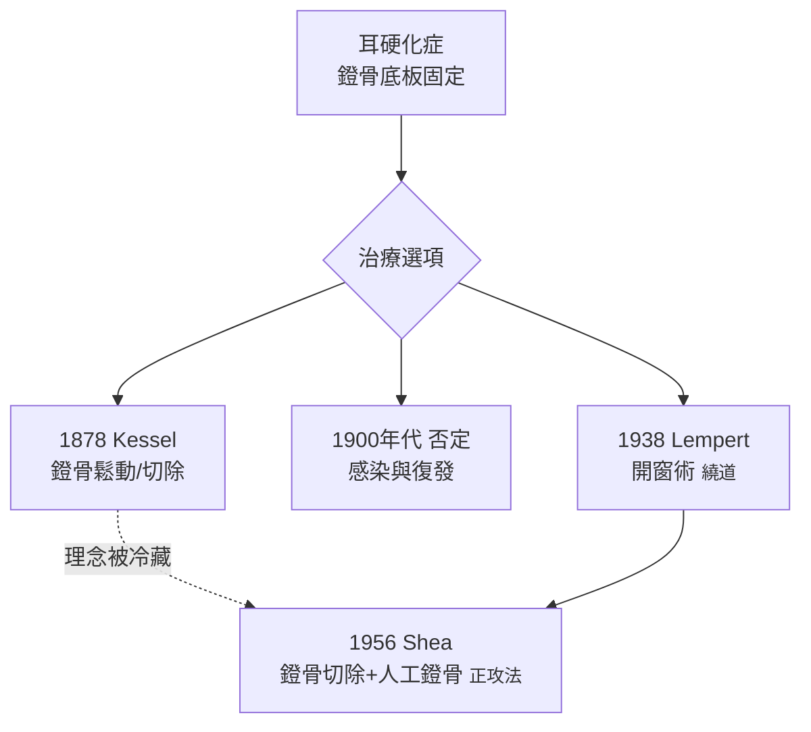

## 1878 - 凱塞爾的鐙骨鬆動術（在「不可觸碰」的耳朵裡動第一刀）

## 案件摘要

**本案的謎題：一種進行性傳導性耳聾，病根明明可推測在聽小骨，醫學界卻百年不敢動刀。**

1878 年，柏林耳科醫生約翰內斯·凱塞爾（Johannes Kessel）為耳硬化症（otosclerosis）患者施行史上第一批**鐙骨鬆動術（stapes mobilization）**——分離、鬆動或切斷鐙骨周圍固定的韌帶，讓被新骨「凍結」的聽骨鏈重新傳聲。這是耳科外科史上最叛逆的一步：蓋倫以降「耳內不可開刀」的禁忌被公開撕破。雖然 Kessel 的成果因感染與復發被否定了半世紀，他留下的路標——「病灶在鐙骨底板，可以重建活動度」——正是 1956 年 Shea 鐙骨切除術（`1956-Shea鐙骨切除術.md`）的直系前身。

## 前因 -- 為什麼會有這個案子

- Toynbee（1857）的顳骨研究：對 1,659 件顳骨的病理整理，首次把「進行性傳導性聽損」與鐙骨底板周圍骨質增生連結——病灶定位的先行者。
- 顯微鏡、止血鉗、局部麻醉與無菌技術在 1870 年代剛剛就位（Lister 的石炭酸消毒 1865 起）——外科的條件第一次勉強夠用。
- 耳科學的臨床困境：傳導性聽損病人日增，助聽器（還要等 20 年，`1898-阿庫風電子助聽器.md`）與保守治療都無力；開窗術的構想（在水平半規管開窗繞過固定區）已在紙上。
- 禁忌的重量：中耳被視為「神聖不可侵犯」（蓋倫以來的傳統），Kessel 自己都寫道這是「向百年偏見宣戰」。

## 線索與推理 -- 數學式、程式、理論

耳硬化症造成傳導性聽損的力學本質：鐙骨底板被骨疣固定，震動無法傳入前庭窗。可用「聽骨鏈增益」的失效來表示：

$$ G_{\text{正常}} \approx 22\,\mathrm{dB} \;(\text{槓桿}1.3 \times \text{面積比}17) \quad \Rightarrow \quad G_{\text{固定}} \to 0 \; (\text{底板不動}) $$

```python
def conductive_gap(otosclerosis=True):
    air_bone_gap_db = 40 if otosclerosis else 0
    # 氣導聽損 40–60 dB，骨導正常 → 經典氣骨導差 (ABG)
    return f"氣導 {air_bone_gap_db+5} dB, 骨導 5 dB → ABG {air_bone_gap_db} dB"

print(conductive_gap())
```



Kessel 的技術包含分離砧鐙關節、切斷鐙骨肌、甚至部分切除鐙骨——在無手術顯微鏡的年代以裸眼＋放大鏡完成，膽識驚人。他被否定有三因：感染控制不足、無法維持中耳密閉（前庭窗開放導致「開放性迷路瘻管」暈眩與感染）、以及當時主流（Politzer 學派）的保守氛圍。**技術判決正確、執行條件不足**——本案屬於「太早的偵探」型冤案。

## 結案 -- 後果與影響

- 1900 年 Kessel 被迫離開柏林，開窗路線一度中斷；但 1913 年 Jenkins、1923 年 Nylén（首例在顯微鏡下）、1938 年 Lempert 的「一期開窗術」接力重啟。
- Lempert 開窗術（水平半規管開新窗）在 1940–50 年代盛行，成功率約 80%——但需破壞迷路、術後眩暈、且有「遲發性感音神經惡化」。
- 1952 年 Rosen 恢復鐙骨鬆動術；1956 年 Shea 以 Teflon 人工鐙骨＋靜脈瓣重建底板，成為現代標準（成功率 >90%，ABG 幾乎閉合）——Kessel 的直系後代。
- 現代影像與分子研究：耳硬化與麻疹病毒及 COL1A1（成骨不全基因）的關聯被逐步揭露；COCH 基因研究提供病理線索。
- 一句話結案：外科史上有時不是偵探錯了，而是偵探比他的武器早到了六十年。

## 關鍵人物與文獻

- Johannes Kessel（1837–1907），柏林；"Über die Durchschneidung des Steigbügelmuskels"等系列報告（1876–1884）。
- Joseph Toynbee, *The Diseases of the Ear*（1860；遺著）——顳骨病理學的奠基。
- Adam Politzer, *Lehrbuch der Ohrenheilkunde*（1878）與其保守立場——本案的「反方偵探」。
- Julius Lempert（1938）開窗術；John J. Shea Jr.（1956/1958）鐙骨切除術。
- A. Mudry, *Studies on the History of Otosclerosis*（2000）；M. R. House 的耳外科史整理。
