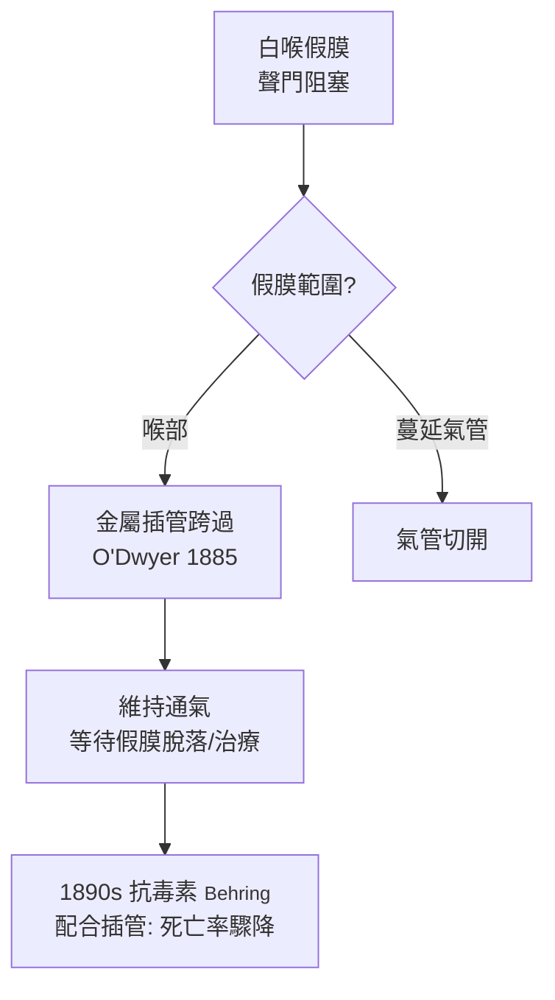

## 1885 - 歐德威的白喉插管（用一根金屬管對抗兒童殺手）

## 案件摘要

**本案的兇手在 19 世紀的每個夏天屠殺兒童：喉部的灰白假膜緩緩悶死宿主。**

1885 年，紐約兒科醫生約瑟夫·歐德威（Joseph O'Dwyer）發表白喉**氣管內插管術**：以金屬插管經口跨過喉部假膜，撐出一條通氣道，取代死亡率居高不下的氣管切開術。在白喉抗毒素（1890–94）問世前，這是數以萬計兒童唯一的活路。O'Dwyer 的插管器、導入器與「插管鉗」，加上他與 pneumatic chamber（氣壓艙通氣法）的配合，使紐約的白喉窒息死亡率大幅下降——也順手發明了現代氣管插管的基本形制。

## 前因 -- 為什麼會有這個案子

- 白喉（diphtheria）在 19 世紀是兒童頭號殺手之一：紐約市 1880 年代年死亡數千童；假膜由會厭蔓延至氣管分支，窒息在數日內降臨。
- 氣管切開術雖已存在，但 19 世紀中葉報告死亡率常超 50%（幼兒操作難、感染、套管阻塞）；醫學界渴望「非手術」的通氣法。
- Traube（1871）與 O'Dwyer（1880）的「氣壓艙」——把兒童放進密閉箱以正負壓推動呼吸——只能爭取時間，無法解決氣道本身。
- 插管構想的前身：Bouchut（1858）曾以橡膠管為新生兒插管，被 Vulpian 的動物實驗反駁而放棄——「插管不可行」成為教科書定論，O'Dwyer 是翻案者。

## 線索與推理 -- 數學式、程式、理論

插管救命的核心是**繞過可變長度的阻塞段**。與氣切比較的決策推理：

```python
def airway_rescue(age, obstruction_level, surgeon_ready):
    # 白喉假膜多在喉部(聲門上/聲門)，氣切繞過全段但手術重
    if age < 4 and not surgeon_ready:
        return "O'Dwyer 插管: 無刀口、快、可由兒科醫生執行"
    if obstruction_level >= "延伸至氣管":
        return "氣切: 插管無法跨過遠端阻塞"
    return "插管為首選，氣切為後備"

print(airway_rescue(2, "喉部", False))
```



O'Dwyer 的工程貢獻：管壁開側孔以利呼吸、專用「導入器」使管能繞過會厭滑入聲門、以及拔管鉗。臨床推理上，他必須回答三個問題——管子如何固定（靠聲門嵌合）、痰液如何排除（側孔＋吸引）、多久拔管（假膜脫落後逐步「堵管試驗」）——這三問至今仍是氣道管理的教科書框架。1894 年起 Behring 的白喉抗毒素（1895 年始獲諾獎）與插管並用，紐約白喉死亡率在 1895–1900 年間斷崖下降；1923 年 Toxoid 疫苗問世後，白喉成為疫苗可預防疾病。

## 結案 -- 後果與影響

- 插管術直接催生現代**氣管內插管**：麻醉學（1880s–1900s 的 MacEwen、Kuhn、Magill）與今日手術室、急診、ICU 的氣道管理，形制上都是 O'Dwyer 金屬管的後裔。
- 麻醉學的起源本身就在耳鼻喉科：1878 年蘇格蘭醫生 William MacEwen 首次於清醒下為口腔腫瘤病人插管——本案與其共同構成「氣道外科」的黎明。
- 白喉戰役全景：1883 年 Klebs 與 Löffler 發現白喉桿菌、1888 年 Roux 與 Yersinin 發現外毒素、1890 年 Behring 與北里柴三郎抗毒素——「病原—毒素—抗體—氣道支持—疫苗」的完整防治鏈成為現代傳染病學的模板。
- O'Dwyer 的插管因 1920 年代疫苗普及而退役，但「以管代刀」的理念延續到今日的喉罩、視頻喉鏡與經皮氣切。
- 一句話結案：他設計的只是一根管子，卻在疫苗來臨前，為一整個時代的兒童爭到了呼吸的時間。

## 關鍵人物與文獻

- Joseph O'Dwyer（1841–1898），紐約內外科醫院；*Intubation of the Larynx*（1885）與系列論文；紐約插管醫院（Intubation Hospital）創辦人。
- Pierre Bouchut（1858）先驅與其挫折；Ludwig Traube（1871）氣壓艙。
- Emil von Behring 與北里柴三郎（1890）白喉抗毒素，1901 年首屆諾貝爾獎；Roux 與 Yersin（1888）白喉毒素。
- William MacEwen（1878/1880）清醒氣管插管的首例報告。
- Ralph Colp Jr., "Joseph O'Dwyer: intubation of the larynx"（史學綜述）；George Rosen 的白喉防治史研究。
