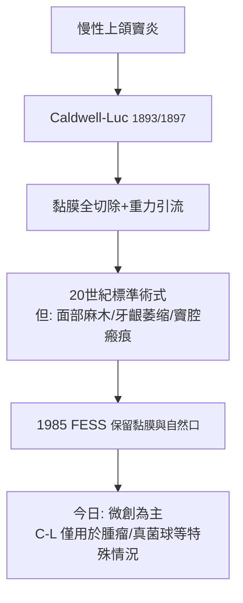

## 1893 - 考德威爾—呂克氏手術（把鼻竇從「看不到的膿袋」變成「可管理的器官」）

## 案件摘要

**本案要對付的是四對藏在上頜骨裡的空洞——它們發炎化膿時，醫生幾乎無計可施。**

1893 年，費城牙科外科醫生 George Wesley Caldwell 發表上頜竇的**經前齒槽（犬齒窩）入路開窗引流術**；兩年後（1897）法國醫生 Henri Luc 在巴黎獨立發表類似術式，後世合稱 **Caldwell-Luc 手術（考德威爾—呂克氏手術）**：從口內齒齦切開、鑿開上頜竇前壁、清除病變黏膜、並於下鼻道開引流窗。它在整個 20 世紀是慢性上頜竇炎的標準手術，直到功能性內視鏡手術（`1985-功能性內視鏡鼻竇手術.md`）以「保留黏膜與自然開口」的新哲學將其邊緣化——但本案的歷史意義在於：**鼻竇第一次成為「外科可及」的器官**。

## 前因 -- 為什麼會有這個案子

- 鼻竇炎的歷史負擔：牙源性感染（上頜牙根與竇底僅隔薄骨）使慢性上頜竇炎常見且遷延；膿腫、瘻管、骨炎甚至眶內與顱內併發症在抗生素前年代是致命病。
- 診斷學剛剛到位：1887 年 Zuckerkandl 的鼻竇解剖學經典、1895 年倫琴 X 光的問世（1890s 末即用於鼻竇炎診斷）——「看到了病灶」才有「決定開刀」的動力。
- 前驅術式各自缺陷：微創穿刺沖洗（Ansel-Luc，1880s）只能緩解；Emmert（1870）、Küfner（1890）的鼻內開窗視野差、易閉塞。
- 麻醉與無菌術普及後，「經口入路大開窗」成為可行選項——外科勇氣第一次有制度背書。

## 線索與推理 -- 數學式、程式、理論

Caldwell-Luc 的設計邏輯是**「清創＋重力引流」**兩段論：

```python
def caldwell_luc_plan(sinus):
    steps = []
    if sinus.chronic_purulence and sinus.mucosa_diseased:
        steps.append("犬齒窩開窗 → 直視下全部刮除病變黏膜")
    steps.append("下鼻道開對孔 → 依重力引流")
    if sinus.dental_origin:
        steps.append("處理病灶牙/拔牙 → 去除感染源")
    return steps

print(caldwell_luc_plan(type("S", (), {
    "chronic_purulence": True, "mucosa_diseased": True,
    "dental_origin": True})()))
```



外科生理學的關鍵誤判：Caldwell-Luc 預設「有病黏膜就該全部切除」。後來的鼻竇生理學證明黏膜纖毛運輸（ mucociliary clearance，方向由竇底螺旋流向自然口）是鼻竇自淨的核心——**全切除反而破壞引流的原動力**。這個「理論缺陷」正是 1985 年 FESS 革命的立論基礎：手術應「打通自然口、保留並恢復黏膜」而非「刮光一切」。此外重力引流假說也低估了纖毛：下鼻道對孔常因纖毛方向不變而形成「死循環引流」。

## 結案 -- 後果與影響

- 20 世紀前中葉，Caldwell-Luc 拯救了大量病人；其入路也被擴充至上頜竇腫瘤、真菌球、齒源性病變——至今在特定情境仍是選項。
- 它催生了鼻竇外科的完整學科譜系：蝶竇與篩竇手術（Onodi 的解剖學，1906）、額竇手術（Riedel, 1898；Lothrop, 1914）。
- 誤判的代價成為教學素材：黏膜全切除與「重力引流至上」被 FESS 時代徹底修正——本案是醫學史上「正確的手術、錯誤的理論」的經典案例。
- 術後遺症（眶下神經麻木、牙齒麻木、臉頰凹陷、萎縮性鼻炎）在 1990 年代後因 FESS 普及而罕見。
- 一句話結案：Caldwell-Luc 打開了門，卻開錯了窗——而外科學正是靠這種「開錯」才學會何處該開。

## 關鍵人物與文獻

- George Wesley Caldwell（1866–1946），費城；"Oro-antral fistula and naso-antral window"（1893）。
- Henri Luc（1855–1925），巴黎；《Chirurgie du maxillaire supérieur et des sinus》（1897 附近）。
- Emil Zuckerkandl, *Normale und pathologische Anatomie der Nasenhöhle*（1882/1893）——鼻竇解剖經典。
- Arthur W. Proetz 的鼻竇生理與重力實驗（1953）；Walter Messerklinger（1978）纖毛運輸與內視鏡診斷——修正本案理論的偵探。
- Stammberger & Kennedy（1995）*Functional Endoscopic Sinus Surgery* 中對 C-L 時代的歷史清算。
