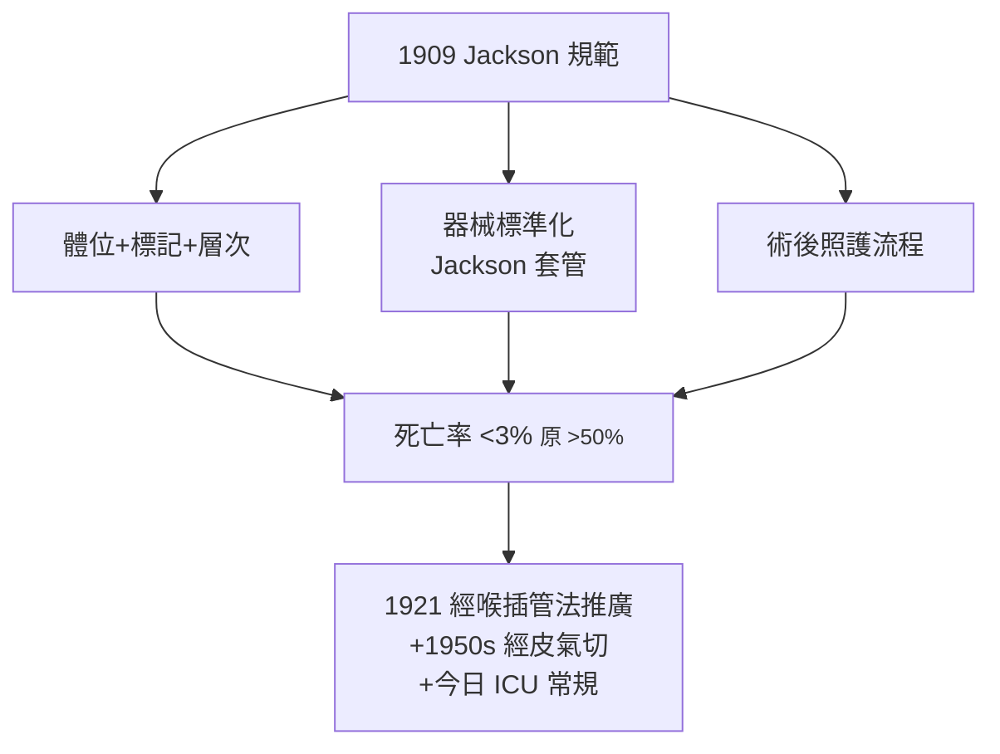

## 1909 - 傑克遜規範氣管切開術（把「絕望的刀」變成「標準作業」）

## 案件摘要

**本案不是發明新手術，而是把一個兩千歲的手術徹底「馴化」。**

1909 年，費城 Chevalier Jackson 發表劃時代論文《氣管切開術》（*The Lancet Clinic*, 1909），對這個從古希臘（`-0100-阿斯克列皮亞德斯氣切傳說.md`）流傳下來的急救手術做全面規範化：固定體位與解剖標記、切口層次、氣管壁的「Z 字」對齊、套管選擇、術後照護流程、以及最重要的——**異物與出血的預防規則**。他統計自己與同仁的病例，把兒科氣切死亡率從 19 世紀的 50% 以上壓到 3% 以下。本案的主角是「把藝術變成流程」的那種偵探：一絲不苟的紀錄者、器械發明家與法醫級品管者。

## 前因 -- 為什麼會有這個案子

- 氣切在 19 世紀仍是一場賭局：兒童白喉（`1885-歐德威白喉插管.md` 之前與之後）與異物窒息是主要適應症，但操作耗時、出血兇猛、套管滑脫即死。
- Jackson 的履歷正中要害：他是支氣管鏡與食道鏡的發明者（1890s）、異物學的集大成者——「氣道裡出過什麼差錯」他一清二楚。
- 無菌術、麻醉與局部浸潤麻醉已成熟；但氣切的特殊難點在「時間」：窒息病人在台上等不了常規麻醉。
- 他身邊有完整的病例登記制度（Chevalier Jackson Collection，費城，兩千餘件異物與標本）——本案的方法論是**用屍檢與取出物做品管迴圈**。

## 線索與推理 -- 數學式、程式、理論

Jackson 的規範是逐項對「失敗模式」的反制：

```python
def jackson_protocol(failure_mode):
    rules = {
        "找不到氣管":    "固定喉頭+中線切口+僅用解經典解剖標記(環狀軟骨/胸骨上窩)",
        "出血致死":      "絕不切開甲狀腺峽部以下盲目深切; 逐層縫紮",
        "套管滑脫":      "Z形對齊縫合固定+選用合適長度套管",
        "術後阻塞":      "內管可抽換+濕化+專職護理",
        "氣管狹窄(遲發)": "不切第一環; 保護環狀軟骨",
    }
    return rules.get(failure_mode, "個案分析")

for fm in ("找不到氣管", "氣管狹窄(遲發)"):
    print(fm, "→", jackson_protocol(fm))
```



解剖學推理的核心是「時間—層次」問題：窒息病人不能等，故切口必須「一次到位但不越界」——Jackson 警告絕不可盲目加深以求快（出血與氣管旁竄位是死因之首）。他還系統性地記錄了「高/低位氣切」的差異與併發症（環狀軟骨損傷→聲門下狹窄），這條規則至今仍是指南第一條。他的異物學成果同時讓「氣切作為異物救援」的必要性下降——支氣管鏡取代了「下不了台」的氣切。

## 結案 -- 後果與影響

- 氣切成為安全常規手術；1921 年 Jackson 與同事推廣的技術手冊成為世界標準，費城 Jefferson 學院成為「氣道朝聖地」。
- 1950s Shelden（經皮氣切構想）、1985 年 Ciaglia（經皮擴張氣切）把 Jackson 的開放術式再壓縮到床旁——流程化的精神延續。
- 長期氣切（呼吸衰竭、神經肌肉疾病）在 1952 年哥本哈根小兒麻痺大流行（負壓呼吸器時代）後轉入正壓通氣時代，氣切成為 ICU 基本技能。
- Jackson 同時是職業醫學的先驅：對工業異物、鹽酸職業傷害的調查促成美國勞工立法——本案偵探的第二戰場。
- 一句話結案：醫學進步不只靠新手術，更靠把舊手術的每個死因逐一審判。

## 關鍵人物與文獻

- Chevalier Jackson（1865–1958），費城；"Tracheotomy"（1909）；*Peroral Endoscopy and Laryngeal Surgery*（1915）。
- Antonio Musa Brasavola（1546）文藝復興首例紀錄；Lorenz Heister（1718s）與 Pierre-Fidèle Bretonneau（1825）白喉氣切的推廣者。
- Ciaglia et al., "Percutaneous dilatational tracheostomy"（*Chest*, 1985）。
- The Chevalier Jackson Collection（Mütter Museum，費城醫學院）——本案的「物證庫」。
- B. Kirchner, "Chevalier Jackson and his influence on bronchoesophagology"（*Ann Otol Rhinol Laryngol*）；R. H. Jackson（其子）的回憶錄 *Inflammatory and toxic effects of industrial dusts*。
